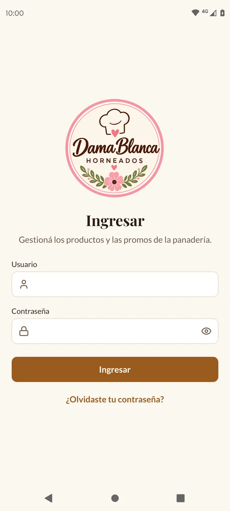
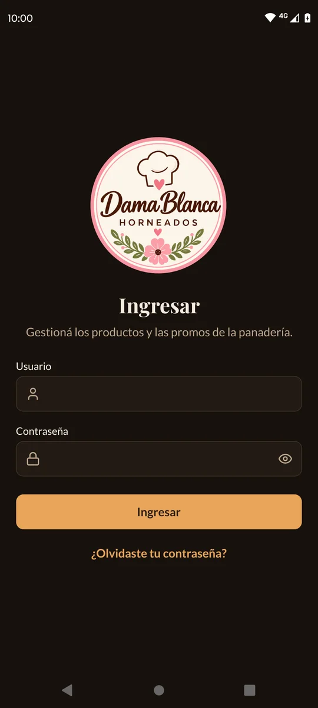
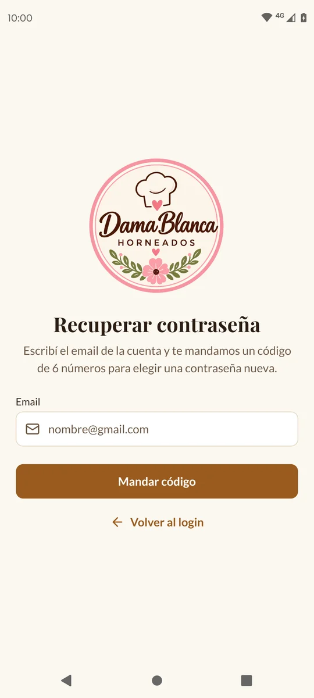
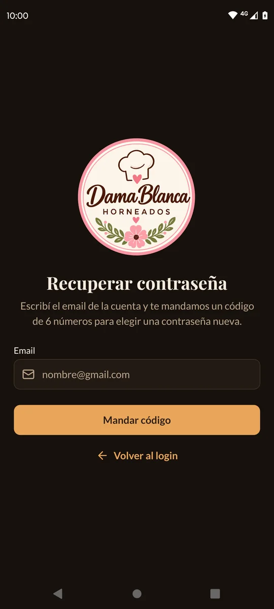
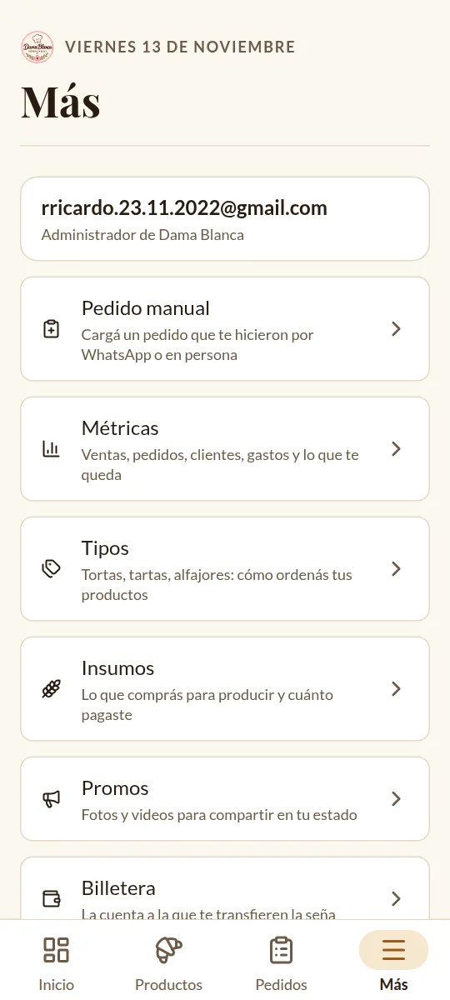
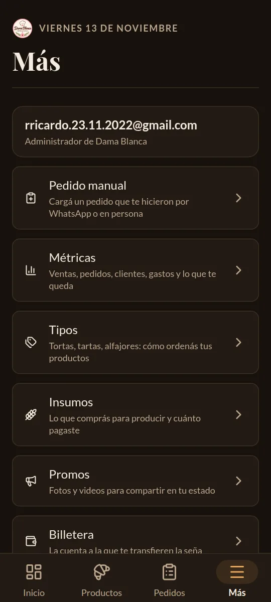
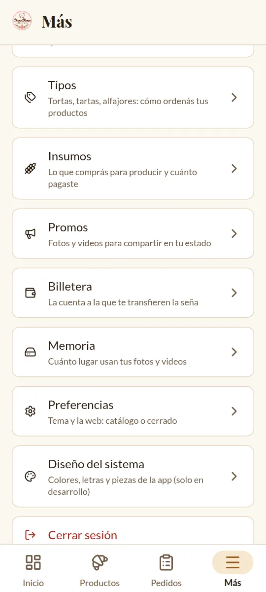
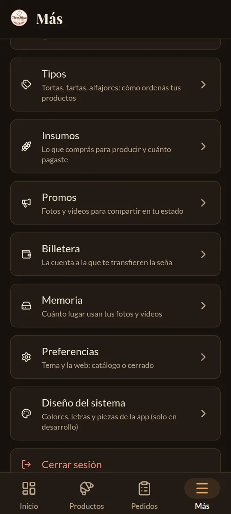
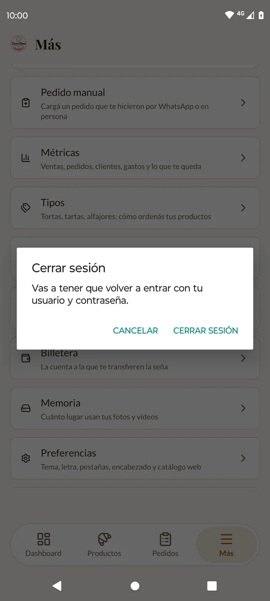
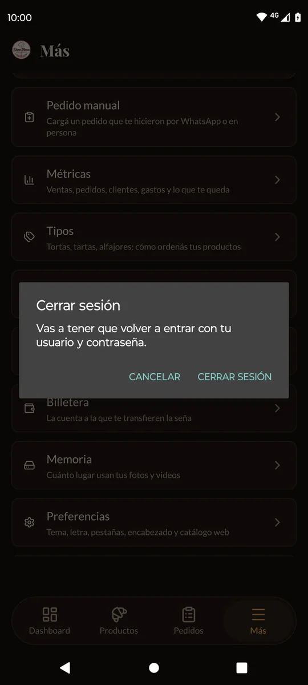

# 1. Empezar

Cómo instalar la app en tu celular, entrar con tu usuario, recuperar la contraseña
si te la olvidás, qué te muestra el Inicio y cómo moverte por las pantallas.

[← Volver al índice](README.md)

---

## Instalar la app

La app no está en Play Store: te la pasa la persona que la desarrolló, como un
archivo `.apk` (por ejemplo `panaderia-digital-1.5.0.apk`), o te la instala con el
celular conectado a la computadora.

Si te mandan el archivo:

1. Abrilo desde el celular (por ejemplo, tocándolo en WhatsApp o en **Descargas**).
2. Android te va a preguntar si permitís instalar apps de ese lugar. Tocá
   **Configuración**, activá el permiso y volvé.
3. Tocá **Instalar**.

En tu pantalla de inicio aparece el ícono redondo de Dama Blanca, con el nombre
«PANADERIA-DIGITAL».

**Para actualizarla**, instalá la versión nueva encima de la que tenés, de la misma
forma. No hace falta desinstalar: tu sesión y tus preferencias se mantienen. Para
saber qué versión tenés, mirá al fondo de la pestaña **Más**: dice, por ejemplo,
«Versión 1.5.0».

> ⚠️ Si al actualizar Android dice que la app no se puede instalar porque ya existe
> una distinta, avisale a quien te la pasó antes de desinstalar nada.

---

## Entrar con tu usuario

La primera vez que abrís la app aparece la pantalla **Ingresar**:

1. En **Usuario**, escribí tu usuario.
2. En **Contraseña**, escribí tu contraseña. Para ver lo que escribiste, tocá el
   ojito de la derecha.
3. Tocá **Ingresar**.

Si está todo bien, entrás directo a la app.

No hay forma de crear una cuenta desde la app: hay un solo usuario, el tuyo, y lo
crea la persona que desarrolló el sistema.

La sesión queda abierta **30 días**, aunque cierres la app o apagues el celular.
Pasado ese tiempo, la app te vuelve a mostrar la pantalla **Ingresar** sin avisar:
es normal, volvé a entrar con tu usuario y contraseña.

### Si no te deja entrar

| Mensaje | Qué hacer |
| --- | --- |
| «Usuario o contraseña incorrectos» | Revisá que estén bien escritos (mayúsculas incluidas). Si no te acordás de la contraseña, mirá el punto siguiente. |
| «Ingresá tu usuario» / «Ingresá tu contraseña» | Te faltó completar ese campo. |
| «No hay conexión con el servidor…» | Revisá que tengas internet (wifi o datos) y probá de nuevo. |
| «El servidor tardó demasiado en responder…» | Probá de nuevo: la primera vez del día puede tardar (ver [Preguntas frecuentes](12-preguntas-frecuentes.md)). |

---

## Si te olvidaste la contraseña

La app te manda un **código de 6 números** a tu email para que elijas una
contraseña nueva.

1. En la pantalla **Ingresar**, tocá **¿Olvidaste tu contraseña?**.
2. Escribí el **email de tu cuenta** y tocá **Mandar código**.

   

   
   
   

3. Abrí tu email. Te llega un mensaje con el asunto «123456 es tu código de
   Panadería Digital» (con tu código en lugar de 123456).
4. Volvé a la app. En la pantalla **Nueva contraseña**:
   - En **Código**, escribí los 6 números.
   - En **Contraseña nueva**, escribí la contraseña nueva (al menos 8 caracteres).
   - En **Repetí la contraseña nueva**, escribila otra vez.
5. Tocá **Cambiar contraseña**. Entrás directo a la app.

Tené en cuenta:

- El código **vence en 15 minutos** y sirve una sola vez.
- Si no te llegó, revisá la carpeta de spam. Después de un minuto se habilita
  **Reenviar el código**: te manda uno nuevo y el anterior deja de servir.
- Si escribiste mal el email, tocá **Usar otro email**.
- Tiene que ser el email que se registró para tu cuenta. Si escribís otro, la app
  sigue igual al paso siguiente, pero el código no llega nunca (es así a propósito,
  por seguridad). Si no sabés cuál es, preguntale a quien desarrolló la app.
- Con la contraseña nueva, tu **usuario** sigue siendo el mismo.

| Mensaje | Qué quiere decir |
| --- | --- |
| «Código inválido o vencido» | El código está mal, pasaron más de 15 minutos o ya lo usaste. Pedí uno nuevo. |
| «El código tiene 6 números» | Te faltan o te sobran números. |
| «Tiene que tener al menos 8 caracteres» | La contraseña nueva es muy corta. |
| «Las contraseñas no coinciden» | Lo que escribiste en los dos campos no es igual. |
| «Pediste demasiados códigos. Probá de nuevo en un rato.» | Pediste más de 5 códigos en una hora. Esperá un rato. |

> 💡 **Para cambiar la contraseña** aunque te la acuerdes, el camino es el mismo:
> cerrá la sesión (**Más → Cerrar sesión**) y en la pantalla **Ingresar** tocá
> **¿Olvidaste tu contraseña?**.

---

## Las pantallas de la app

Abajo de todo está la **barra de pestañas**, con las cuatro partes principales:

| Pestaña | Para qué es |
| --- | --- |
| **Inicio** | Compartir tu catálogo y la agenda: tus pedidos día por día (lo vemos abajo). |
| **Productos** | Lo que vendés: cargar, editar, compartir, pausar y borrar ([capítulo 2](02-productos.md)). |
| **Pedidos** | Lo que te encargan tus clientes ([capítulo 3](03-pedidos.md)). |
| **Más** | Todo lo demás: pedido manual, métricas, tipos, insumos, promos, billetera, memoria, preferencias y cerrar sesión. |

Tocá una pestaña para ir a esa parte.

---

## El Inicio

Es lo primero que ves al entrar. Arriba tiene dos botones y, debajo, la agenda.

Si cerraste la web ([Preferencias](10-preferencias.md#cerrar-la-web-por-un-tiempo)),
arriba de todo aparece el aviso «Tu web está cerrada»: «Los clientes ven el cartel y
no pueden hacer pedidos.» Está para que no te olvides de abrirla. El botón **Abrirla
en Preferencias** te lleva a donde se abre.

### Compartir y Ver catálogo

Son el atajo para lo que más hacés cuando un cliente te escribe:

- **Compartir** (verde): abre WhatsApp con un saludo y el link de tu web ya
  escritos. Elegí a quién mandarlo (el chat del cliente que te preguntó, un grupo o
  **Mi estado**) y tocá **Enviar**. Antes de mandarlo podés cambiar el texto.

  > ¡Hola! 👋 Te paso el catálogo de Dama Blanca: ahí ves todos los productos con sus
  > precios y podés hacer tu pedido.
  >
  > 👉 (el link de tu web)

- **Ver catálogo**: abre tu web en el navegador del celular, para que veas lo mismo
  que ven tus clientes.

### La agenda

Debajo está la **Agenda**: el mes, con un color en cada día según cuántos productos
te pidieron para ese día.

- Arriba dice **tu tope**, por ejemplo «Tu tope: 25 productos por día»: cuántos
  productos podés preparar en un día. Para cambiarlo, tocá **Cambiar**.
- Cada día del mes está pintado **igual que lo ve el cliente en la web**: verde
  «Libre», amarillo «Casi» y rojo «Llena». Los días que ya pasaron van sin color.
- **Hoy** va en blanco, con el borde marcado y la palabra «Hoy».
- En la esquina de los días con pedidos hay un **circulito con un número**: cuántos
  productos te faltan preparar para ese día.
- Con las flechas de arriba pasás al mes anterior o al siguiente.

**Tocá un día para abrirlo**: ves sus pedidos, qué hay que hacer y podés cerrarlo
para la web. Todo eso está explicado en
[La agenda: tus pedidos por día](03-pedidos.md#la-agenda-tus-pedidos-por-día).

> 💡 Lo que antes estaba en el inicio (lo vendido hoy y los pedidos para atender)
> ahora lo ves en **Más → Métricas → Balance** ([capítulo 8](08-metricas.md)) y en
> la pestaña **Pedidos** ([capítulo 3](03-pedidos.md)).

> 💡 Lo que hacés desde la app (confirmar una seña, entregar, cancelar, cargar un
> pedido manual) se actualiza solo. Los pedidos nuevos de la **web** no: **tirá la
> pantalla para abajo** para verlos.

---

## La pestaña Más

**Más** es un menú. Arriba está tu usuario y, abajo, una opción por cada apartado:

| Opción | Qué hay adentro |
| --- | --- |
| **Pedido manual** | Cargá un pedido que te hicieron por WhatsApp o en persona ([capítulo 4](04-pedido-manual.md)). |
| **Métricas** | Ventas, pedidos, clientes, gastos y lo que te queda ([capítulo 8](08-metricas.md)). |
| **Tipos** | Tortas, tartas, alfajores: cómo ordenás tus productos ([capítulo 2](02-productos.md#los-tipos)). |
| **Insumos** | Lo que comprás para producir y cuánto pagaste. Con ellos armás las recetas ([capítulo 7](07-insumos.md)). |
| **Promos** | Fotos y videos para compartir en tu estado ([capítulo 6](06-promos.md)). |
| **Billetera** | La cuenta a la que te transfieren la seña ([capítulo 5](05-billetera.md)). |
| **Memoria** | Cuánto lugar usan tus fotos y videos ([capítulo 9](09-memoria.md)). |
| **Preferencias** | Tema y la web: catálogo o cerrado ([capítulo 10](10-preferencias.md)). |
| **Cerrar sesión** | En rojo, al fondo. |

Al fondo de todo, debajo de **Cerrar sesión**, dice qué versión de la app tenés
(por ejemplo «Versión 1.5.0»).

### Volver atrás

Cuando abrís algo (un producto, un pedido, una opción de **Más**), arriba a la
izquierda aparece un **botón redondo con una flecha**. Tocalo para volver. El botón
de volver de Android hace lo mismo.

Desde **Productos**, **Pedidos** o **Más**, el botón de volver de Android te lleva al
**Inicio**; desde el **Inicio**, sale de la app.

### Tirar para abajo para actualizar

En las pantallas que muestran datos (el Inicio, un día de la agenda, la lista de
productos, la de pedidos, un pedido, las métricas, los insumos, las promos y la
memoria), **apoyá el
dedo arriba de todo y deslizalo hacia abajo**. Aparece una ruedita que gira: cuando
desaparece, ya tenés los datos al día.

Usalo sobre todo en el **Inicio** y en **Pedidos**, para ver si entraron pedidos
nuevos.

En los formularios (cargar un producto, un pedido manual, la billetera…) no se usa:
no hay nada que actualizar.

### Mientras carga

Cuando una pantalla está trayendo los datos, en su lugar pasan por una cinta un pan,
una medialuna y un alfajor. Si es un pedacito de la pantalla (más pedidos al final
de la lista, por ejemplo), la cinta es chica y al lado dice qué está cargando.

### Cuando algo no carga

Si una pantalla no puede traer los datos, muestra un recuadro rojo con el motivo y
un botón **Reintentar**. Revisá tu internet y tocalo.

---

## Cerrar sesión

1. Tocá la pestaña **Más**.
2. Bajá hasta el final y tocá **Cerrar sesión** (en rojo).
3. La app te avisa: «Vas a tener que volver a entrar con tu usuario y contraseña.».
   Tocá **Cerrar sesión** para confirmar o **Cancelar** para quedarte.

Tus preferencias no se borran.

---

Siguiente: [2. Productos →](02-productos.md)
