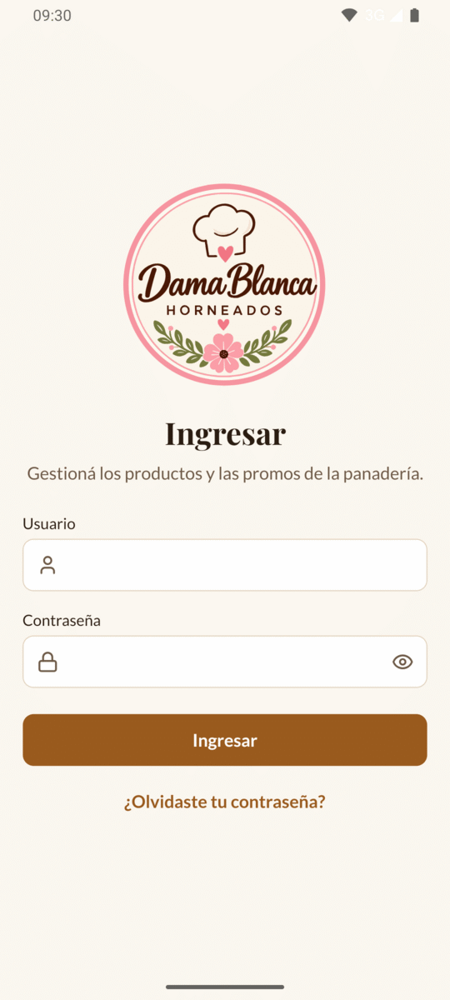
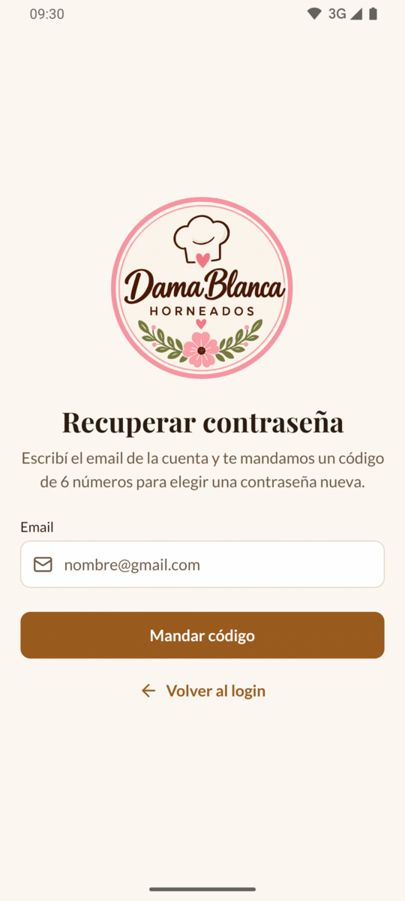
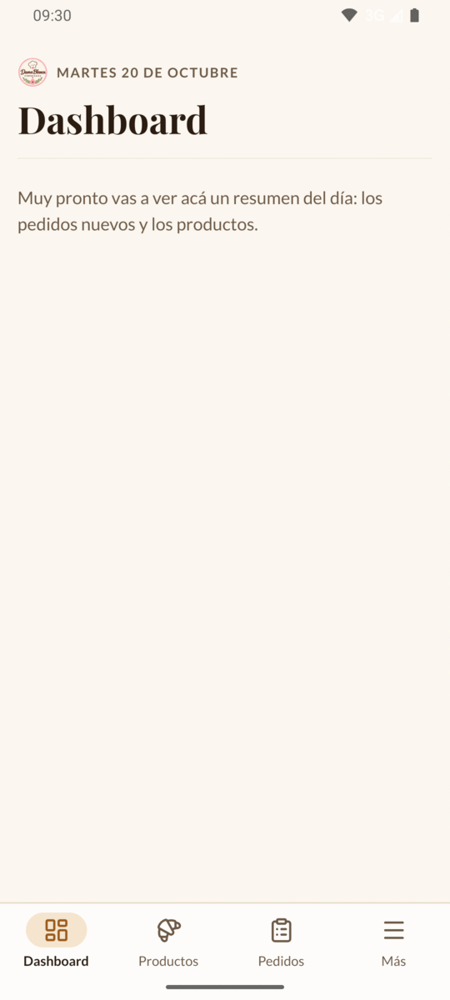
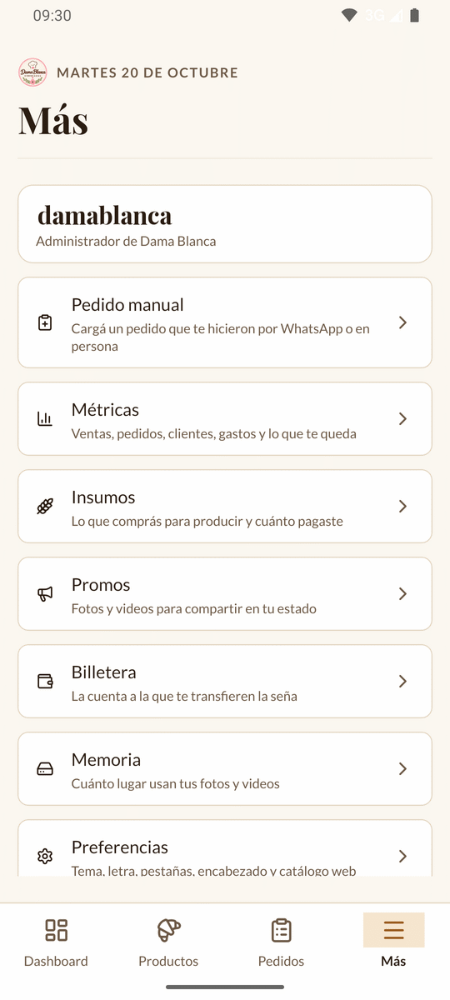
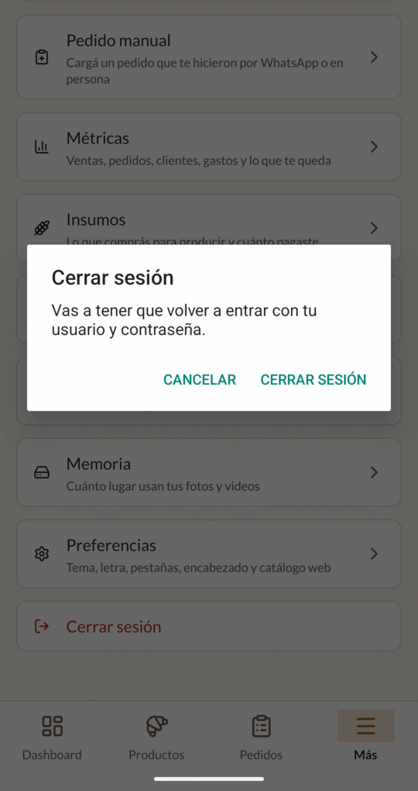

# 1. Empezar

Cómo instalar la app en tu celular, entrar con tu usuario, recuperar la contraseña
si te la olvidás y moverte por las pantallas.

[← Volver al índice](README.md)

---

## Instalar la app

La app no está en Play Store: te la pasa la persona que la desarrolló, como un
archivo `.apk` (por ejemplo `panaderia-digital-1.0.0.apk`), o te la instala con el
celular conectado a la computadora.

Si te mandan el archivo:

1. Abrilo desde el celular (por ejemplo, tocándolo en WhatsApp o en **Descargas**).
2. Android te va a preguntar si permitís instalar apps de ese lugar. Tocá
   **Configuración**, activá el permiso y volvé.
3. Tocá **Instalar**.

En tu pantalla de inicio aparece el ícono redondo de Dama Blanca, con el nombre
«PANADERIA-DIGITAL».

**Para actualizarla**, instalá la versión nueva encima de la que tenés, de la misma
forma. No hace falta desinstalar: tu sesión y tus preferencias se mantienen.

> ⚠️ Si al actualizar Android dice que la app no se puede instalar porque ya existe
> una distinta, avisale a quien te la pasó antes de desinstalar nada.

---

## Entrar con tu usuario

La primera vez que abrís la app aparece la pantalla **Ingresar**:

1. En **Usuario**, escribí tu usuario.
2. En **Contraseña**, escribí tu contraseña. Para ver lo que escribiste, tocá el
   ojito de la derecha.
3. Tocá **Ingresar**.

Si está todo bien, entrás directo a la app.

No hay forma de crear una cuenta desde la app: hay un solo usuario, el tuyo, y lo
crea la persona que desarrolló el sistema.

La sesión queda abierta **30 días**, aunque cierres la app o apagues el celular.
Pasado ese tiempo, la app te vuelve a mostrar la pantalla **Ingresar** sin avisar:
es normal, volvé a entrar con tu usuario y contraseña.

### Si no te deja entrar

| Mensaje | Qué hacer |
| --- | --- |
| «Usuario o contraseña incorrectos» | Revisá que estén bien escritos (mayúsculas incluidas). Si no te acordás de la contraseña, mirá el punto siguiente. |
| «Ingresá tu usuario» / «Ingresá tu contraseña» | Te faltó completar ese campo. |
| «No hay conexión con el servidor…» | Revisá que tengas internet (wifi o datos) y probá de nuevo. |
| «El servidor tardó demasiado en responder…» | Probá de nuevo: la primera vez del día puede tardar (ver [Preguntas frecuentes](12-preguntas-frecuentes.md)). |

---

## Si te olvidaste la contraseña

La app te manda un **código de 6 números** a tu email para que elijas una
contraseña nueva.

1. En la pantalla **Ingresar**, tocá **¿Olvidaste tu contraseña?**.
2. Escribí el **email de tu cuenta** y tocá **Mandar código**.

   

3. Abrí tu email. Te llega un mensaje con el asunto «123456 es tu código de
   Panadería Digital» (con tu código en lugar de 123456).
4. Volvé a la app. En la pantalla **Nueva contraseña**:
   - En **Código**, escribí los 6 números.
   - En **Contraseña nueva**, escribí la contraseña nueva (al menos 8 caracteres).
   - En **Repetí la contraseña nueva**, escribila otra vez.
5. Tocá **Cambiar contraseña**. Entrás directo a la app.

Tené en cuenta:

- El código **vence en 15 minutos** y sirve una sola vez.
- Si no te llegó, revisá la carpeta de spam. Después de un minuto se habilita
  **Reenviar el código**: te manda uno nuevo y el anterior deja de servir.
- Si escribiste mal el email, tocá **Usar otro email**.
- Tiene que ser el email que se registró para tu cuenta. Si escribís otro, la app
  sigue igual al paso siguiente, pero el código no llega nunca (es así a propósito,
  por seguridad). Si no sabés cuál es, preguntale a quien desarrolló la app.
- Con la contraseña nueva, tu **usuario** sigue siendo el mismo.

| Mensaje | Qué quiere decir |
| --- | --- |
| «Código inválido o vencido» | El código está mal, pasaron más de 15 minutos o ya lo usaste. Pedí uno nuevo. |
| «El código tiene 6 números» | Te faltan o te sobran números. |
| «Tiene que tener al menos 8 caracteres» | La contraseña nueva es muy corta. |
| «Las contraseñas no coinciden» | Lo que escribiste en los dos campos no es igual. |
| «Pediste demasiados códigos. Probá de nuevo en un rato.» | Pediste más de 5 códigos en una hora. Esperá un rato. |

> 💡 **Para cambiar la contraseña** aunque te la acuerdes, el camino es el mismo:
> cerrá la sesión (**Más → Cerrar sesión**) y en la pantalla **Ingresar** tocá
> **¿Olvidaste tu contraseña?**.

---

## Las pantallas de la app

Abajo de todo está la **barra de pestañas**, con las cuatro partes principales:

| Pestaña | Para qué es |
| --- | --- |
| **Dashboard** | El resumen del día. Por ahora dice «Muy pronto vas a ver acá un resumen del día: los pedidos nuevos y los productos.» |
| **Productos** | Lo que vendés: cargar, editar, pausar y borrar ([capítulo 2](02-productos.md)). |
| **Pedidos** | Lo que te encargan tus clientes ([capítulo 3](03-pedidos.md)). |
| **Más** | Todo lo demás: pedido manual, métricas, insumos, promos, billetera, memoria, preferencias y cerrar sesión. |

Tocá una pestaña para ir a esa parte.

### La pestaña Más

**Más** es un menú. Arriba está tu usuario y, abajo, una opción por cada apartado:

| Opción | Qué hay adentro |
| --- | --- |
| **Pedido manual** | Cargá un pedido que te hicieron por WhatsApp o en persona ([capítulo 4](04-pedido-manual.md)). |
| **Métricas** | Ventas, pedidos, clientes, gastos y lo que te queda ([capítulo 8](08-metricas.md)). |
| **Insumos** | Lo que comprás para producir y cuánto pagaste ([capítulo 7](07-insumos.md)). |
| **Promos** | Fotos y videos para compartir en tu estado ([capítulo 6](06-promos.md)). |
| **Billetera** | La cuenta a la que te transfieren la seña ([capítulo 5](05-billetera.md)). |
| **Memoria** | Cuánto lugar usan tus fotos y videos ([capítulo 9](09-memoria.md)). |
| **Preferencias** | Tema, letra, pestañas, encabezado y catálogo web ([capítulo 10](10-preferencias.md)). |
| **Cerrar sesión** | En rojo, al fondo. |

### Volver atrás

Cuando abrís algo (un producto, un pedido, una opción de **Más**), arriba a la
izquierda aparece un **botón redondo con una flecha**. Tocalo para volver. El botón
de volver de Android hace lo mismo.

Desde **Productos**, **Pedidos** o **Más**, el botón de volver de Android te lleva al
**Dashboard**; desde el **Dashboard**, sale de la app.

### Tirar para abajo para actualizar

En las pantallas que muestran datos (la lista de productos, la de pedidos, un
pedido, las métricas, los insumos, las promos y la memoria), **apoyá el dedo arriba
de todo y deslizalo hacia abajo**. Aparece una ruedita que gira: cuando desaparece,
ya tenés los datos al día.

Usalo sobre todo en **Pedidos**, para ver si entraron pedidos nuevos.

En los formularios (cargar un producto, un pedido manual, la billetera…) no se usa:
no hay nada que actualizar.

### Cuando algo no carga

Si una pantalla no puede traer los datos, muestra un recuadro rojo con el motivo y
un botón **Reintentar**. Revisá tu internet y tocalo.

---

## Cerrar sesión

1. Tocá la pestaña **Más**.
2. Bajá hasta el final y tocá **Cerrar sesión** (en rojo).
3. La app te avisa: «Vas a tener que volver a entrar con tu usuario y contraseña.».
   Tocá **Cerrar sesión** para confirmar o **Cancelar** para quedarte.

Tus preferencias (tema, letra, barra y encabezado) no se borran.

---

Siguiente: [2. Productos →](02-productos.md)
