# 2. Productos

En la pestaña **Productos** cargás todo lo que vendés. Lo que está **activo** aparece
en la web para tus clientes; lo que **pausás** queda guardado, pero no se ve.

[← Volver al índice](README.md)

---

## La lista de productos

Tocá la pestaña **Productos** (el ícono de la medialuna) en la barra de abajo.

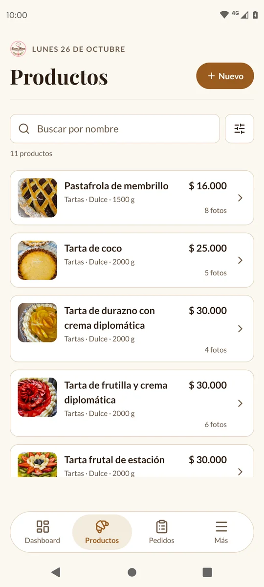
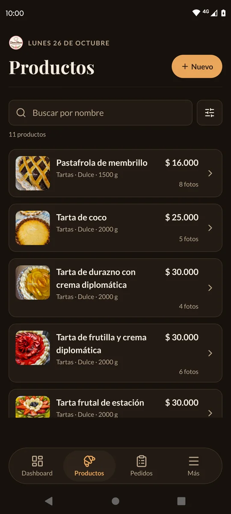

Cada tarjeta muestra:

- La **foto de portada** (si no tiene fotos, una medialuna dibujada).
- El **nombre**, tal como lo escribiste, y el **precio** a la derecha.
- El **tipo**, el **gusto** y el **peso**, por ejemplo «Tartas · Dulce · 1500 g». Si
  no tiene tipo, solo el gusto y el peso.
- Abajo, la **etiqueta** dorada si tiene una, «Pausado» si está pausado y cuántas
  fotos tiene («Sin fotos», «1 foto», «4 fotos»).

Los productos están ordenados por gusto (Dulce, Salado, Agridulce, Ácido, Amargo,
Picante) y, dentro de cada gusto, por nombre.

Tocá una tarjeta para ver el producto completo.

La lista trae los productos de a 20: cuando llegás al final, se cargan los
siguientes solos. Si no, tocá **Ver más productos**.

### Buscar

Escribí parte del nombre en **Buscar por nombre**. No importan las mayúsculas ni los
acentos: «sandwich» encuentra «Sándwich de miga». Busca solo en el nombre, no en la
descripción.

Para dejar de buscar, borrá lo que escribiste.

### Filtrar

Al lado del buscador hay un **botón cuadrado de filtros**. Tocalo y se abre una hoja
desde abajo con:

- **Estado**: **Todos**, **Activos** o **Pausados**.
- **Gusto**: **Todos los gustos** o uno en particular.
- **Tipo**: **Todos los tipos** o uno de los que armaste (ver [Los tipos](#los-tipos)).

La lista cambia mientras elegís. Abajo de la hoja, el botón dice cuántos productos
coinciden (por ejemplo **Ver 6 productos**): tocalo para cerrar la hoja.

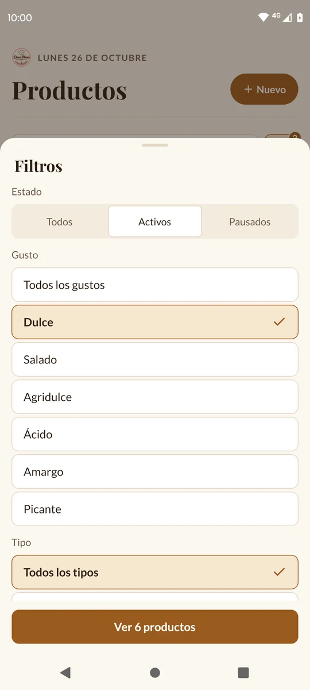
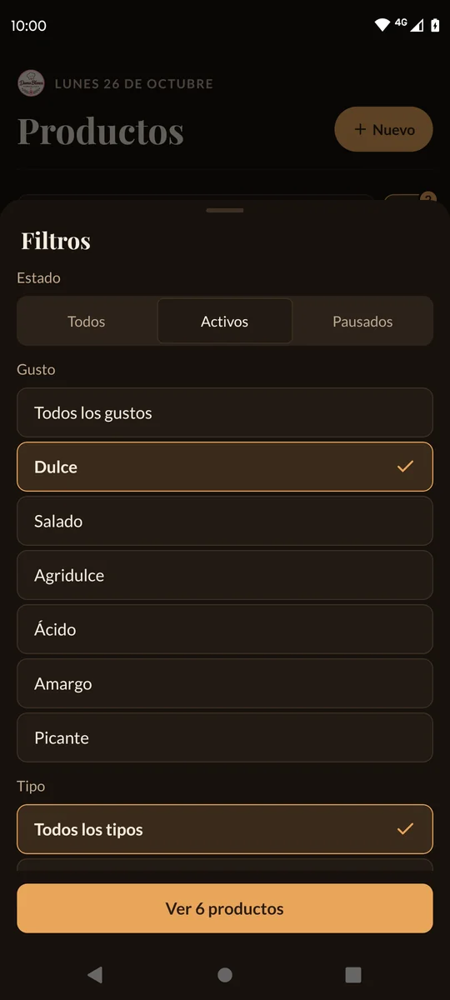

Con un filtro puesto, el botón queda marcado con cuántos filtros hay, y debajo del
buscador se lee qué estás viendo, por ejemplo «Filtrando: Dulce · Activos». Tocá
**Limpiar** para sacar los filtros (lo que escribiste en el buscador queda).

Si nada coincide, la app dice «Ningún producto coincide»: tocá **Quitar filtros**
para ver todo de nuevo.

---

## Cargar un producto nuevo

1. En la pestaña **Productos**, tocá **Nuevo** (o el **+** redondo, según el estilo de
   encabezado que tengas).
2. Completá los datos (los explicamos abajo).
3. Tocá **Guardar producto**.

La app vuelve a la lista y el producto ya aparece. Si está **Activo**, **ya se ve en
la web**, aunque las fotos todavía se estén subiendo.

> ⚠️ Si salís de la pantalla sin tocar **Guardar producto**, lo que cargaste se
> pierde y no te avisa.

### Los datos de un producto

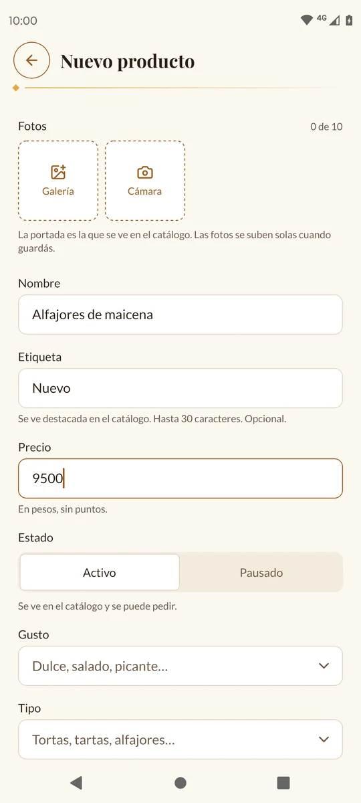
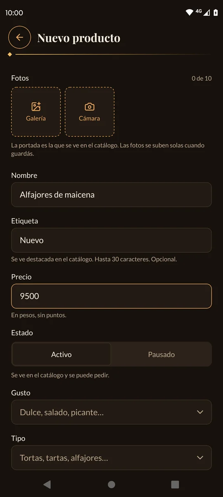

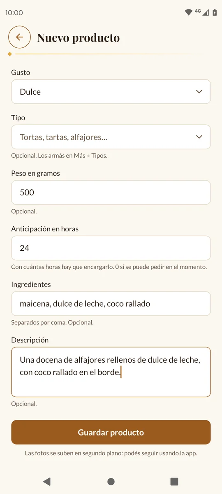
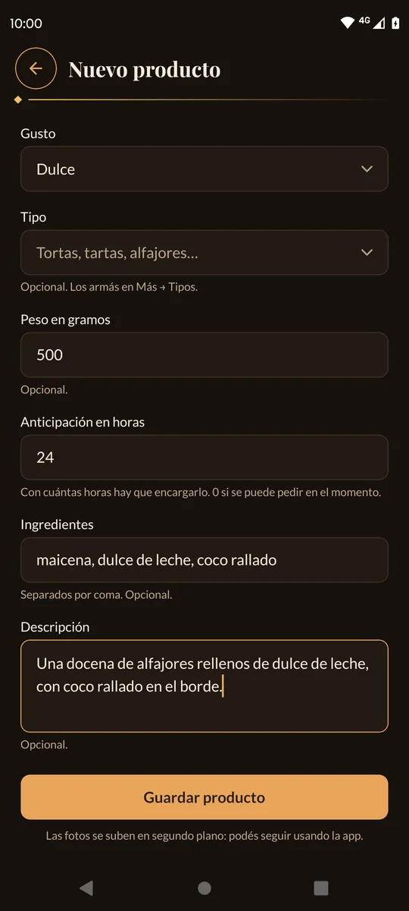

| Campo | ¿Obligatorio? | Cómo se completa |
| --- | --- | --- |
| **Fotos** | No | Hasta 10. Ver [Las fotos](#las-fotos). |
| **Nombre** | Sí | Por ejemplo «Alfajores de maicena». No puede haber dos productos con el mismo nombre. |
| **Etiqueta** | No | Un texto corto que se destaca en la web, como una estampilla dorada: «Nuevo», «Promo lanzamiento», «Solo sábados». Hasta 30 caracteres. |
| **Precio** | Sí | En pesos, **sin puntos ni comas**: `9500`. |
| **Estado** | — | **Activo** (se ve en la web y se puede pedir) o **Pausado** (no se ve ni se puede pedir). Empieza en Activo. |
| **Gusto** | Sí | Tocá el campo y elegí: Dulce, Salado, Agridulce, Ácido, Amargo o Picante. |
| **Tipo** | No | Tocá el campo y elegí uno de tus tipos (Tartas, Pizzas…) o **Sin tipo**. Los armás en **Más → Tipos** (ver [Los tipos](#los-tipos)). |
| **Peso en gramos** | No | Solo el número: `500`. Se muestra como «500 g». |
| **Anticipación en horas** | Sí | Con cuántas horas de anticipación hay que encargarlo. Escribí `0` si se puede pedir en el momento. |
| **Ingredientes** | No | Separados por coma: «maicena, dulce de leche, coco rallado». |
| **Descripción** | No | Lo que quieras contar del producto: «Una docena de alfajores rellenos de dulce de leche, con coco rallado en el borde.» |

Al tocar la tecla de «siguiente» del teclado, pasás al campo que sigue.

### La anticipación

La anticipación le dice al cliente con cuánto tiempo tiene que encargar el producto.
Se escribe en **horas**, de 0 a 720 (30 días), y no tiene un valor por defecto:
tenés que completarla siempre.

| Escribís | En la web dice |
| --- | --- |
| `0` | Nada (se puede pedir en el momento) |
| `24` | «Con 24 hs de anticipación» |
| `48` | «Con 48 hs de anticipación» |
| `72` | «Con 3 días de anticipación» |
| `168` | «Con 7 días de anticipación» |

Es solo informativa: el pedido no lleva fecha. En el resumen del pedido, la web le
dice al cliente cuándo va a estar listo según el producto que más anticipación
necesita (ver [La web de tus clientes](11-la-web.md)).

### Los gustos

Los gustos son siempre los mismos seis: **Dulce**, **Salado**, **Agridulce**,
**Ácido**, **Amargo** y **Picante**. No se pueden agregar otros desde la app.

En la web, tus clientes pueden filtrar por gusto. Solo aparecen los gustos que
tienen algún producto activo.

### Mensajes al guardar

| Mensaje | Qué hacer |
| --- | --- |
| «Ingresá el nombre» | Falta el nombre. |
| «Ingresá el precio» | Falta el precio. |
| «Solo números, sin puntos ni comas» | Escribiste `4.800` o `4800,50`: escribí `4800`. |
| «El precio tiene que ser mayor que 0» | El precio no puede ser 0. |
| «Elegí un gusto» | Falta elegir el gusto. |
| «Ingresá con cuántas horas hay que encargarlo (0 si se pide en el momento)» | Falta la anticipación. |
| «Hasta 720 horas (30 días)» | La anticipación es demasiado grande. |
| «Ya existe un producto con ese nombre: «…».» | Ya tenés uno con ese nombre (sin importar mayúsculas ni acentos). Si dice «Está pausado: activalo en vez de crear otro.», buscalo en **Pausados** y activalo. |

---

## Las fotos

### Agregar fotos

En la parte de **Fotos** hay dos recuadros:

- **Galería**: elegí una o varias fotos de tu celular.
- **Cámara**: sacá una foto en el momento.

La primera vez, Android te pide permiso para usar tus fotos o la cámara. Tocá
**Permitir**. Si lo rechazaste, la app dice «Para sacar fotos, permití el acceso a la
cámara en los ajustes del celular.»: entrá a los ajustes del celular, buscá la app y
activá el permiso.

Cada producto puede tener **hasta 10 fotos**. El contador dice cuántas llevás («3 de
10»).

La app achica las fotos antes de subirlas, así no gastás datos de más. A cada foto
se le agrega el **logo de Dama Blanca** como marca de agua.

### La portada

La **portada** es la foto que se ve en la lista y en el catálogo web. Es la primera, y
tiene la etiqueta dorada «Portada» con una estrella.

Para cambiarla, **tocá la estrella** de otra foto (o la foto misma).

Para sacar una foto, tocá la **X** de la esquina.

### Cómo se suben

Las fotos se suben **cuando tocás Guardar producto**, en segundo plano: podés seguir
usando la app mientras tanto. En la tarjeta del producto vas a ver «Subiendo 3
fotos…», y cada foto aparece en cuanto termina.

> ⚠️ No cierres la app del todo (deslizándola desde las apps abiertas) mientras se
> suben: las fotos que falten se pierden. Las que ya se subieron quedan.

Si no hay internet o algo falla, la app reintenta sola. Si igual no puede, en la
tarjeta aparece un aviso rojo, «Una foto no se subió» (o «3 fotos no se subieron»),
con dos botones:

- **Reintentar**: la vuelve a subir.
- **Descartar**: la deja de lado.

---

## Ver un producto

Tocá un producto de la lista.

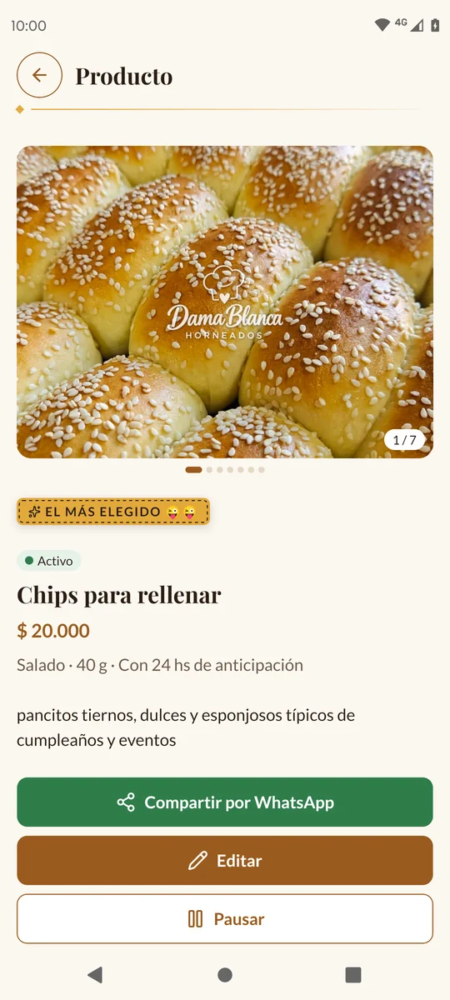
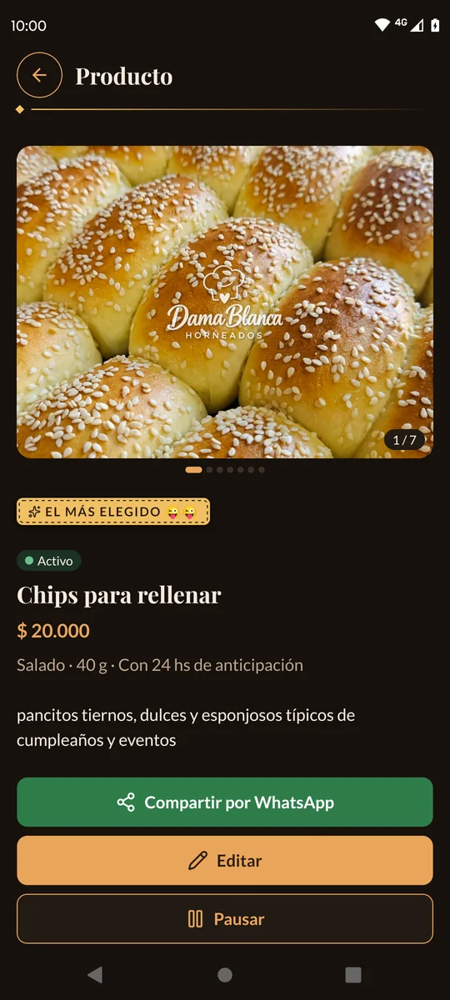

Vas a ver:

- Las fotos: deslizá de costado para pasarlas.
- La etiqueta, si tiene.
- Si está **Activo** (verde) o **Pausado** (gris).
- El nombre y el precio.
- El tipo, el gusto, el peso y la anticipación, por ejemplo «Tartas · Dulce · 2000 g
  · Con 24 hs de anticipación». Si la anticipación es 0, dice «Se pide en el
  momento».
- La descripción y los ingredientes.

Abajo están los botones **Compartir por WhatsApp**, **Editar**, **Pausar** (o
**Activar**) y **Eliminar producto**.

> 💡 Las estrellas y comentarios que dejan tus clientes se ven solo en la web, no
> en la app.

---

## Compartir un producto por WhatsApp

Para mandarle un producto a alguien, o publicarlo en tu estado:

1. Abrí el producto.
2. Tocá el botón verde **Compartir por WhatsApp**.
3. Se abre WhatsApp con la **foto de portada** y un texto ya escrito: el nombre, la
   descripción, el precio, la anticipación y el link para pedirlo en la web.
4. Elegí a quién mandarlo (un chat, un grupo o **Mi estado**) y tocá **Enviar**.

Por ejemplo:

> **Pastafrola de membrillo**
> Masa frola con dulce de membrillo
> $ 16.000 · Con 24 hs de anticipación
>
> Hacé tu pedido acá 👉 (el link del producto en tu web)

El link abre ese producto en la web, con el botón para sumarlo al pedido. Si el
producto no tiene fotos, se manda solo el texto.

La primera vez tarda un poco, porque baja la foto al celular. Las siguientes es al
instante.

> 💡 Solo se pueden compartir los productos **activos**: el link de uno pausado diría
> que no está disponible. Mientras está pausado, debajo del botón dice «Pausado: no se
> ve en el catálogo ni se puede pedir. Para compartirlo, activalo.».

Si dice «No encontramos WhatsApp en este celular.», instalá WhatsApp (el común, no
WhatsApp Business).

---

## Editar un producto

1. Abrí el producto y tocá **Editar**.
2. Cambiá lo que necesites.
3. Tocá **Guardar cambios**.

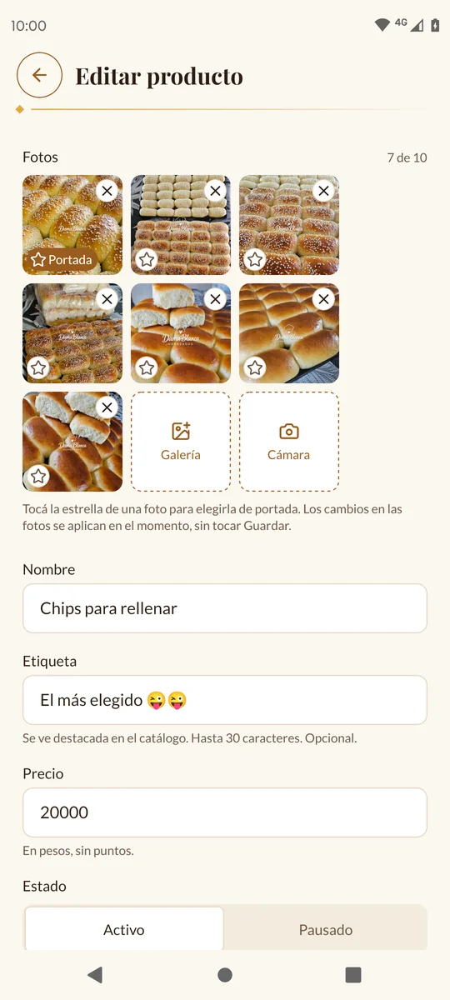
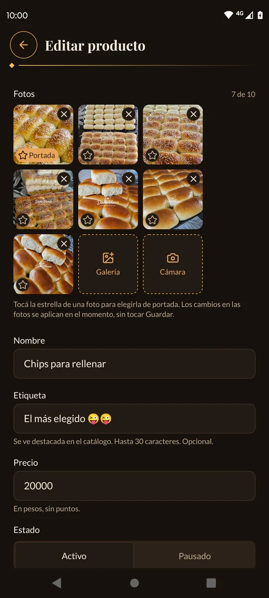

Las fotos funcionan distinto que al crear: **cada cambio en las fotos se aplica en
el momento**, sin tocar Guardar.

- Las fotos nuevas se suben enseguida y van al final (no cambian la portada).
- Al tocar la **X** de una foto ya subida, la app pregunta «¿Borrar esta foto?» y
  avisa «Se borra del producto y del catálogo. No se puede deshacer.». Tocá
  **Borrar** para confirmar. Si era la portada, la siguiente pasa a serlo.
- Una foto que se está subiendo se ve más clara, con una ruedita. Una que falló
  tiene un **!** rojo: tocala para reintentar.

Si vaciás la **Etiqueta**, la **Descripción** o el **Peso**, se le sacan al producto.
Para sacarle el tipo, elegí **Sin tipo**.

> 💡 En [Métricas → Más vendidos](08-metricas.md), los productos se agrupan por
> nombre. Si le cambiás el nombre a un producto, sus ventas viejas quedan con el
> nombre anterior, en otra fila.

---

## Pausar o activar un producto

Pausar sirve para lo que no vendés por un tiempo, como el pan dulce fuera de
temporada: el producto queda guardado con sus fotos y datos, pero no se ve en la web.

1. Abrí el producto.
2. Tocá **Pausar**. Cambia al instante, sin preguntar.

Debajo dice «Pausado: no se ve en el catálogo ni se puede pedir. Para compartirlo,
activalo.».

Para volver a mostrarlo, tocá **Activar**.

Mientras está pausado:

- No aparece en el catálogo web.
- Si alguien abre un link viejo de ese producto, la web dice «Este producto no está
  disponible».
- Si un cliente lo tenía elegido, la web se lo saca del pedido y le avisa.
- Lo seguís viendo en tu lista con la marca «Pausado», y lo podés agregar en un
  [pedido manual](04-pedido-manual.md).

También podés cambiar el estado desde **Editar**.

> 💡 Si después de pausar un producto lo seguís viendo en la lista de **Activos**,
> tirá la lista para abajo para actualizarla.

---

## Eliminar un producto

> ⚠️ Eliminar **no se puede deshacer** y borra también todas sus fotos. Si es algo
> que vas a volver a vender, mejor **pausalo**.

1. Abrí el producto.
2. Tocá **Eliminar producto** (en rojo, al fondo).
3. La app pregunta «¿Eliminar «nombre del producto»?» y avisa «Se borran también
   todas sus fotos. No se puede deshacer.».
4. Tocá **Eliminar** para confirmar, o **Cancelar**.

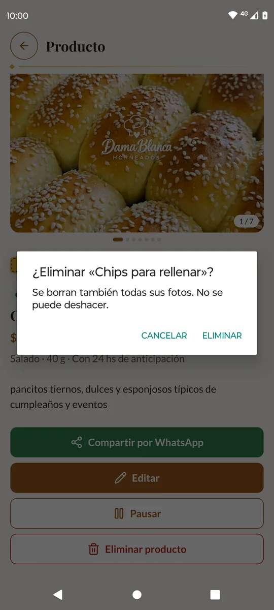
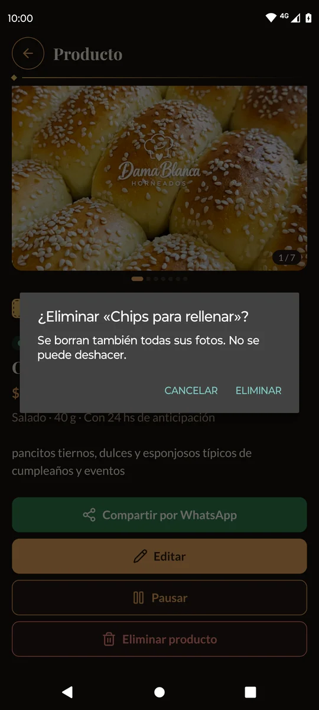

Los pedidos que ya tenían ese producto no cambian: guardan su nombre y su precio.

---

## Los tipos

Los **tipos** son las familias con las que ordenás lo que vendés: Tortas, Tartas,
Pizzas, Alfajores… Los armás vos, con los nombres que quieras. Son aparte del gusto:
una tarta puede ser **Tartas** y **Dulce**; una pizzeta, **Pizzas** y **Salado**.

Para qué sirven:

- En la web, la **Carta** muestra tus productos **agrupados por tipo** (primero un
  tipo, después el otro), y los que no tienen tipo van al final, en **Otros** (ver
  [La web de tus clientes](11-la-web.md)).
- Tus clientes pueden filtrar el catálogo por tipo.
- En la lista de **Productos** podés filtrar por tipo.

El tipo es **opcional**: un producto sin tipo se vende igual.

### Ver y armar tus tipos

Tocá la pestaña **Más** y después **Tipos**. Cada tipo dice cuántos productos lo
usan.

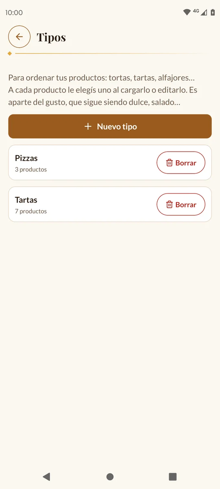
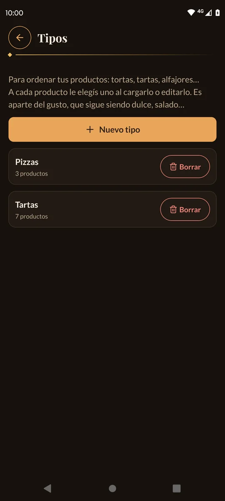

Para crear uno:

1. Tocá **Nuevo tipo**.
2. Escribí el **Nombre**, por ejemplo «Pizzas».
3. Tocá **Guardar tipo**.

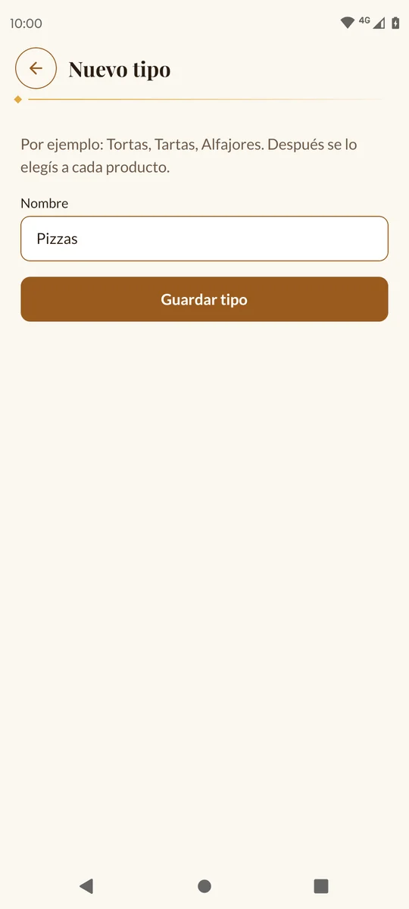
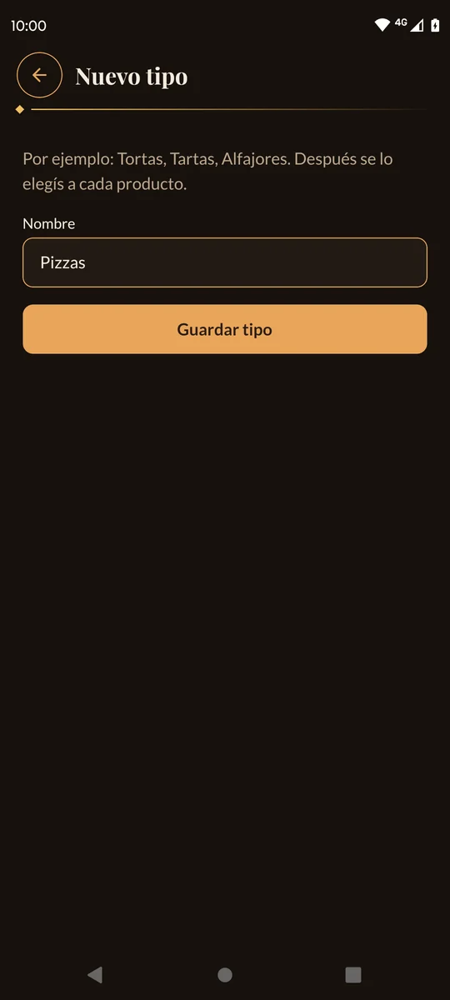

Después, a cada producto le elegís su tipo en **Editar** (o al cargarlo), en el
campo **Tipo**.

> 💡 Si después de cambiarle el tipo a varios productos la lista de **Tipos** sigue
> diciendo «Ningún producto», tirala para abajo para actualizarla.

### Cambiarle el nombre

Tocá el tipo en la lista, cambiá el nombre y tocá **Guardar cambios**. Los productos
que lo usan quedan con el nombre nuevo.

Si ya existe otro con ese nombre, la app avisa: «Ya existe un tipo con ese nombre».

### Borrar un tipo

1. Tocá **Borrar** al lado del tipo.
2. La app te dice qué pasa con los productos, por ejemplo «Los 3 productos que lo usan
   van a quedar sin tipo. No se borra ningún producto.».
3. Tocá **Borrar** para confirmar, o **Cancelar**.

Los productos no se borran: quedan **sin tipo** y en la web pasan a **Otros**.

---

## Los nombres en mayúsculas

Si escribís un nombre todo en mayúsculas, como «TARTA DE FRUTILLA», en la web y en los
pedidos se muestra «Tarta de frutilla». En la pestaña **Productos** lo seguís viendo
como lo escribiste.

> 💡 Si el nombre lleva una marca o un nombre propio, escribilo con mayúsculas y
> minúsculas («Alfajor Dama Blanca»): así se respeta tal cual.

---

Siguiente: [3. Pedidos →](03-pedidos.md)
