# 3. Pedidos

En la pestaña **Pedidos** están todos los pedidos que te hicieron: los que llegan
desde la web y los que cargás vos a mano. Desde acá confirmás la seña, le avisás al
cliente que está listo, marcás lo que entregaste y cancelás lo que no va.

Cada pedido es **para un día**. En la **agenda** del Inicio ves cuánto trabajo tenés
cada día, qué hay que preparar y cerrás los días que ya no podés tomar más
([La agenda: tus pedidos por día](#la-agenda-tus-pedidos-por-día)).

[← Volver al índice](README.md)

---

## El recorrido de un pedido

Todo pedido pasa por estos estados. El estado se ve siempre en una etiqueta de
color:

| Estado | Color | Qué quiere decir |
| --- | --- | --- |
| «Esperando la seña» | Ámbar | El cliente hizo el pedido y todavía no le confirmaste la seña. Todo pedido de la web empieza así. |
| «Seña pagada» | Marrón | Le confirmaste la seña y cuánto te transfirió. |
| «Sin seña» | Marrón | Lo confirmaste sin cobrarle seña ([Confirmar sin seña](#confirmar-sin-seña)). |
| «Entregado» | Verde | El cliente lo retiró o se lo llevaste. |
| «Cancelado» | Gris | No se hace. |

Un día normal es así:

1. Un cliente hace un pedido en la web y elige **para qué día** lo quiere. Te
   aparece en **Pedidos** como «Esperando la seña».
2. El cliente te transfiere la seña y te manda el comprobante por WhatsApp.
3. Abrís el pedido, escribís cuánto te transfirió y tocás **Confirmar seña**.
   Pasa a «Seña pagada».
4. El día anterior (o el mismo día), en la agenda abrís ese día y tocás **Qué hay
   que hacer**: ves todo lo que tenés que preparar.
5. Cuando lo tenés hecho, tocás **Avisar que está listo**: se abre WhatsApp con el
   mensaje ya escrito y solo tenés que mandarlo.
6. Cuando lo retira (o se lo llevás) y te paga lo que falta, tocás **Marcar
   entregado**.

> 💡 Si alguien te paga todo cuando lo retira, sin seña, podés tocar **Sin seña**
> para dejarlo confirmado, o marcarlo entregado directamente desde «Esperando la
> seña».

---

## La lista de pedidos

Tocá la pestaña **Pedidos** (el ícono del portapapeles) en la barra de abajo.

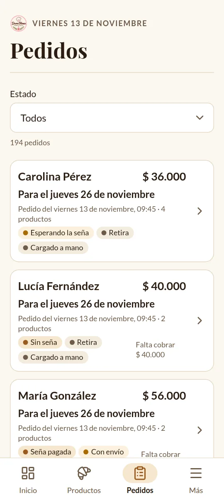
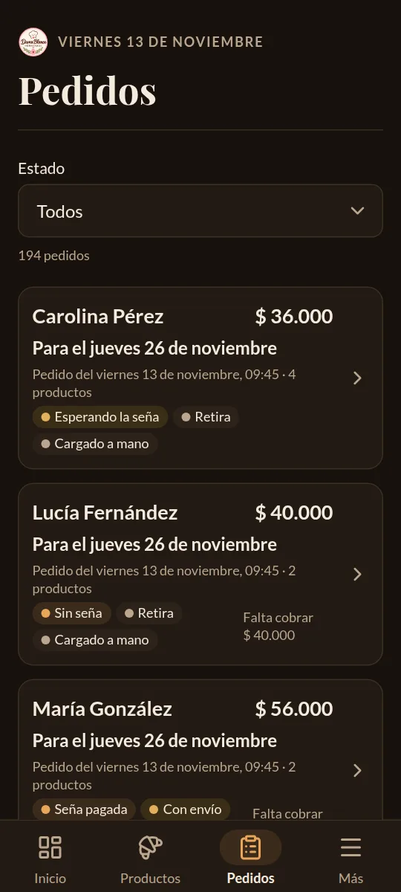

Los pedidos aparecen del más nuevo al más viejo. Cada tarjeta muestra:

- **Arriba:** el nombre del cliente, tal como lo escribió, y el **total** a la derecha.
- **Para qué día es**, en letra grande: por ejemplo «Para el jueves 26 de
  noviembre». Los pedidos de antes de que existiera la agenda dicen «Sin día de
  entrega».
- **Debajo, en gris:** cuándo hizo el pedido y cuántos productos lleva. Por
  ejemplo: «Pedido del viernes 13 de noviembre, 09:45 · 5 productos». Cuenta
  unidades: dos tartas y tres panes son «5 productos».
- **Abajo, las etiquetas:** el estado; **«Con envío»** o **«Retira»**, según cómo lo
  recibe el cliente; y, si lo cargaste vos, «Cargado a mano». Si la seña ya está
  confirmada, a la derecha dice cuánto te falta cobrar, por ejemplo «Falta cobrar
  $ 35.000».

Tocá una tarjeta para abrir el pedido.

### Ver solo un estado

Arriba de la lista está el campo **Estado**, que dice «Todos». Tocalo y elegí qué
pedidos querés ver: **Todos**, **Esperando la seña**, **Seña pagada**, **Entregado**
o **Cancelado**.

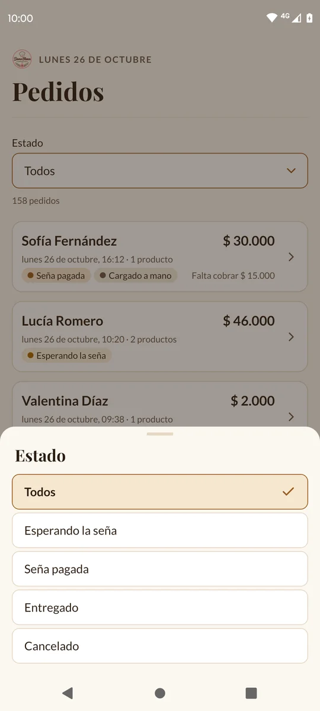
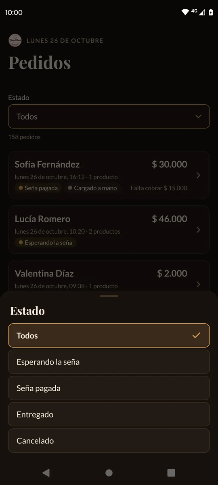

Debajo del filtro dice cuántos pedidos hay en ese estado, por ejemplo «12 pedidos».

Los pedidos **«Sin seña»** aparecen al elegir **Seña pagada**: para la app son
pedidos confirmados, igual que los que tienen seña.

> 💡 Para ver a quién le tenés que reclamar la seña, elegí **Esperando la seña**.
> Para ver lo que tenés que preparar un día, abrí ese día en la
> [agenda](#la-agenda-tus-pedidos-por-día).

### Los pedidos nuevos

Un pedido de la web que **todavía no abriste para mirarlo** sale **resaltado**: con el
borde y el fondo del color de la app y la marca **«Nuevo»** al lado del estado. Así
lo ves de un vistazo, en esta lista y en la pantalla de cada día de la agenda.

Al abrirlo, arriba de todo aparece el aviso «Pedido nuevo» con el botón **Marcar
como visto**. Tocalo cuando ya lo leíste: deja de salir resaltado. No cambia el
estado del pedido ni le avisa nada al cliente.

Si lo marcaste sin querer, al fondo del pedido está **Marcar como no visto**: vuelve
a salir como nuevo.

Los pedidos que cargás vos ([Pedido manual](04-pedido-manual.md)) ya salen vistos.

> ⚠️ Los pedidos nuevos de la web **no aparecen solos** mientras tenés la pantalla
> abierta. Para ver si entró alguno, **tirá la lista para abajo** con el dedo y
> soltala: se recarga.

Lo que hacés vos desde la app (confirmar una seña, entregar, cancelar, cargar un
pedido manual) sí se actualiza solo en la lista.

### Más pedidos

La lista trae los pedidos de a 20. Cuando llegás al final, se cargan los siguientes
solos. Si no, tocá **Ver más pedidos**.

### Si la lista está vacía

- Con **Todos**: «Todavía no hay pedidos. Cuando un cliente haga un pedido desde la
  web, lo vas a ver acá.»
- Con otro estado: «No hay pedidos en este estado».

---

## El detalle de un pedido

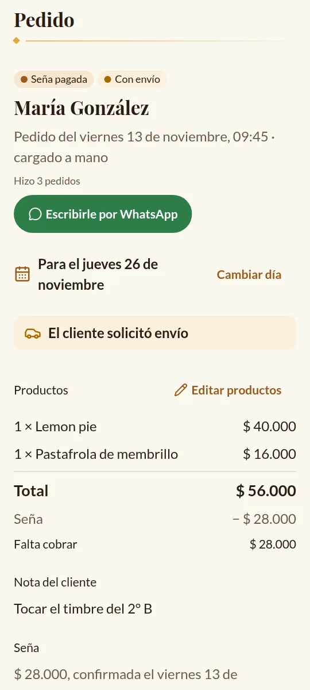
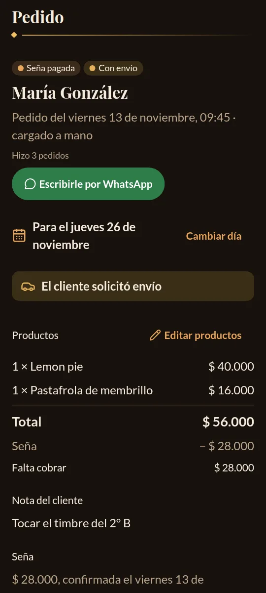

Al abrir un pedido ves, de arriba para abajo:

### El cliente

- Las etiquetas: el estado y **«Con envío»** o **«Retira»**.
- El nombre del cliente, grande.
- Cuándo lo pidió: «Pedido del viernes 13 de noviembre, 09:45». Si lo cargaste vos,
  sigue con «· cargado a mano».
- Si es cliente nuevo o ya te compró: «Es su primer pedido» o «Hizo 3 pedidos»
  (contando este).
- El botón verde **Escribirle por WhatsApp**: abre el chat con el cliente con un
  saludo ya escrito, por ejemplo:

  > ¡Hola María! ¿Cómo estás? Te escribo de Dama Blanca por tu pedido.

  Lo podés cambiar antes de mandarlo.

> 💡 El número de teléfono del cliente no se muestra escrito: para hablarle, usá
> el botón de WhatsApp.

### Para qué día es

Con el ícono del calendario dice para cuándo es el pedido: «Para el jueves 26 de
noviembre». Los pedidos viejos, de antes de la agenda, dicen «Sin día de entrega».

**Si el cliente te pide otro día**, tocá **Cambiar día** (está mientras el pedido no
esté entregado ni cancelado). Se abre la hoja **¿Para qué día?** con el calendario:
tocá el día nuevo y listo, se cambia al instante.

En tu calendario podés elegir **cualquier día**, aunque esté «Llena» o la web no lo
ofrezca: vos sabés si te da el tiempo. Los colores están para que veas cómo viene
cada día.

### Envío o retiro

Debajo, una franja dice cómo lo recibe el cliente:

- «El cliente solicitó envío» (con un autito): hay que llevárselo.
- «El cliente lo retira en el local» (con el localcito): lo pasa a buscar.

Lo eligió el cliente al hacer el pedido en la web (o vos, en el
[pedido manual](04-pedido-manual.md)). Desde el detalle **no se cambia**, y no
cambia el precio: es solo para que sepas qué hacer. La dirección la arreglás con el
cliente por WhatsApp.

### Productos

Cada producto con la cantidad y lo que suma, por ejemplo «1 × Lemon pie
… $ 40.000». Abajo, el **Total**.

Los nombres y los precios son los del momento del pedido: si después cambiás un
precio, este pedido no cambia.

Si tiene seña, debajo del total aparecen:

- **Seña**, con lo que te transfirió (por ejemplo «− $ 28.000»).
- **Falta cobrar**, con lo que te tiene que pagar al recibirlo. Cuando el pedido ya
  está entregado, dice **Cobrado al entregar**.

Al lado del título **Productos** está **Editar productos**, para sumar o sacar cosas
([Editar los productos de un pedido](#editar-los-productos-de-un-pedido)).

### Nota del cliente

Lo que el cliente escribió al hacer el pedido (por ejemplo, «Tocar el timbre del
2° B»). En los pedidos que cargás vos, va tu nota. Si no hay nota, no aparece.

### Lo de abajo: la seña y los botones

Más abajo está el bloque **Seña** y, al final, los botones **Avisar que está listo**,
**Marcar entregado** y **Cancelar pedido**. Los vemos uno por uno a continuación.

---

## Confirmar la seña

Mientras el pedido está «Esperando la seña», en el bloque **Seña** hay un campo que
pregunta **¿Cuánto te transfirió?**.

1. Fijate en tu cuenta cuánto te transfirió el cliente.
2. Escribí el monto en pesos, **sin puntos ni comas**. Por ejemplo: `35000`.
   El número gris que aparece en el campo es solo una ayuda (la mitad del total):
   tenés que escribirlo igual.
3. Tocá **Confirmar seña**.

El pedido pasa a «Seña pagada» y en **Productos** aparece lo que falta cobrar.

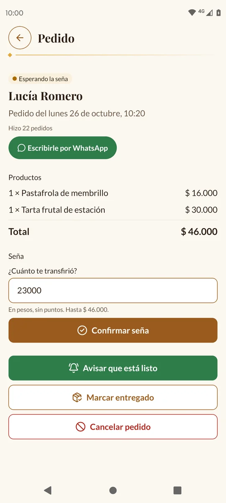
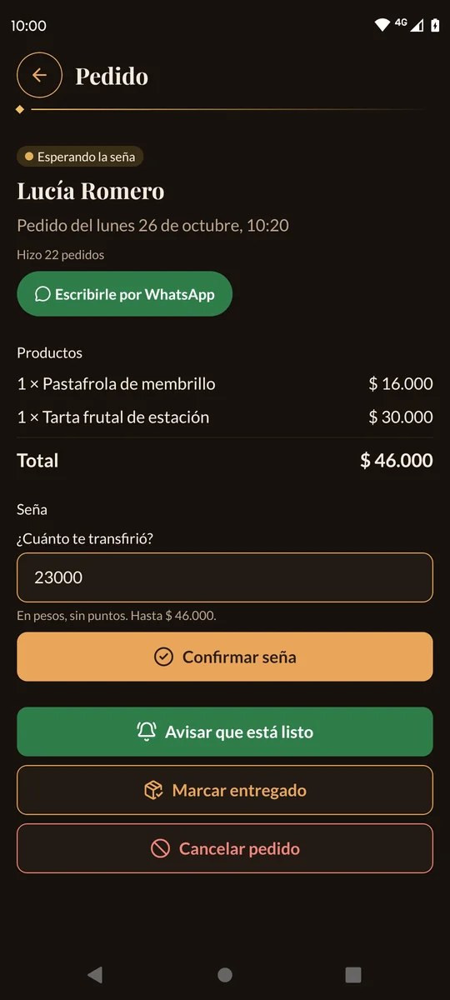

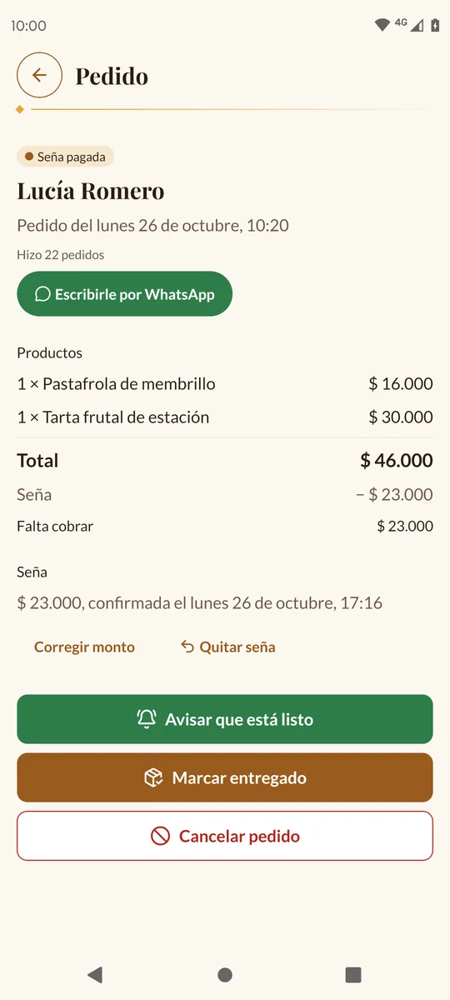
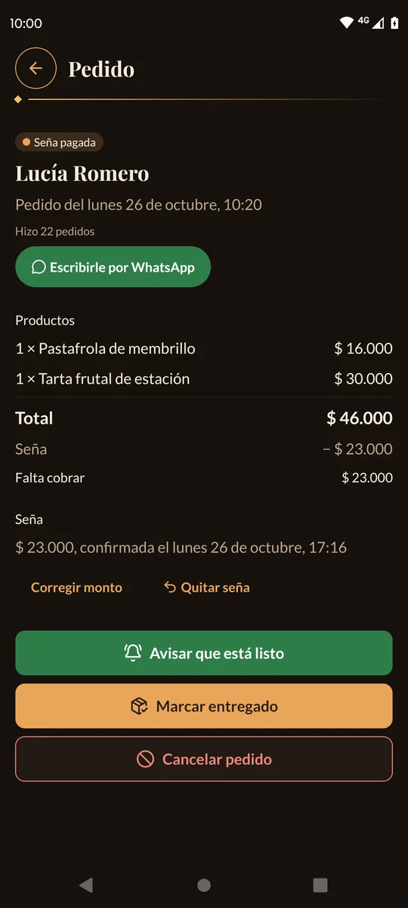

Si algo está mal, la app te avisa debajo del campo:

| Mensaje | Qué pasó |
| --- | --- |
| «Escribí cuánto te transfirió» | El campo está vacío. |
| «Solo números, sin puntos ni comas» | Escribiste un punto, una coma o una letra. |
| «Tiene que ser mayor que 0» | Escribiste 0. Si no te va a pagar seña, tocá **Sin seña**. |
| «No puede ser más que el total ($ 70.000)» | El monto es más grande que el pedido. |

### Confirmar sin seña

A veces tomás un pedido sin cobrar seña (un cliente de confianza, alguien que paga
todo al retirar). Para eso está el botón **Sin seña**, debajo de **Confirmar seña**.

Tocalo y el pedido queda confirmado, con la etiqueta «Sin seña». En el bloque
**Seña** dice cuándo lo confirmaste, por ejemplo «Sin seña, confirmado el viernes 13
de noviembre, 09:45». No aparecen las filas **Seña** ni **Falta cobrar**: el cliente
te debe el total.

Abajo hay dos botones:

- **Cargar seña**: si el cliente después te transfirió. Escribí cuánto y tocá
  **Guardar monto**. Pasa a «Seña pagada».
- **Deshacer**: si lo tocaste sin querer. Vuelve a «Esperando la seña».

> 💡 Un pedido «Sin seña» se ve en **Qué hay que hacer** igual que los demás: lo
> tenés que preparar.

### Corregir o quitar la seña

Con la seña pagada, el bloque **Seña** dice cuánto y cuándo la confirmaste, por
ejemplo «$ 28.000, confirmada el viernes 13 de noviembre, 09:45». Abajo hay dos
botones:

- **Corregir monto**: si escribiste mal el número. Cambialo y tocá **Guardar
  monto**. Si te arrepentiste, tocá **No cambiar**. Si en realidad no hubo seña,
  tocá **Sin seña**.
- **Quitar seña**: si la confirmaste por error. El pedido vuelve a «Esperando la
  seña» al instante, sin preguntar.

---

## Editar los productos de un pedido

Un cliente te escribe «sumame 6 medialunas» o «sacame la tarta». No hace falta
cargar otro pedido: editás el que ya tiene.

Se puede mientras el pedido está «Esperando la seña», «Seña pagada» o «Sin seña»
(no si ya está entregado o cancelado).

1. Abrí el pedido y tocá **Editar productos** (al lado del título **Productos**).
2. Se abre la pantalla **Editar productos**, con el nombre del cliente arriba.
3. En **En el pedido** están los productos que ya tiene. Con **+** y **−** cambiás la
   cantidad. Cuando queda en 1, el **−** se convierte en un tachito: tocalo para
   sacar el producto (queda en 0 en la lista, por si lo querés volver a sumar).
4. Para agregar algo nuevo, en **Sumar productos** buscalo en **Buscar un producto**
   y tocá su **+**. También aparecen los pausados.
5. Mirá el **Total** nuevo: si cambió, abajo dice «Antes» con el total que tenía.
   Si tiene seña, ves también lo que falta cobrar.
6. Tocá **Guardar cambios**. Volvés al pedido, ya actualizado.

> 💡 **Lo que ya estaba conserva el precio con el que se pidió. Lo que sumes entra
> con el precio de hoy.** Así no le cambiás el precio de lo que ya había pedido.

> ⚠️ Si salís sin tocar **Guardar cambios**, el pedido queda como estaba.

| Mensaje | Qué hacer |
| --- | --- |
| «El pedido tiene que tener al menos un producto. Si ya no va, cancelalo» | Sacaste todo. Si el cliente ya no quiere nada, cancelá el pedido. |
| «Este pedido está entregado: ya no se pueden cambiar sus productos.» (o «cancelado») | Tocá **Volver al pedido**. Si hace falta, primero deshacé la entrega o la cancelación. |

---

## Avisar que está listo

Mientras el pedido no está entregado ni cancelado, tocá el botón verde **Avisar que
está listo**. Se abre WhatsApp con el cliente y el mensaje ya escrito. Si lo retira:

> ¡Hola María! Tu pedido ya está listo para retirar:
> • 1 × Lemon pie
> • 1 × Pastafrola de membrillo
> Al retirarlo te queda por pagar $ 28.000.
> ¡Te esperamos! Dama Blanca

Si es **con envío**, dice «Tu pedido ya está listo y en un rato te lo llevamos:», «Al
recibirlo te queda por pagar…» y termina con «¡Gracias! Dama Blanca».

Si ya te pagó todo, en lugar del monto dice «Ya está todo pago: solo tenés que pasar
a buscarlo.» (o «Ya está todo pago.» si es con envío). Si no tiene seña, el monto es
el total.

Solo tenés que tocar enviar en WhatsApp.

> 💡 Avisar **no cambia el estado** del pedido: sigue como estaba hasta que lo
> marques entregado.

---

## Marcar entregado

Cuando el cliente retira el pedido (o se lo llevaste), tocá **Marcar entregado**.
Funciona con o sin seña.

El pedido pasa a «Entregado» y abajo dice cuándo, por ejemplo «Entregado el viernes
16 de octubre, 19:40».

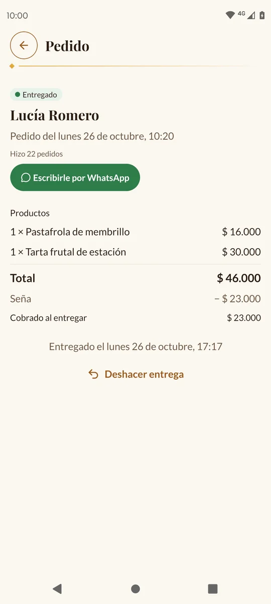
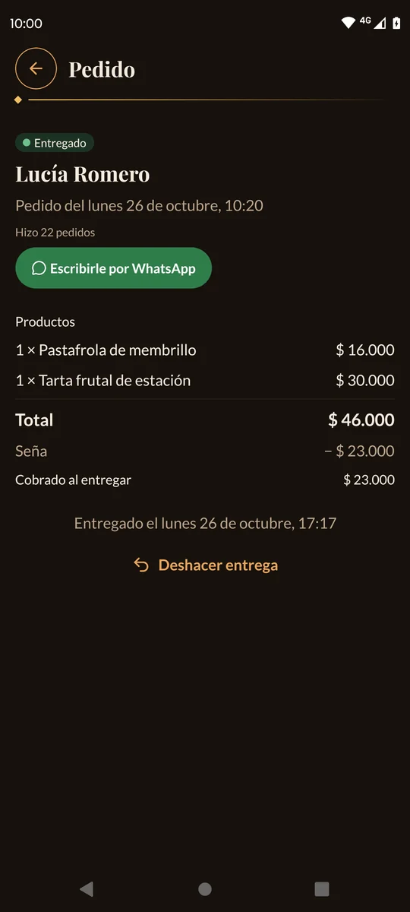

Si lo marcaste por error, tocá **Deshacer entrega**: vuelve a «Seña pagada» (o a
«Sin seña») si estaba confirmado, o a «Esperando la seña» si no.

---

## Cancelar un pedido

1. Tocá el botón rojo **Cancelar pedido**.
2. La app te pregunta «¿Cancelar el pedido?». Si tenía seña, te recuerda: «La seña
   queda registrada, por si hay que devolverla.»
3. Tocá **Cancelar pedido** para confirmar, o **No** para dejarlo como estaba.

El pedido pasa a «Cancelado» y abajo dice cuándo y, si la tenía, de cuánto era la
seña.

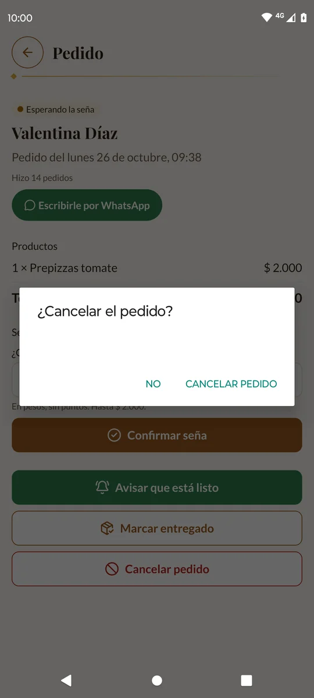
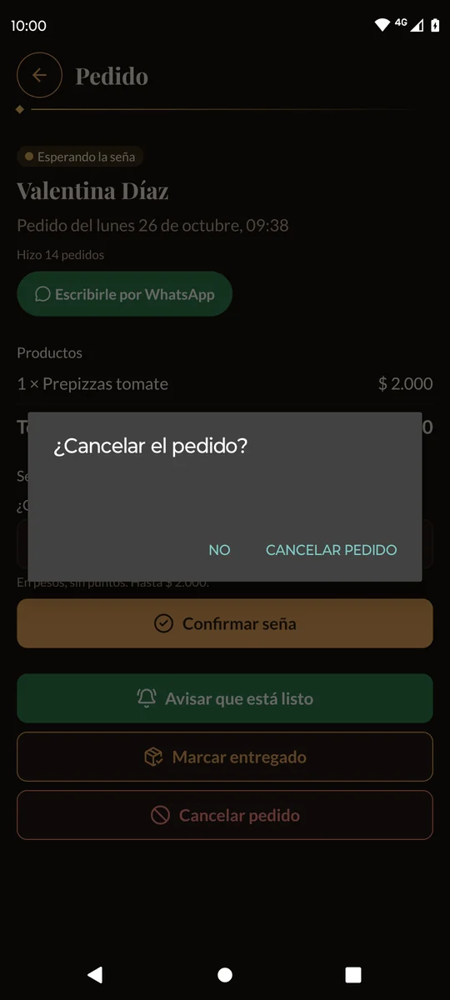

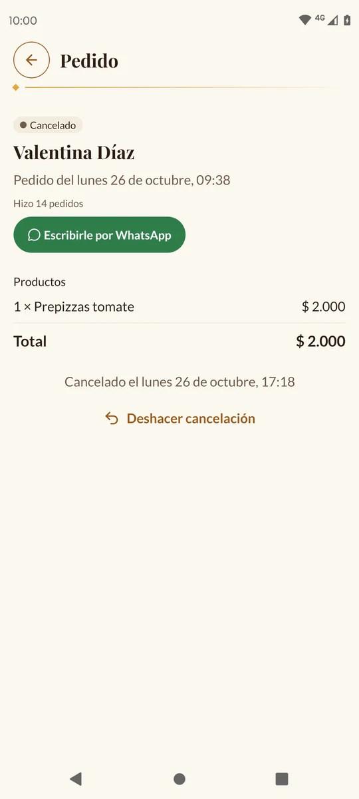
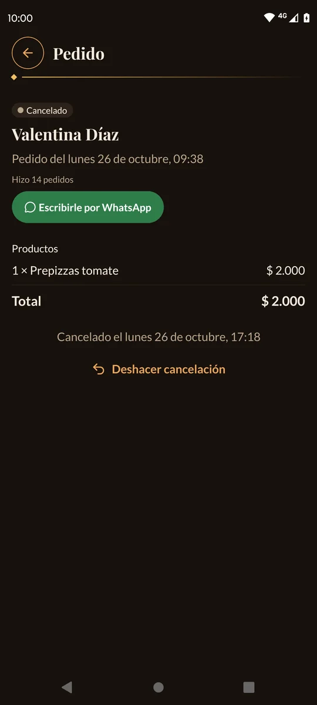

Si te equivocaste, tocá **Deshacer cancelación**: vuelve al estado que tenía.

> 💡 Los pedidos cancelados no cuentan como ventas en las [Métricas](08-metricas.md)
> ni en los productos de su día en la agenda.

---

## Cada paso se puede deshacer

| Si tocaste… | Para volver atrás… |
| --- | --- |
| Confirmar seña | **Quitar seña** |
| Sin seña | **Deshacer** |
| Marcar entregado | **Deshacer entrega** |
| Cancelar pedido | **Deshacer cancelación** |
| Cambiar día | **Cambiar día** otra vez, eligiendo el día de antes |

Un pedido entregado o cancelado no muestra el bloque de la seña, ni **Cambiar día**
ni **Editar productos**. Si necesitás cambiar algo de uno de esos, primero deshacé la
entrega o la cancelación.

Solo cancelar pide confirmación. Los demás botones actúan al toque, porque se
pueden deshacer.

---

## La agenda: tus pedidos por día

Como cada pedido es para un día, la app te arma una **agenda**: está en la pestaña
**Inicio**, apenas entrás a la app. Te sirve para ver cuánto trabajo tenés cada día,
saber qué preparar y dejar de tomar pedidos cuando ya no das más.

### Tu tope de productos por día

Arriba dice, por ejemplo, «Tu tope: 25 productos por día»: **cuántos productos podés
preparar en un día**. Cuando un día llega a ese número, la web deja de ofrecerlo
solo.

Para cambiarlo:

1. Tocá **Cambiar**.
2. En la hoja **Productos por día**, escribí el número en **¿Cuántos productos podés
   preparar por día?** (de 1 a 1000).
3. Tocá **Guardar**.

Si lo dejás vacío, no hay tope: la web ofrece todos los días hasta que vos cierres
alguno. En ese caso, arriba dice «Poné cuántos productos podés preparar por día: al
llegar, la web deja de ofrecer ese día» y el botón es **Ponerlo**.

### Los colores del mes

Cada día está pintado **igual que lo ve el cliente** en la web cuando elige el día de
su pedido:

| Color | Qué quiere decir |
| --- | --- |
| Verde, «Libre» | Tiene lugar. El cliente lo puede elegir. |
| Amarillo, «Casi» | Se está llenando: pasó el 40 % de tu tope (con 25, desde 11 productos). El cliente lo puede elegir todavía. |
| Rojo, «Llena» | Llegó a tu tope o lo cerraste vos con **Agenda llena**. La web no lo ofrece. |

Debajo del mes está la **leyenda**, con los números de tu tope. Con un tope de 25:
«Libre» hasta 10, «Casi» de 11 a 24 y «Llena» desde 25 o si la marcás.

Además:

- **Hoy** va en blanco, con el borde marcado y la palabra «Hoy». La web nunca ofrece
  hoy, así que su color no importa: está para que lo ubiques.
- Los días que **ya pasaron** van sin color.
- El **circulito con un número** en la esquina de un día dice **cuántos productos te
  faltan preparar** para ese día. Cuando anotás lo que ya hiciste en **Qué hay que
  hacer**, el número baja. Con todo hecho, el circulito desaparece.
- Un **relojito** arriba a la izquierda marca un día en que elegiste **hacer menos**
  que tu tope (lo vemos más abajo).
- Con las flechas de arriba cambiás de mes.

> 💡 «Llena» solo cierra el día **para la web**. Vos podés seguir cargando pedidos
> manuales en cualquier día, también en uno lleno.

### La pantalla de un día

**Tocá un día del calendario** y se abre su pantalla, con el título **Agenda**.

De arriba para abajo:

- **El día**, por ejemplo «jueves 26 de noviembre» (o «Hoy · …» y «Mañana · …»).
- **Sus números**, por ejemplo «3 pedidos · 8 productos de 12»: cuántos pedidos tiene,
  cuántos productos suman y, después del «de», tu tope (o lo que elegiste hacer ese
  día).
- **¿Cuántos querés hacer este día?** (no aparece en los días que ya pasaron).
- **Qué hay que hacer** (si el día tiene pedidos).
- **Agenda llena** o **Volver a abrir el día**.
- **Pedidos**: los pedidos de ese día, con la misma tarjeta de la pestaña Pedidos.
  Tocá uno para abrirlo. Los cancelados van aparte, al final, bajo «Cancelados (N)»:
  no cuentan en los pedidos ni en los productos del día.

Si el día no tiene pedidos, dice «No hay pedidos para este día. Si un cliente acaba
de pedir, tirá para abajo.»

> 💡 **Tirá la pantalla para abajo** para ver si entraron pedidos nuevos de la web
> para ese día.

### ¿Cuántos querés hacer este día?

A veces un día puntual querés trabajar menos (tenés un turno médico, un cumpleaños,
llega mercadería). Sin cambiar tu tope de siempre, podés decir **cuántos productos
querés hacer ese día**.

1. En la pantalla del día, en **¿Cuántos querés hacer este día?** (dice «Los de
   siempre: hasta 25 productos.»), tocá **Hacer menos este día**.
2. Se abre la hoja **Este día quiero hacer**. En **¿Cuántos productos querés hacer?**
   escribí el número, por ejemplo `12`.
3. Tocá **Guardar**.

Desde ahí, el apartado dice «Este día: hasta 12 (de 25)», con el borde marcado, y en
el calendario el día lleva el **relojito**.

**Cómo lo ve la web:** lo que no querés hacer (en el ejemplo, 13 de los 25) cuenta
como **ocupado**. Por eso la web muestra el día «Casi» o «Llena» antes que los
demás. Cuando los pedidos llegan a 12, el día se cierra para la web.

- Para cambiar el número, tocá **Cambiar**.
- Para volver a tu tope de siempre, tocá **Volver a lo normal**.

> ⚠️ Si ese día ya tiene más productos pedidos que el número que escribiste, la app
> te avisa antes de guardar, por ejemplo: «Ya tenés 19 productos pedidos para ese
> día. Se quedan, pero el día va a quedar lleno.» Los pedidos no se borran: el día
> solo se cierra para la web.

> 💡 Para no tomar **ningún** pedido más ese día, no escribas 0: usá **Agenda llena**.

### Qué hay que hacer

Es tu **hoja de trabajo del día**: todos los productos de los pedidos sin entregar
de ese día, **sumados**, sin importar de quién es cada pedido. Si tres clientes
pidieron lemon pie, ves «3 Lemon pie».

1. En la pantalla del día, tocá **Qué hay que hacer**.
2. Arriba ves el día, cuántos productos son («8 productos de 3 pedidos sin
   entregar»), una barrita de avance y cuánto llevás: «Hiciste 1 de 8».
3. Cada producto tiene, en grande, **cuántos hay que hacer**, y abajo «Hechos 1 ·
   faltan 1». Si son de pedidos que todavía no pagaron la seña, dice «Todos sin seña»
   o, por ejemplo, «2 sin seña» (están sumados igual).

**Para anotar lo que sacaste del horno:**

- Tocá **+** en ese producto tantas veces como unidades hiciste (con **−** bajás).
  Aparece el botón **Agregar 2** (con el número que armaste): tocalo y se suma a lo
  hecho.
- Si ya hiciste todos los de ese producto, tocá **Listo** (verde): se completa de una
  y baja al final, con «¡Listo! 3 de 3».
- Si marcaste **Listo** por error, tocá **Deshacer**: vuelve a 0 hechos.

Cuando terminás todo, arriba dice «¡Terminaste todo el día!». Tocá **Cerrar** para
volver.

> ⚠️ Lo que armás con **+** y **−** **no se guarda solo**: se guarda recién cuando
> tocás **Agregar** o **Listo**.

> 💡 Lo que anotás acá solo sirve para que lleves la cuenta: no cambia el estado de
> los pedidos ni le avisa nada al cliente. Para eso están **Avisar que está listo**
> y **Marcar entregado** en cada pedido.

### Agenda llena

Un día **se cierra para la web** de dos formas:

- **Solo**, cuando los productos pedidos llegan a tu tope (o a lo que elegiste hacer
  ese día). Arriba aparece «Llegó a tu tope: la web ya no ofrece este día. Vos podés
  seguir cargando pedidos. Para volver a ofrecerlo, subí tu tope.»
- **Cuando vos lo decidís**, aunque tenga pocos productos (por ejemplo, tomaste un
  pedido grande por WhatsApp o ese día no vas a estar). En la pantalla del día, tocá
  el botón rojo **Agenda llena**.

Con el día cerrado, arriba dice «Agenda llena: la web no ofrece este día. Vos podés
seguir cargando pedidos.», en el calendario sale en rojo «Llena» y los clientes no lo
pueden elegir.

Para abrirlo de nuevo, tocá **Volver a abrir el día**.

> 💡 Los pedidos que ya tenía ese día no se tocan. Y vos podés seguir cargando
> [pedidos manuales](04-pedido-manual.md) para ese día.

### Mensajes de la agenda

| Mensaje | Qué hacer |
| --- | --- |
| «Escribí cuántos productos querés hacer» | En **Este día quiero hacer**, el campo está vacío. |
| «De 1 a 1000. Para no hacer nada, usá «Agenda llena»» | Escribiste 0 o un número muy grande. Para no tomar pedidos ese día, tocá **Agenda llena**. |
| «Solo números, sin puntos ni comas» / «Solo números» | Escribiste un punto, una coma o una letra. |
| «De 1 a 1000» | En **Productos por día**, el número es 0 o muy grande. |
| «No se pudo anotar ese número. Cerrá la hoja y volvé a abrirla.» | En **Qué hay que hacer**, cerrá la hoja con **Cerrar** y volvé a tocar **Qué hay que hacer**. |
| «No encontramos ese día. Volvé al inicio y elegilo en el calendario.» | Volvé atrás y tocá el día en la agenda. |

---

## Mensajes que pueden aparecer

**«El pedido ya está entregado»**, **«El pedido ya está cancelado»** u otros
parecidos: el pedido cambió antes de que tocaras el botón (por ejemplo, tocaste dos
veces seguidas). La app vuelve a cargar el pedido sola y te muestra cómo está ahora.
Fijate el estado y seguí desde ahí.

**«Este pedido no existe»**: el pedido no está más. Tocá **Volver a pedidos**.

**«No hay conexión con el servidor…»** o **«El servidor tardó demasiado en
responder…»**: revisá tu internet y tocá **Reintentar**. Ver también
[Problemas y preguntas frecuentes](12-preguntas-frecuentes.md).

---

Siguiente: [4. Pedido manual →](04-pedido-manual.md)
