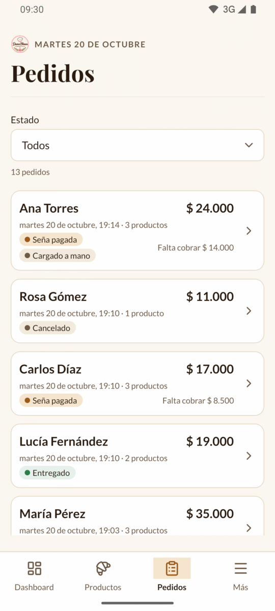
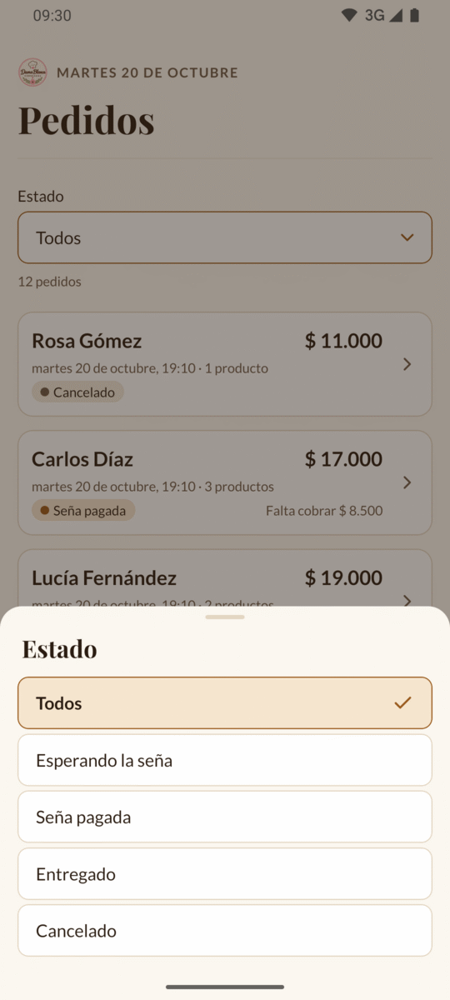
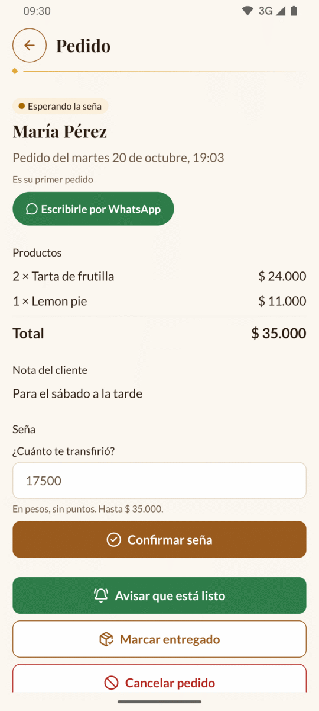
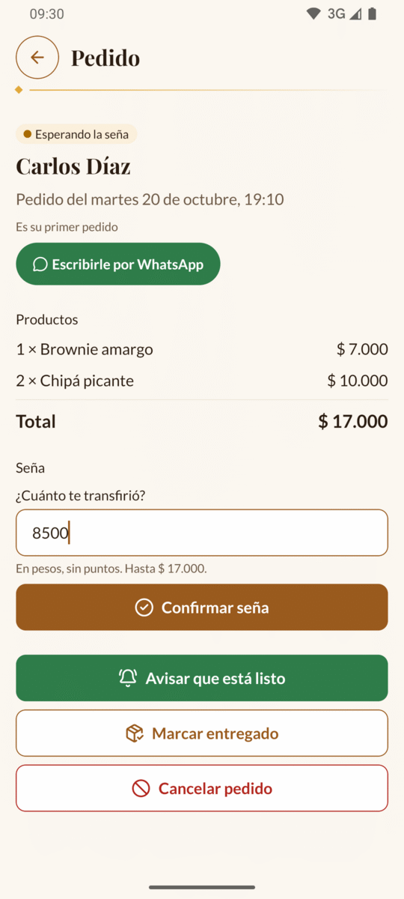
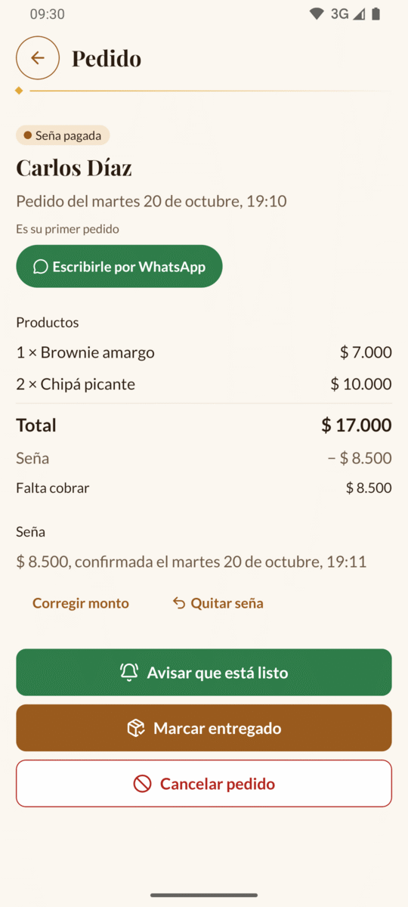
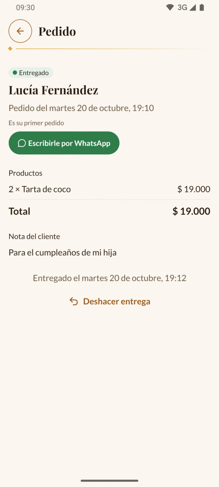
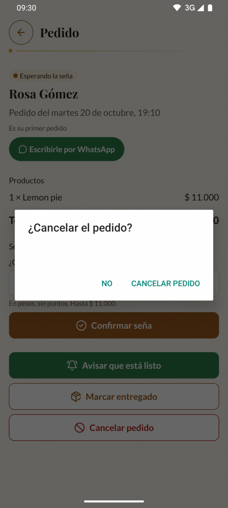
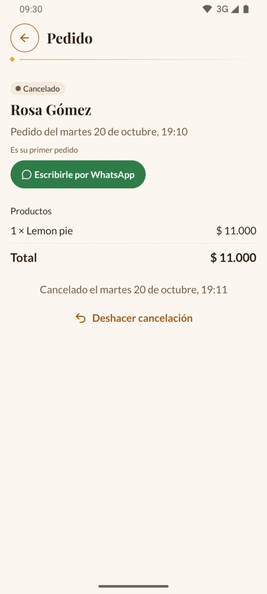

# 3. Pedidos

En la pestaña **Pedidos** están todos los pedidos que te hicieron: los que llegan
desde la web y los que cargás vos a mano. Desde acá confirmás la seña, le avisás al
cliente que está listo, marcás lo que entregaste y cancelás lo que no va.

[← Volver al índice](README.md)

---

## El recorrido de un pedido

Todo pedido pasa por estos estados. El estado se ve siempre en una etiqueta de
color:

| Estado | Color | Qué quiere decir |
| --- | --- | --- |
| «Esperando la seña» | Ámbar | El cliente hizo el pedido y todavía no le confirmaste la seña. Todo pedido de la web empieza así. |
| «Seña pagada» | Marrón | Le confirmaste la seña y cuánto te transfirió. |
| «Entregado» | Verde | El cliente lo retiró. |
| «Cancelado» | Gris | No se hace. |

Un día normal es así:

1. Un cliente hace un pedido en la web. Te aparece en **Pedidos** como
   «Esperando la seña».
2. El cliente te transfiere la seña y te manda el comprobante por WhatsApp.
3. Abrís el pedido, escribís cuánto te transfirió y tocás **Confirmar seña**.
   Pasa a «Seña pagada».
4. Cuando lo tenés hecho, tocás **Avisar que está listo**: se abre WhatsApp con el
   mensaje ya escrito y solo tenés que mandarlo.
5. Cuando lo retira y te paga lo que falta, tocás **Marcar entregado**.

> 💡 Si alguien te paga todo cuando lo retira, sin seña, también podés marcarlo
> entregado directamente desde «Esperando la seña».

---

## La lista de pedidos

Tocá la pestaña **Pedidos** (el ícono del portapapeles) en la barra de abajo.

Los pedidos aparecen del más nuevo al más viejo. Cada tarjeta muestra:

- **Arriba:** el nombre del cliente, tal como lo escribió, y el **total** a la derecha.
- **En el medio:** el día y la hora en que hizo el pedido y cuántos productos lleva.
  Por ejemplo: «viernes 16 de octubre, 18:08 · 5 productos». Cuenta unidades: dos
  tartas y tres panes son «5 productos».
- **Abajo:** la etiqueta del estado. Si lo cargaste vos, al lado dice «Cargado a
  mano». Si la seña ya está pagada, a la derecha dice cuánto te falta cobrar, por
  ejemplo «Falta cobrar $ 35.000».

Tocá una tarjeta para abrir el pedido.

### Ver solo un estado

Arriba de la lista está el campo **Estado**, que dice «Todos». Tocalo y elegí qué
pedidos querés ver: **Todos**, **Esperando la seña**, **Seña pagada**, **Entregado**
o **Cancelado**.

Debajo del filtro dice cuántos pedidos hay en ese estado, por ejemplo «12 pedidos».

> 💡 Para ver lo que tenés que preparar, elegí **Seña pagada**. Para ver a quién le
> tenés que reclamar la seña, elegí **Esperando la seña**.

### Ver los pedidos nuevos

> ⚠️ Los pedidos nuevos de la web **no aparecen solos** mientras tenés la pantalla
> abierta. Para ver si entró alguno, **tirá la lista para abajo** con el dedo y
> soltala: se recarga.

Lo que hacés vos desde la app (confirmar una seña, entregar, cancelar, cargar un
pedido manual) sí se actualiza solo en la lista.

### Más pedidos

La lista trae los pedidos de a 20. Cuando llegás al final, se cargan los siguientes
solos. Si no, tocá **Ver más pedidos**.

### Si la lista está vacía

- Con **Todos**: «Todavía no hay pedidos. Cuando un cliente haga un pedido desde la
  web, lo vas a ver acá.»
- Con otro estado: «No hay pedidos en este estado».

---

## El detalle de un pedido

Al abrir un pedido ves, de arriba para abajo:

### El cliente

- La etiqueta del estado.
- El nombre del cliente, grande.
- Cuándo lo pidió: «Pedido del viernes 16 de octubre, 18:08». Si lo cargaste vos,
  sigue con «· cargado a mano».
- Si es cliente nuevo o ya te compró: «Es su primer pedido» o «Hizo 4 pedidos»
  (contando este).
- El botón verde **Escribirle por WhatsApp**: abre el chat con el cliente con un
  saludo ya escrito, por ejemplo:

  > ¡Hola María! ¿Cómo estás? Te escribo de Dama Blanca por tu pedido.

  Lo podés cambiar antes de mandarlo.

> 💡 El número de teléfono del cliente no se muestra escrito: para hablarle, usá
> el botón de WhatsApp.

### Productos

Cada producto con la cantidad y lo que suma, por ejemplo «5 × Pan dulce con frutas
… $ 25.000». Abajo, el **Total**.

Los nombres y los precios son los del momento del pedido: si después cambiás un
precio, este pedido no cambia.

Si tiene seña, debajo del total aparecen:

- **Seña**, con lo que te transfirió (por ejemplo «− $ 35.000»).
- **Falta cobrar**, con lo que te tiene que pagar al retirarlo. Cuando el pedido ya
  está entregado, dice **Cobrado al entregar**.

### Nota del cliente

Lo que el cliente escribió al hacer el pedido (por ejemplo, para cuándo lo
necesita). En los pedidos que cargás vos, va tu nota. Si no hay nota, no aparece.

---

## Confirmar la seña

Mientras el pedido está «Esperando la seña», en el bloque **Seña** hay un campo que
pregunta **¿Cuánto te transfirió?**.

1. Fijate en tu cuenta cuánto te transfirió el cliente.
2. Escribí el monto en pesos, **sin puntos ni comas**. Por ejemplo: `35000`.
   El número gris que aparece en el campo es solo una ayuda (la mitad del total):
   tenés que escribirlo igual.
3. Tocá **Confirmar seña**.

El pedido pasa a «Seña pagada» y en **Productos** aparece lo que falta cobrar.

Si algo está mal, la app te avisa debajo del campo:

| Mensaje | Qué pasó |
| --- | --- |
| «Escribí cuánto te transfirió» | El campo está vacío. |
| «Solo números, sin puntos ni comas» | Escribiste un punto, una coma o una letra. |
| «Tiene que ser mayor que 0» | Escribiste 0. |
| «No puede ser más que el total ($ 70.000)» | El monto es más grande que el pedido. |

### Corregir o quitar la seña

Con la seña pagada, el bloque **Seña** dice cuánto y cuándo la confirmaste, por
ejemplo «$ 35.000, confirmada el viernes 16 de octubre, 18:31». Abajo hay dos
botones:

- **Corregir monto**: si escribiste mal el número. Cambialo y tocá **Guardar
  monto**. Si te arrepentiste, tocá **No cambiar**.
- **Quitar seña**: si la confirmaste por error. El pedido vuelve a «Esperando la
  seña» al instante, sin preguntar.

---

## Avisar que está listo

Mientras el pedido no está entregado ni cancelado, tocá el botón verde **Avisar que
está listo**. Se abre WhatsApp con el cliente y este mensaje ya escrito:

> ¡Hola María! Tu pedido ya está listo para retirar:
> • 5 × Pan dulce con frutas
> • 2 × Tarta de frutilla
> Al retirarlo te queda por pagar $ 35.000.
> ¡Te esperamos! Dama Blanca

Si ya te pagó todo, en lugar del monto dice «Ya está todo pago: solo tenés que pasar
a buscarlo.». Si no tiene seña, el monto es el total.

Solo tenés que tocar enviar en WhatsApp.

> 💡 Avisar **no cambia el estado** del pedido: sigue como estaba hasta que lo
> marques entregado.

---

## Marcar entregado

Cuando el cliente retira el pedido, tocá **Marcar entregado**. Funciona con o sin
seña.

El pedido pasa a «Entregado» y abajo dice cuándo, por ejemplo «Entregado el viernes
16 de octubre, 19:40».

Si lo marcaste por error, tocá **Deshacer entrega**: vuelve a «Seña pagada» si tenía
seña, o a «Esperando la seña» si no.

---

## Cancelar un pedido

1. Tocá el botón rojo **Cancelar pedido**.
2. La app te pregunta «¿Cancelar el pedido?». Si tenía seña, te recuerda: «La seña
   queda registrada, por si hay que devolverla.»
3. Tocá **Cancelar pedido** para confirmar, o **No** para dejarlo como estaba.

El pedido pasa a «Cancelado» y abajo dice cuándo y, si la tenía, de cuánto era la
seña.

Si te equivocaste, tocá **Deshacer cancelación**: vuelve al estado que tenía.

> 💡 Los pedidos cancelados no cuentan como ventas en las [Métricas](08-metricas.md).

---

## Cada paso se puede deshacer

| Si tocaste… | Para volver atrás… |
| --- | --- |
| Confirmar seña | **Quitar seña** |
| Marcar entregado | **Deshacer entrega** |
| Cancelar pedido | **Deshacer cancelación** |

Un pedido entregado o cancelado no muestra el bloque de la seña. Si necesitás
cambiar la seña de uno de esos, primero deshacé la entrega o la cancelación.

Solo cancelar pide confirmación. Los demás botones actúan al toque, porque se
pueden deshacer.

---

## Mensajes que pueden aparecer

**«El pedido ya está entregado»**, **«El pedido ya está cancelado»** u otros
parecidos: el pedido cambió antes de que tocaras el botón (por ejemplo, tocaste dos
veces seguidas). La app vuelve a cargar el pedido sola y te muestra cómo está ahora.
Fijate el estado y seguí desde ahí.

**«Este pedido no existe»**: el pedido no está más. Tocá **Volver a pedidos**.

**«No hay conexión con el servidor…»** o **«El servidor tardó demasiado en
responder…»**: revisá tu internet y tocá **Reintentar**. Ver también
[Problemas y preguntas frecuentes](12-preguntas-frecuentes.md).

---

Siguiente: [4. Pedido manual →](04-pedido-manual.md)
