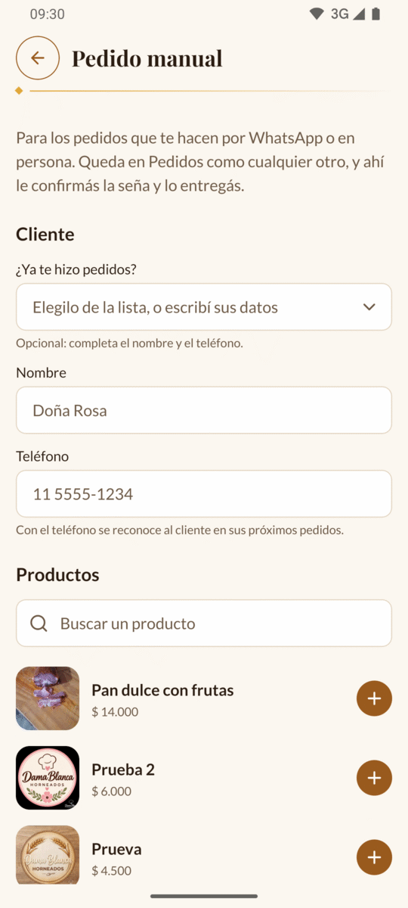
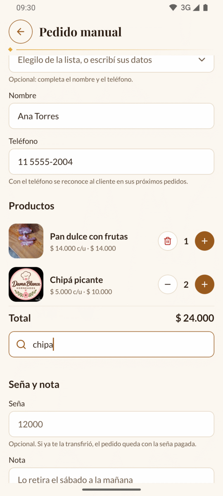
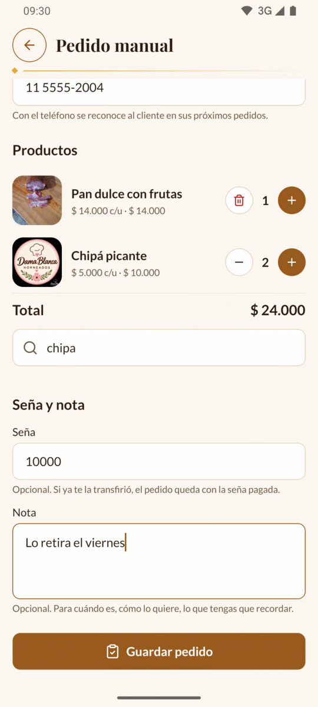
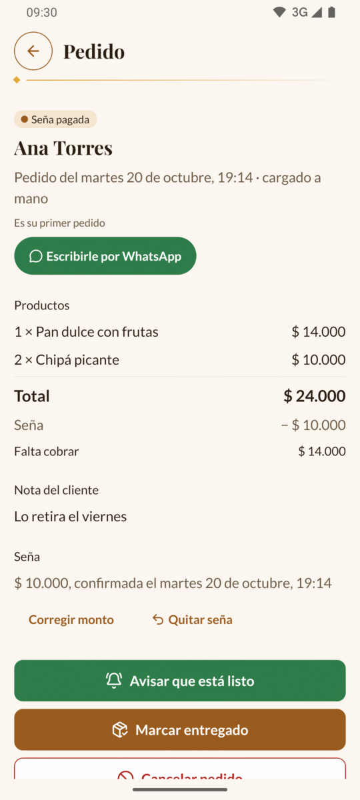

# 4. Pedido manual

No todos los pedidos llegan por la web: algunos te los hacen por WhatsApp, por
teléfono o en persona. Con **Pedido manual** los anotás en la app, así quedan en
**Pedidos** junto con los demás y cuentan en las [Métricas](08-metricas.md).

[← Volver al índice](README.md)

---

## Dónde está

Tocá la pestaña **Más** y después **Pedido manual** (es la primera opción).

---

## Cargar un pedido paso a paso

### 1. El cliente

Si el cliente ya te hizo pedidos antes (por la web o a mano), aparece el campo
**¿Ya te hizo pedidos?**:

1. Tocalo. Se abre la lista **Elegí el cliente**, con los que te compraron más
   recientemente arriba. Al lado de cada nombre está su teléfono.
2. Tocá el cliente. Se llenan solos el **Nombre** y el **Teléfono**.

Si es un cliente nuevo, escribí:

- **Nombre**: por ejemplo «Doña Rosa».
- **Teléfono**: con la característica, por ejemplo «11 5555-1234». Podés escribirlo
  con espacios, guiones o paréntesis.

> ⚠️ El teléfono tiene que llevar **la característica** (11, 351, 221…). Un número
> como «5555-1234» no alcanza: al guardar te va a decir «El teléfono no es válido».
> No hace falta poner +54 ni el 9.

> 💡 La app reconoce a cada cliente **por su teléfono**. Si escribís un teléfono que
> ya existe, el pedido queda a nombre de ese cliente, y si le cambiaste el nombre,
> se le actualiza.

### 2. Los productos

En **Productos** está la lista de todo lo que vendés, también lo que tenés pausado
(dice «Pausado», pero lo podés agregar igual).

1. Si tenés muchos, escribí parte del nombre en **Buscar un producto**. No importan
   las mayúsculas ni los acentos: «sandwich» encuentra «Sándwich de miga».
2. Tocá el **+** redondo del producto que pidió. Sube arriba, a los elegidos.
3. Para pedir más de uno, tocá **+** otra vez. Para sacar uno, tocá **−**. Cuando
   queda en 1, el **−** se convierte en un tachito: tocalo para quitar el producto.

Arriba vas viendo los productos elegidos con el precio por unidad, lo que suma cada
uno y el **Total**, con los precios de hoy.

Si tenés más de 20 productos, abajo de todo aparece **Ver más productos**.

Hay dos límites: hasta 50 unidades de un mismo producto y hasta 30 productos
distintos por pedido.

### 3. Seña y nota

- **Seña** (opcional): si el cliente ya te transfirió la seña, escribí cuánto, en
  pesos y sin puntos. El pedido queda directamente como «Seña pagada». Si todavía no
  te pagó, dejalo vacío.
- **Nota** (opcional): lo que tengas que recordar, por ejemplo «Lo retira el sábado
  a la mañana» o «Sin nueces». Hasta 300 letras.

### 4. Guardar

Tocá **Guardar pedido**. Se abre el detalle del pedido nuevo, igual que cualquier
pedido de la web: desde ahí le confirmás la seña, le avisás que está listo y lo
marcás entregado (ver [Pedidos](03-pedidos.md)).

En la lista de **Pedidos** aparece con la marca «Cargado a mano».

> ⚠️ Si salís de la pantalla antes de tocar **Guardar pedido**, lo que escribiste
> se pierde y no te avisa.

---

## Mensajes que pueden aparecer

| Mensaje | Qué hacer |
| --- | --- |
| «Escribí el nombre del cliente» | Falta el nombre (al menos 2 letras). |
| «El nombre puede tener hasta 60 letras» | Acortalo. |
| «Escribí el teléfono del cliente» | Falta el teléfono. |
| «Revisá el teléfono: por ejemplo, 11 5555-1234» | Tiene letras o le faltan números. |
| «El teléfono no es válido» | Le falta la característica (por ejemplo, el 11). |
| «Elegí al menos un producto» | No agregaste ningún producto. |
| «Un pedido puede tener hasta 30 productos distintos» | Hacé dos pedidos. |
| «Solo números, sin puntos ni comas» | En la seña escribiste un punto, una coma o una letra. |
| «No puede ser más que el total (…)» | La seña es más grande que el pedido. |
| «La nota puede tener hasta 300 letras» | Acortá la nota. |
| «Hay productos que no existen» | Borraste un producto mientras cargabas el pedido. Sacalo y volvé a guardar. |

---

Siguiente: [5. Billetera →](05-billetera.md)
