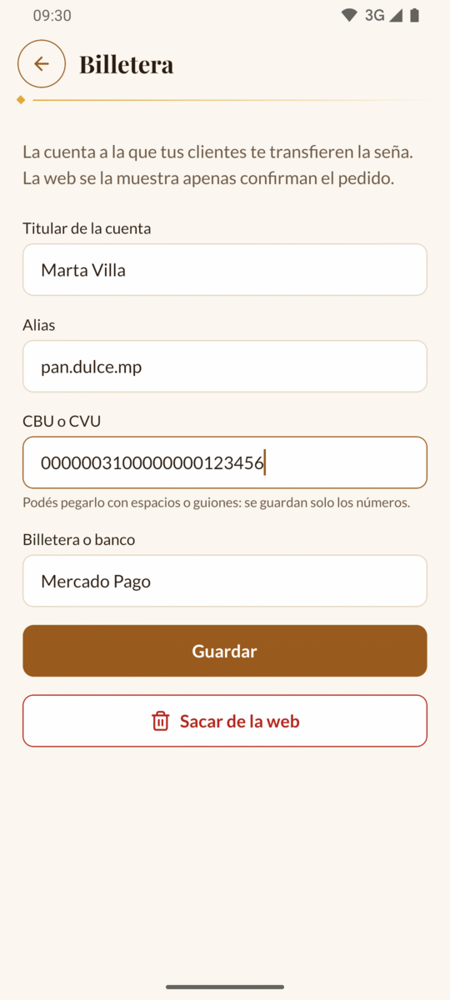
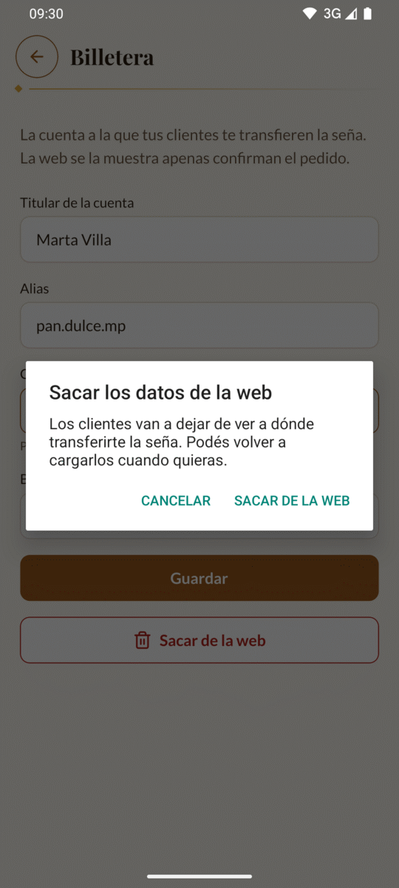

# 5. Billetera

En **Billetera** cargás la cuenta a la que tus clientes te transfieren la seña. Apenas
un cliente confirma un pedido en la web, la web le muestra estos datos para que te
pague.

[← Volver al índice](README.md)

---

## Dónde está

Tocá la pestaña **Más** y después **Billetera**.

Si todavía no cargaste nada, arriba aparece un aviso: «Todavía no cargaste los datos:
la web no muestra a dónde transferir la seña.»

---

## Cargar o cambiar tus datos

Completá los cuatro campos:

| Campo | Qué va | Ejemplo |
| --- | --- | --- |
| **Titular de la cuenta** | El nombre de quien figura en la cuenta. | Marta Villa |
| **Alias** | El alias de la cuenta: de 6 a 20 caracteres, letras sin acentos, números, puntos y guiones. | pan.dulce.mp |
| **CBU o CVU** | Los 22 números. Lo podés pegar con espacios o guiones: se guardan solo los números. | 0000003100000000123456 |
| **Billetera o banco** | Dónde está la cuenta. | Mercado Pago, Ualá, Banco Nación… |

Tocá **Guardar**. Arriba aparece en verde «Listo: la web ya muestra estos datos.».

Hay un solo juego de datos: si guardás otros, reemplazan a los anteriores.

> 💡 La app revisa que el CBU o CVU esté bien copiado (los últimos números son de
> control). Si dice «Revisá el CBU o CVU: tiene que tener 22 números y estar bien
> copiado», copialo de nuevo desde la app de tu banco o billetera.

| Mensaje | Qué hacer |
| --- | --- |
| «Escribí el nombre del titular» | Falta el titular (al menos 3 letras). |
| «Escribí el alias» | Falta el alias. |
| «De 6 a 20 caracteres: letras sin acentos, números, puntos y guiones» | El alias tiene una ñ, un acento, un espacio u otro signo. |
| «Escribí el CBU o CVU» | Falta el CBU o CVU. |
| «Escribí dónde está la cuenta: Mercado Pago, Ualá…» | Falta la billetera o el banco. |

---

## Lo que ven tus clientes

Después de confirmar el pedido, la web le muestra al cliente el bloque **Pagá la
seña**, con tu alias y tu CBU (cada uno con un botón para copiarlo), «A nombre de
Marta Villa, en Mercado Pago.» y un botón para mandarte el comprobante por WhatsApp.

Más detalles en [La web de tus clientes](11-la-web.md#pagar-la-seña).

---

## Sacar los datos de la web

Si cambiás de cuenta y todavía no tenés la nueva, o no querés que se vea ninguna:

1. Tocá **Sacar de la web** (en rojo).
2. La app avisa: «Los clientes van a dejar de ver a dónde transferirte la seña. Podés
   volver a cargarlos cuando quieras.»
3. Tocá **Sacar de la web** para confirmar, o **Cancelar**.

Sin datos cargados, la web le ofrece al cliente escribirte por WhatsApp para
coordinar cómo te paga la seña.

---

Siguiente: [6. Promos →](06-promos.md)
