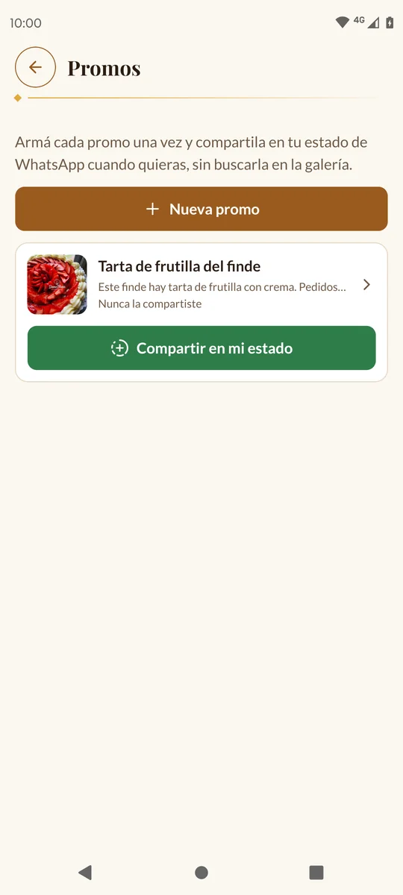
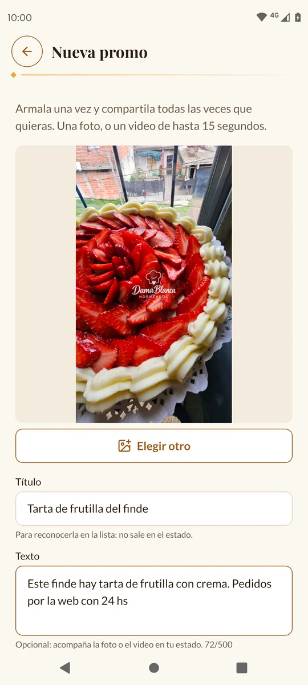
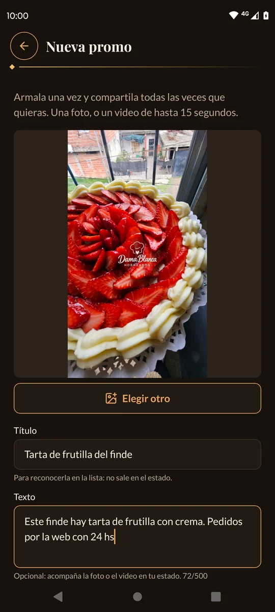
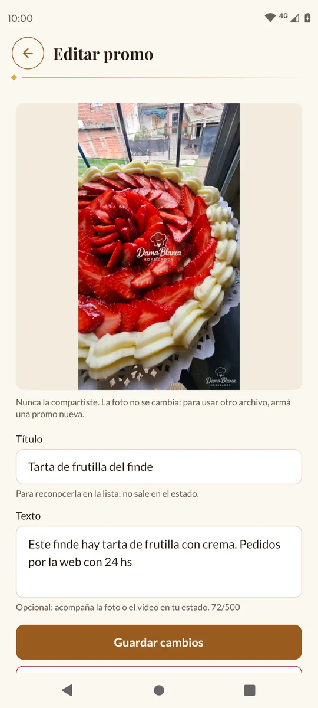
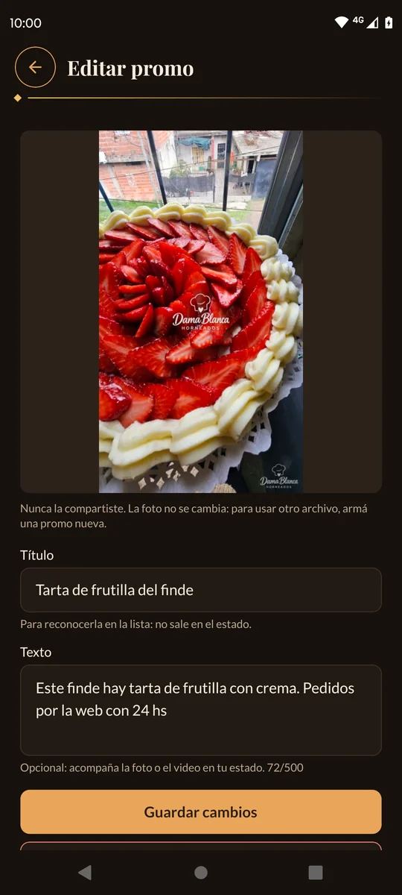
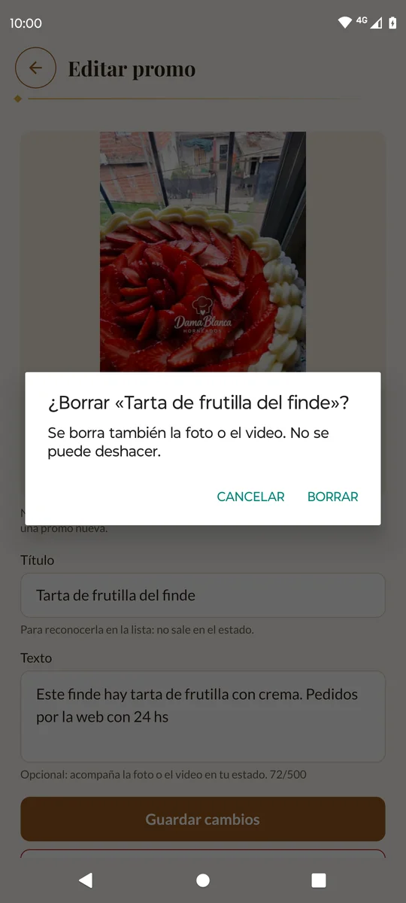
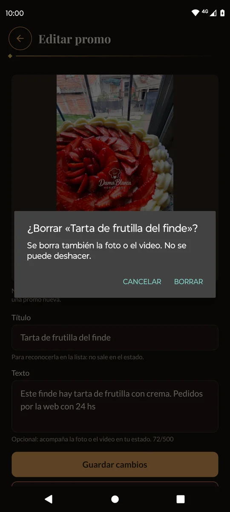

# 6. Promos

**Promos** es tu biblioteca de fotos y videos para el estado de WhatsApp. Armás cada
promo una vez y la compartís todas las veces que quieras, sin buscarla en la galería.

Las promos son solo tuyas: no aparecen en la web.

[← Volver al índice](README.md)

---

## Dónde está

Tocá la pestaña **Más** y después **Promos**.

Cada promo muestra su foto (los videos tienen un ▶ y cuánto duran), el título, el
texto y cuántas veces la compartiste, por ejemplo «Compartida 3 veces · la última,
ayer».

---

## Armar una promo nueva

1. Tocá **Nueva promo**.
2. Tocá **Elegir foto o video** y elegí una foto o un video de tu galería.
   - Los videos pueden durar **hasta 15 segundos**.
   - Para cambiar el archivo antes de guardar, tocá **Elegir otro**.
3. En **Título**, escribí un nombre para reconocerla, por ejemplo «2x1 en
   medialunas». El título **no** sale en el estado.
4. En **Texto** (opcional), escribí lo que querés que acompañe la foto en el estado,
   por ejemplo «Hoy 2x1 en medialunas. Hasta las 12». Hasta 500 caracteres.
5. Tocá **Guardar promo**. Mientras sube, el botón dice «Subiendo…».

> ⚠️ Un video tarda un poco más en subir. **No cierres la app** hasta que vuelva a la
> lista.

Si el archivo no sirve, la app te avisa en amarillo:

| Mensaje | Qué hacer |
| --- | --- |
| «El video dura 25 segundos y puede durar hasta 15. Recortalo en la galería y elegilo de nuevo.» | Recortá el video en la galería del celular y volvé a elegirlo. |
| «El video pesa más de 50 MB. Grabalo en menor calidad (1080p) o recortalo.» | Grabalo de nuevo en menor calidad o hacelo más corto. |
| «La foto pesa más de 10 MB. Elegí otra.» | Elegí otra foto. |

---

## Compartir en tu estado de WhatsApp

1. En la lista, tocá el botón verde **Compartir en mi estado** de la promo.
2. Se abre WhatsApp con la foto o el video ya cargado y el texto de la promo. Al
   final del texto se agrega solo el link a tu web: «Hacé tu pedido acá 👉 …».
3. En WhatsApp, elegí **Mi estado** y tocá **Enviar**.

La primera vez que compartís una promo tarda un poco, porque la baja al celular.
Las siguientes veces es al instante.

> 💡 La app cuenta una vez cada vez que tocás **Compartir en mi estado**, aunque
> después no la publiques.

Si dice «No encontramos WhatsApp en este celular.», instalá WhatsApp (el común, no
WhatsApp Business).

---

## Cambiar el título o el texto

Tocá la promo en la lista. Se abre **Editar promo**: cambiá el título o el texto y
tocá **Guardar cambios**.

La foto o el video no se cambian: para usar otro archivo, armá una promo nueva.

---

## Borrar una promo

1. Tocá la promo en la lista.
2. Tocá **Borrar promo** (en rojo).
3. La app pregunta «¿Borrar «2x1 en medialunas»?» y avisa «Se borra también la foto
   o el video. No se puede deshacer.».
4. Tocá **Borrar** para confirmar, o **Cancelar**.

> 💡 Borrar las promos viejas libera lugar en la [Memoria](09-memoria.md).

---

Siguiente: [7. Insumos →](07-insumos.md)
