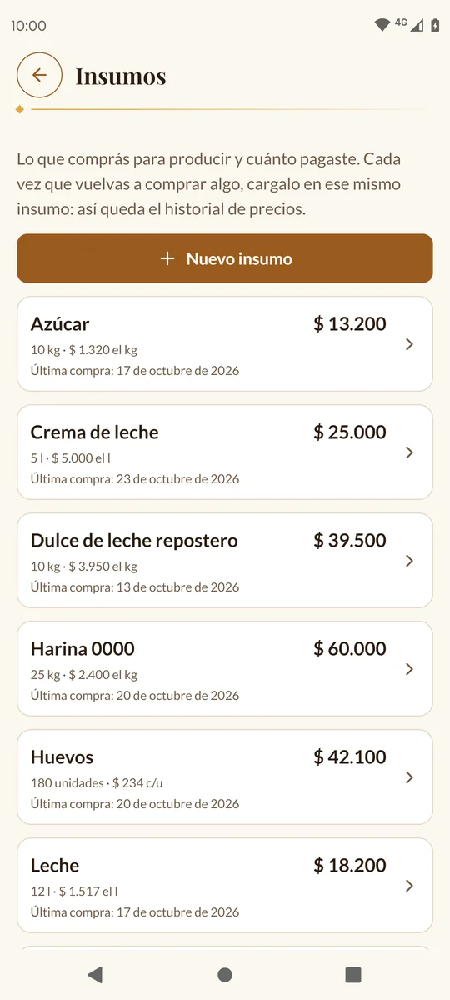
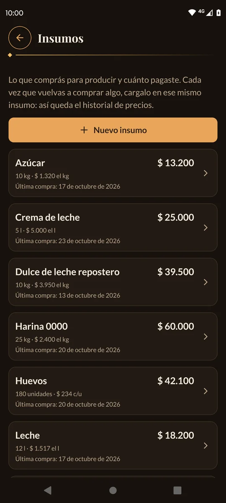
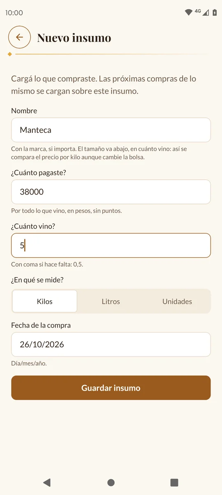
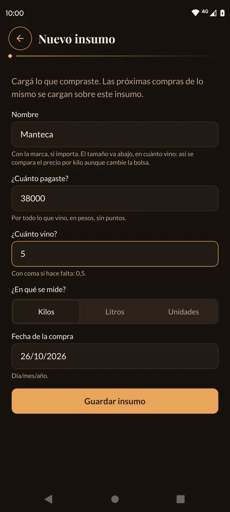
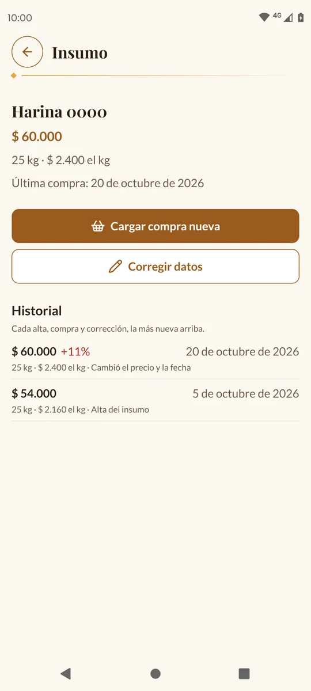
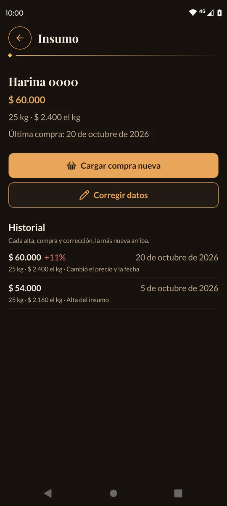
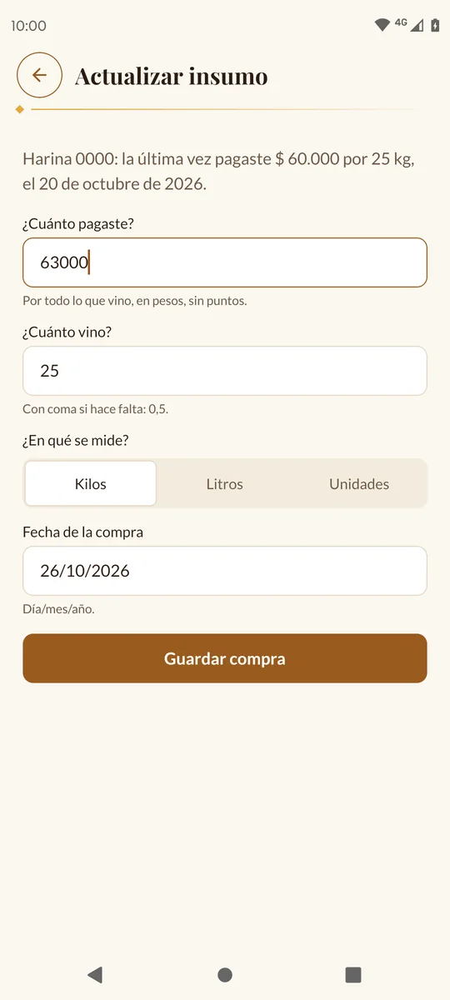
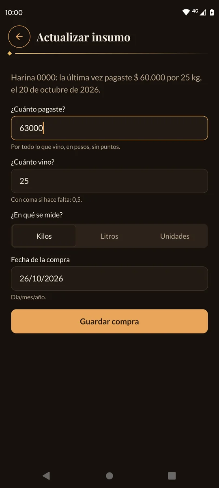

# 7. Insumos

En **Insumos** anotás lo que comprás para producir (harina, manteca, azúcar, cajas…)
y cuánto pagaste. Así sabés cuánto gastás, y la app te avisa cuando algo aumenta.

[← Volver al índice](README.md)

---

## La idea

Cada cosa que comprás es **un insumo**, y cada vez que la volvés a comprar, cargás
**la compra nueva en ese mismo insumo**. Así se arma el historial de precios.

Por ejemplo: creás el insumo «Harina 0000» con la compra de este mes; el mes que
viene, abrís «Harina 0000» y tocás **Cargar compra nueva**. No crees otro insumo
«Harina 0000 noviembre».

Los insumos no se pueden borrar.

---

## La lista de insumos

Tocá la pestaña **Más** y después **Insumos**.

Cada insumo muestra lo último que pagaste, cuánto vino y cuánto sale el kilo (o el
litro, o la unidad), y la fecha de la última compra. Están ordenados por nombre.

---

## Cargar un insumo nuevo

1. Tocá **Nuevo insumo**.
2. Completá los datos:

   | Campo | Qué va | Ejemplo |
   | --- | --- | --- |
   | **Nombre** | Qué es, con la marca si importa. **Sin el tamaño**: el tamaño va en «¿Cuánto vino?». | Harina 0000 |
   | **¿Cuánto pagaste?** | Lo que pagaste por todo, en pesos y sin puntos. | 54000 |
   | **¿Cuánto vino?** | La cantidad. Con coma si hace falta: 0,5. | 25 |
   | **¿En qué se mide?** | **Kilos**, **Litros** o **Unidades**. | Kilos |
   | **Fecha de la compra** | Día/mes/año. Viene con la fecha de hoy. | 05/10/2026 |

3. Tocá **Guardar insumo**. Se abre el insumo nuevo.

> 💡 ¿Por qué el tamaño va aparte? Porque así la app compara el precio **por kilo**
> aunque un mes compres la bolsa de 25 kg y otro mes la de 10 kg.

Si ya existe un insumo con ese nombre, la app te avisa: «Ya existe un insumo con ese
nombre: «…». Para cargar una compra nueva, actualizá ese».

---

## Ver un insumo

Tocá un insumo de la lista. Vas a ver lo último que pagaste, el precio por kilo
(o litro, o unidad), la fecha, los botones **Cargar compra nueva** y **Corregir
datos**, y el **Historial**.

En el **Historial** está cada alta, compra y corrección, la más nueva arriba. Al lado
del precio dice cuánto cambió respecto de la anterior:

- **En rojo con +** (por ejemplo «+11%»): aumentó.
- **En verde con −** (por ejemplo «−8%»): bajó.

La comparación es por kilo, litro o unidad: si pagaste más pero vino más cantidad,
puede bajar igual.

---

## Cargar una compra nueva

Cuando volvés a comprar lo mismo:

1. Abrí el insumo y tocá **Cargar compra nueva**.
2. Arriba te recuerda cuánto pagaste la última vez.
3. Escribí **¿Cuánto pagaste?** esta vez. La cantidad y la unidad vienen como la
   última vez (cambialas si compraste otro tamaño) y la fecha es la de hoy.
4. Tocá **Guardar compra**.

---

## Corregir un dato mal cargado

Si te equivocaste en un precio, una cantidad, la fecha o el nombre:

1. Abrí el insumo y tocá **Corregir datos**.
2. Cambiá lo que esté mal.
3. Tocá **Guardar cambios**.

La corrección también queda en el historial.

> 💡 Los insumos que cargaste antes de que existiera «¿Cuánto vino?» muestran un aviso
> azul: «No dice cuánto vino en la compra…». Tocá **Corregir datos**, completá la
> cantidad y, si el tamaño estaba en el nombre («HARINA 20 KG»), dejá solo «Harina».

---

## Mensajes que pueden aparecer

| Mensaje | Qué hacer |
| --- | --- |
| «Escribí la fecha así: 15/10/2026» | La fecha está mal escrita o no existe (por ejemplo 30/02). |
| «No puede ser posterior a hoy» | La fecha es de un día que todavía no pasó. |
| «Solo números, sin puntos ni comas» | En el precio escribiste un punto o una coma. |
| «Solo números: 25, o 0,5» | En la cantidad hay letras u otros signos. |
| «Es la misma compra que la última: mismo precio, cantidad y fecha.» | No cambiaste nada respecto de la última compra. |
| «No cambiaste nada.» | En **Corregir datos** no modificaste ningún campo. |

---

Siguiente: [8. Métricas →](08-metricas.md)
