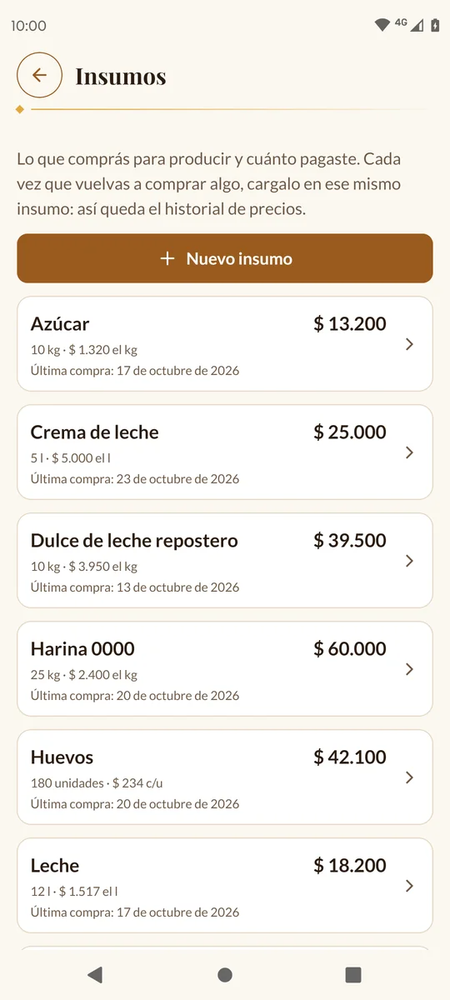
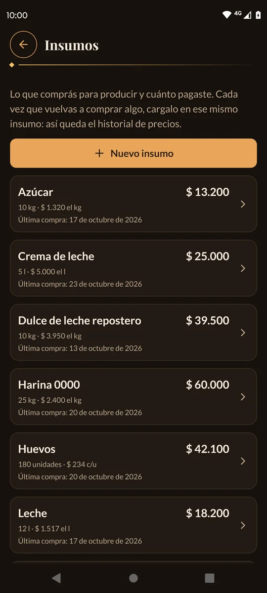
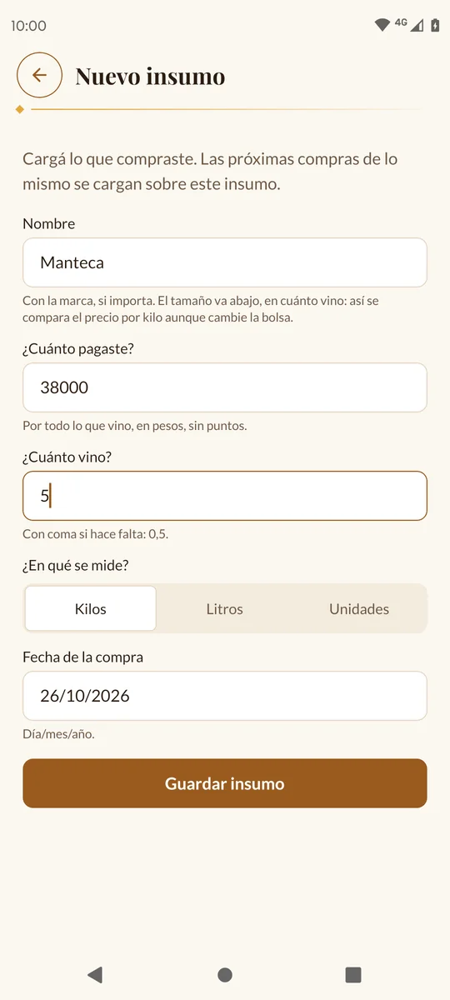
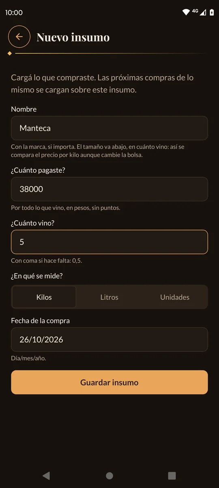
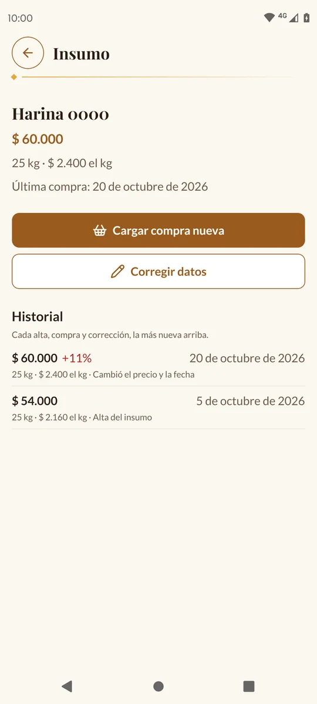
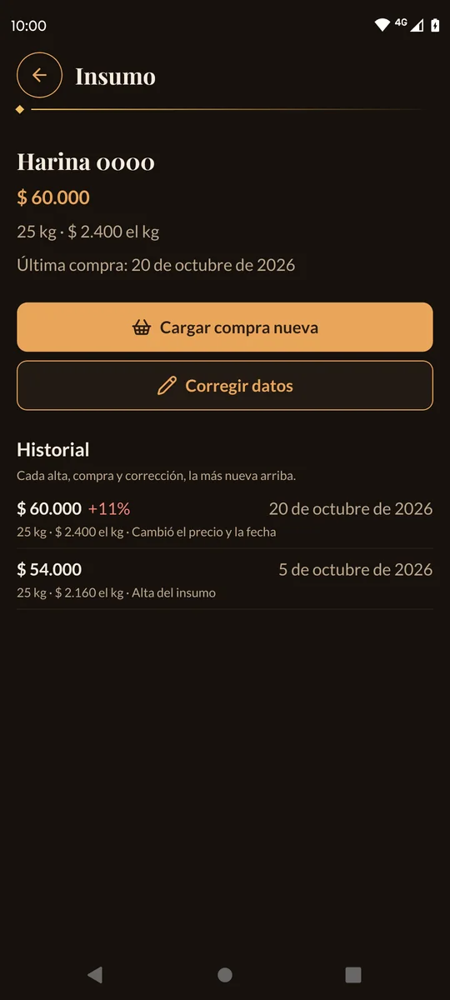
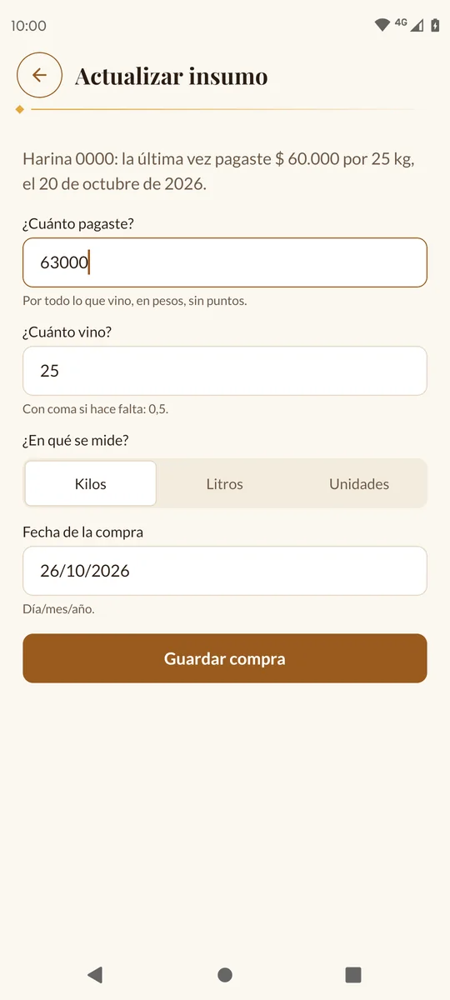
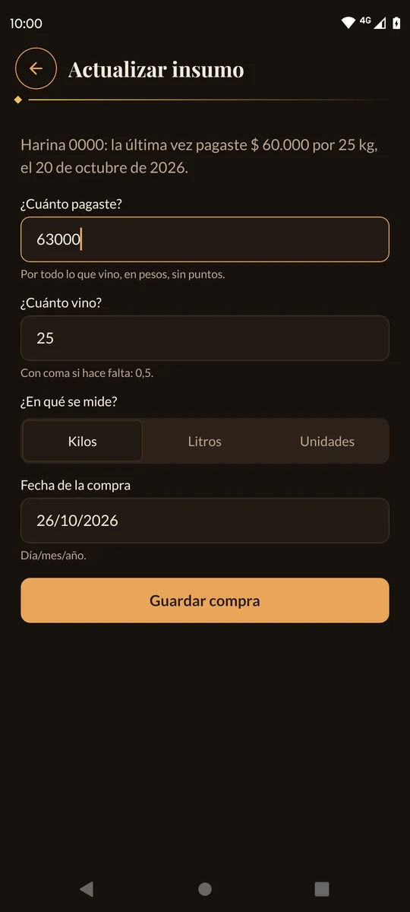

# 7. Insumos y recetas

En **Insumos** anotás lo que comprás para producir (harina, manteca, azúcar, cajas…)
y cuánto pagaste. Así sabés cuánto gastás, y la app te avisa cuando algo aumenta.

Con los insumos cargados, cada producto puede tener **su receta**: con qué se hace y
cuántas unidades salen. La app calcula cuánto te cuesta hacer cada unidad, cuánto
necesitás para un pedido grande y a qué precio conviene venderlo
([Las recetas](#las-recetas)).

[← Volver al índice](README.md)

---

## La idea

Cada cosa que comprás es **un insumo**, y cada vez que la volvés a comprar, cargás
**la compra nueva en ese mismo insumo**. Así se arma el historial de precios.

Por ejemplo: creás el insumo «Harina 0000» con la compra de este mes; el mes que
viene, abrís «Harina 0000» y tocás **Cargar compra nueva**. No crees otro insumo
«Harina 0000 noviembre».

Los insumos no se pueden borrar.

---

## La lista de insumos

Tocá la pestaña **Más** y después **Insumos**.

Cada insumo muestra lo último que pagaste, cuánto vino y cuánto sale el kilo (o el
litro, o la unidad), y la fecha de la última compra. Están ordenados por nombre.

---

## Cargar un insumo nuevo

1. Tocá **Nuevo insumo**.
2. Completá los datos:

   | Campo | Qué va | Ejemplo |
   | --- | --- | --- |
   | **Nombre** | Qué es, con la marca si importa. **Sin el tamaño**: el tamaño va en «¿Cuánto vino?». | Harina 0000 |
   | **¿Cuánto pagaste?** | Lo que pagaste por todo, en pesos y sin puntos. | 54000 |
   | **¿Cuánto vino?** | La cantidad. Con coma si hace falta: 0,5. | 25 |
   | **¿En qué se mide?** | **Kilos**, **Litros** o **Unidades**. | Kilos |
   | **Fecha de la compra** | Día/mes/año. Viene con la fecha de hoy. | 05/10/2026 |

3. Tocá **Guardar insumo**. Se abre el insumo nuevo.

> 💡 ¿Por qué el tamaño va aparte? Porque así la app compara el precio **por kilo**
> aunque un mes compres la bolsa de 25 kg y otro mes la de 10 kg.

Si ya existe un insumo con ese nombre, la app te avisa: «Ya existe un insumo con ese
nombre: «…». Para cargar una compra nueva, actualizá ese».

---

## Ver un insumo

Tocá un insumo de la lista. Vas a ver lo último que pagaste, el precio por kilo
(o litro, o unidad), la fecha, los botones **Cargar compra nueva** y **Corregir
datos**, y el **Historial**.

En el **Historial** está cada alta, compra y corrección, la más nueva arriba. Al lado
del precio dice cuánto cambió respecto de la anterior:

- **En rojo con +** (por ejemplo «+11%»): aumentó.
- **En verde con −** (por ejemplo «−8%»): bajó.

La comparación es por kilo, litro o unidad: si pagaste más pero vino más cantidad,
puede bajar igual.

---

## Cargar una compra nueva

Cuando volvés a comprar lo mismo:

1. Abrí el insumo y tocá **Cargar compra nueva**.
2. Arriba te recuerda cuánto pagaste la última vez.
3. Escribí **¿Cuánto pagaste?** esta vez. La cantidad y la unidad vienen como la
   última vez (cambialas si compraste otro tamaño) y la fecha es la de hoy.
4. Tocá **Guardar compra**.

---

## Corregir un dato mal cargado

Si te equivocaste en un precio, una cantidad, la fecha o el nombre:

1. Abrí el insumo y tocá **Corregir datos**.
2. Cambiá lo que esté mal.
3. Tocá **Guardar cambios**.

La corrección también queda en el historial.

> 💡 Los insumos que cargaste antes de que existiera «¿Cuánto vino?» muestran un aviso
> azul: «No dice cuánto vino en la compra…». Tocá **Corregir datos**, completá la
> cantidad y, si el tamaño estaba en el nombre («HARINA 20 KG»), dejá solo «Harina».

---

## Las recetas

La receta de un producto dice **con qué insumos se hace** y **cuántas unidades
salen**. Con eso, la app calcula cuánto te cuesta hacer cada unidad, usando **el
último precio que pagaste** de cada insumo.

Las recetas no están en **Más**: se abren **desde el producto**. En **Productos**,
tocá el producto y después **Agregar receta** (si todavía no tiene) o **Ver receta**.

> 💡 El costo es **lo que gastás en ingredientes**. No cuenta el gas, la luz, las
> cajas que no cargaste en la receta ni tu tiempo: tenelo en cuenta al ponerle el
> precio.

### Cargar la receta

1. Abrí el producto y tocá **Agregar receta**. Se abre **Cargar receta**.
2. En **¿Cuántas unidades salen?** escribí cuántas salen de una receta. En
   unidades, no en docenas: si salen 4 docenas, poné 48.
3. En **Ingrediente 1**, tocá **Elegí un insumo** y elegí uno de tu lista.
4. Escribí cuánto lleva. Debajo del campo te dice cómo se lee lo que escribiste: con
   1500 dice «1 kilo y medio».
5. Para sumar otro, tocá **Agregar ingrediente** y repetí. Para sacar uno, tocá
   **Quitar** debajo de él.
6. Tocá **Guardar receta**. Se abre la receta con lo que cuesta.

Cómo se escribe la cantidad depende de cómo compraste el insumo:

| Si lo compraste en… | En la receta va en… | Ejemplo |
| --- | --- | --- |
| **Kilos** o **Litros** | **Gramos**: 1000 es 1 kilo (o 1 litro). | Harina: 1000 |
| **Unidades** | **Unidades**, enteras. | Huevos: 3 |

**Algo que no se compra** (el agua, por ejemplo) está al final de la lista de
insumos. Elegilo, escribí qué es en **¿Qué es?** y si se mide en **Gramos** o en
**Unidades**. Cuesta $ 0, pero queda anotado en la receta.

> 💡 En la lista solo aparecen los insumos que dicen **cuánto vino** en la compra:
> sin eso, la app no sabe cuánto cuesta un gramo. Si falta alguno, arriba hay un
> aviso azul. Abrí ese insumo en **Más → Insumos**, tocá **Corregir datos** y
> completá **¿Cuánto vino?** ([Corregir un dato mal cargado](#corregir-un-dato-mal-cargado)).

### Ver la receta

Arriba de todo ves:

- **Cuánto te cuesta cada unidad**, grande. Por ejemplo, «$ 280 cada unidad».
- Cuántas salen y cuánto cuesta toda la receta: «Rinde 50 unidades · Toda la
  receta: $ 14.000».
- A cuánto lo vendés y cuánto te queda: «Lo vendés a $ 500 · Ganás $ 220 por
  unidad». Si lo vendés por menos de lo que te cuesta, dice «Perdés…».

Debajo, los **Ingredientes**, cada uno con cuánto lleva y cuánto cuesta en la
receta. Lo que no se compra dice «No se compra».

El costo se calcula siempre con **el último precio** de cada insumo: cuando cargás
una compra más cara en **Insumos**, el costo de la receta sube solo. No tenés que
tocar la receta.

Abajo están los botones **Realizar receta**, **Editar receta**, **Actualizar
precio** y **Borrar receta**.

Si arriba aparece «No se pudo calcular lo que cuesta algún ingrediente: revisá sus
insumos.», un ingrediente dice «Sin costo»: revisá ese insumo en **Más → Insumos**.
Mientras tanto, **Actualizar precio** no se puede tocar.

### Realizar la receta

Para cuando te piden una cantidad que no es la de la receta:

1. En la receta, tocá **Realizar receta**.
2. En **¿Cuántas unidades tenés que hacer?** escribí cuántas te pidieron.
3. La app te dice cuántas veces tenés que hacer la receta y cuánto necesitás de cada
   ingrediente. Al final, cuánto vas a gastar: «En ingredientes: $ …».

Por ejemplo: si la receta rinde 12 chipás con 1 kilo de harina y te piden 24, dice
«2 recetas» y «2 kilos» de harina.

Si no da justo, aparece «No da justo con la receta: lo que no daba entero está
redondeado para arriba, así no te falta.»

### Ponerle el precio desde la receta

La app te ayuda a calcular el precio de venta a partir de lo que te cuesta:

1. En la receta, tocá **Actualizar precio**. Arriba dice cuánto te sale cada unidad
   en ingredientes y a cuánto lo vendés hoy.
2. En **¿Por cuánto lo multiplicás?** elegí **×2**, **×3**, **×4** u **Otro**. Con
   **Otro**, escribí el número: más que 1 y hasta 10, con un decimal si querés
   (por ejemplo 2,5). Lo que te cuesta, multiplicado: lo que sobra es tu ganancia.
3. En **¿Lo redondeás?** elegí **No** o uno de los precios redondos que te propone.
   Siempre redondea para arriba: nunca ganás menos de lo que elegiste.
4. Debajo ves el **Precio de venta**, la cuenta (por ejemplo «$ 280 ×3 = $ 840,
   redondeado para arriba») y cuánto ganás por unidad.
5. Tocá **Actualizar precio**. Se abre **¿Cambiar el precio?**, con el precio de hoy
   tachado, el nuevo y cuánto sube o baja (por ejemplo «Sube $ 2.000 · +8%»).
6. Si está bien, tocá **Cambiar a $ …**. Si no, **Cancelar**.

El precio del producto cambia enseguida, también en la web. Es lo mismo que cambiarlo
desde **Editar**: los pedidos que ya estaban hechos guardan el precio de antes.

> ⚠️ Si el precio nuevo es **más bajo** que el de hoy, la diferencia aparece en
> ámbar: miralo dos veces antes de confirmar.

### Editar o borrar la receta

- **Editar receta**: se abre el mismo formulario con lo que cargaste. Cambiá lo que
  haga falta y tocá **Guardar cambios**.
- **Borrar receta**: la app pregunta «¿Borrar la receta?». **El producto no se
  toca**: solo se borra con qué se hace y lo que cuesta. Tocá **Borrar** para
  confirmar.

---

## Mensajes que pueden aparecer

| Mensaje | Qué hacer |
| --- | --- |
| «Escribí la fecha así: 15/10/2026» | La fecha está mal escrita o no existe (por ejemplo 30/02). |
| «No puede ser posterior a hoy» | La fecha es de un día que todavía no pasó. |
| «Solo números, sin puntos ni comas» | En el precio escribiste un punto o una coma. |
| «Solo números: 25, o 0,5» | En la cantidad hay letras u otros signos. |
| «Es la misma compra que la última: mismo precio, cantidad y fecha.» | No cambiaste nada respecto de la última compra. |
| «No cambiaste nada.» | En **Corregir datos** no modificaste ningún campo. |
| «Un insumo no dice cuánto trae la bolsa y no se puede elegir…» | En la receta: completá **¿Cuánto vino?** de ese insumo con **Corregir datos**. |
| «No se pudo calcular lo que cuesta algún ingrediente…» | En la receta: revisá el insumo del ingrediente que dice «Sin costo». |
| «Con lo que cuesta, el precio da $ 0: ponelo a mano desde Editar producto.» | El costo es tan bajo que no da un precio: cambialo desde el producto, con **Editar**. |

---

Siguiente: [8. Métricas →](08-metricas.md)
