# 8. Métricas

**Métricas** muestra los números de tu panadería: cuánto vendiste, cuánto gastaste,
cuánto te quedó, qué se vende más, cómo llegan los pedidos y si tus clientes vuelven.

[← Volver al índice](README.md)

---

## Dónde está

Tocá la pestaña **Más** y después **Métricas**. Se abre un menú con seis pantallas:

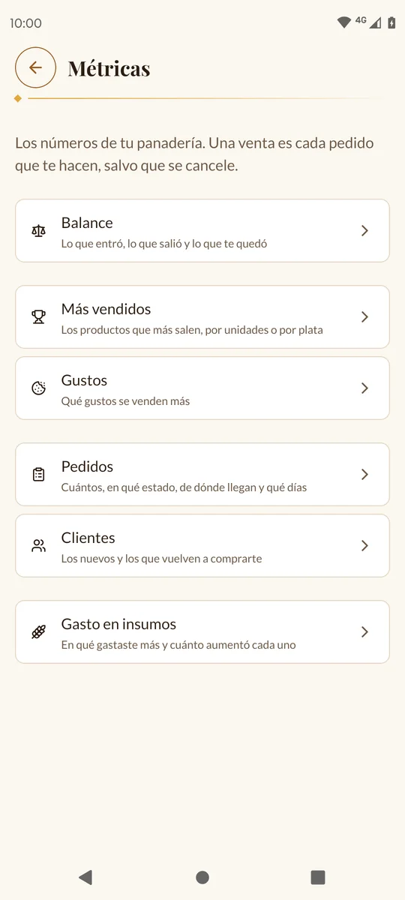
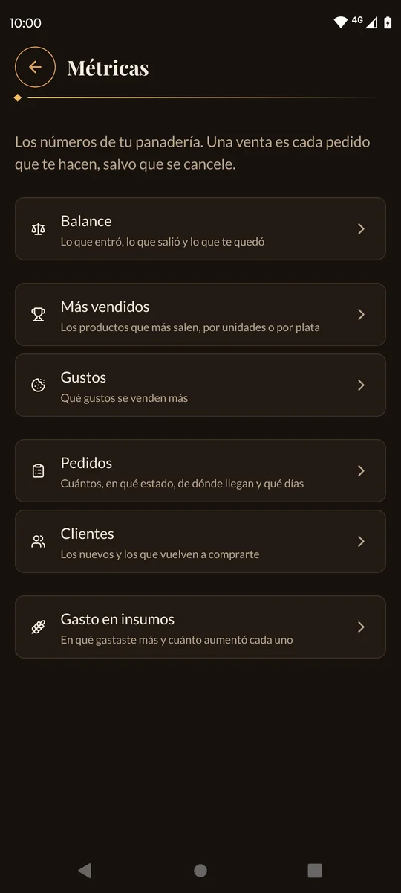

| Pantalla | Qué muestra |
| --- | --- |
| **Balance** | Lo que entró, lo que salió y lo que te quedó |
| **Más vendidos** | Los productos que más salen, por unidades o por plata |
| **Gustos** | Qué gustos se venden más |
| **Pedidos** | Cuántos, en qué estado, de dónde llegan y qué días |
| **Clientes** | Los nuevos y los que vuelven a comprarte |
| **Gasto en insumos** | En qué gastaste más y cuánto aumentó cada uno |

---

## Cómo se cuenta

Antes de mirar los números, conviene saber qué cuenta la app:

- **Una venta es cada pedido que te hacen, salvo que se cancele.** Cuentan los que
  están «Esperando la seña», «Seña pagada» y «Entregado». Si después cancelás un
  pedido, deja de contar solo.
- **Las ventas cuentan el día en que te hicieron el pedido**, no el día en que lo
  entregaste.
- **Lo que gastaste** son las compras que cargaste en [Insumos](07-insumos.md), el día
  de cada compra.
- **Un cliente es un número de teléfono**: si alguien pide dos veces con el mismo
  teléfono, es el mismo cliente aunque escriba el nombre distinto.

---

## Elegir el período

Arriba de cada pantalla podés elegir qué período ver:

| Opción | Qué abarca |
| --- | --- |
| **7 días** | Hoy y los 6 días anteriores |
| **Este mes** | Desde el 1 del mes hasta hoy (es la que aparece al entrar) |
| **Este año** | Desde el 1 de enero hasta hoy |
| **Siempre** | Todo, desde el principio |

Al cambiar de período, los números anteriores se ven más claros con una ruedita
encima hasta que llegan los nuevos.

Los números se actualizan solos cuando confirmás una seña, entregás o cancelás un
pedido, cargás un pedido manual o una compra de insumos. Los **pedidos nuevos de la
web** no: tirá la pantalla para abajo para actualizarla.

---

## Balance

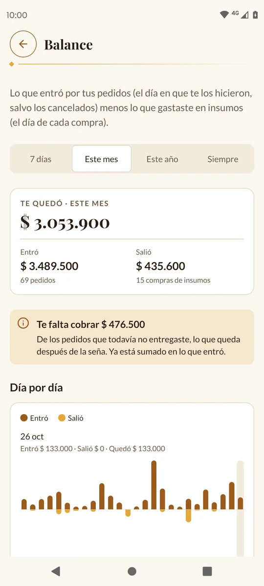
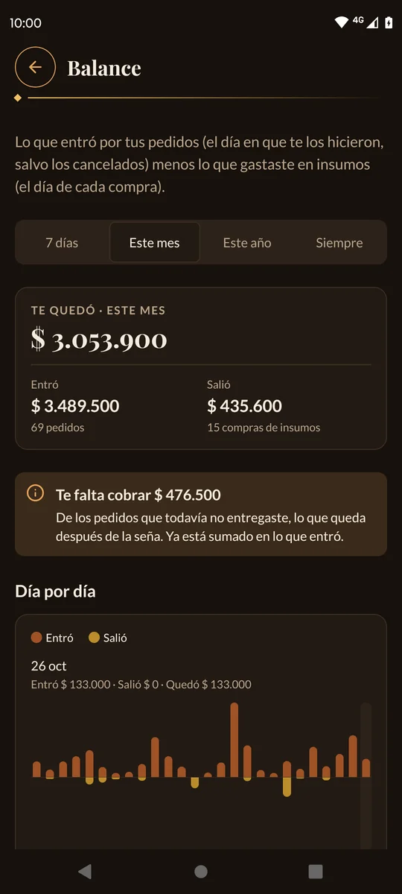

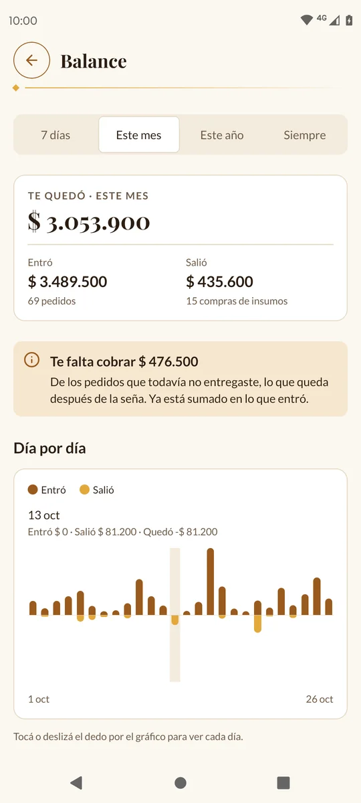
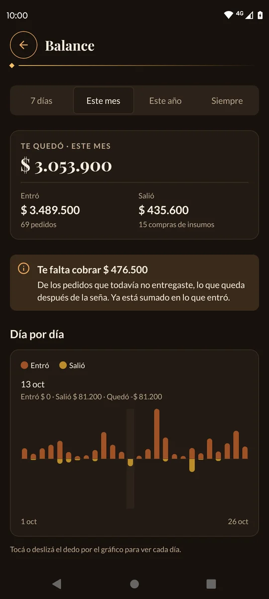

- **Te quedó**: lo que entró menos lo que salió. Si es negativo, aparece en rojo.
- **Entró**: el total de las ventas del período, y cuántos pedidos son.
- **Salió**: el total de las compras de insumos, y cuántas compras son.
- **Te falta cobrar**: de los pedidos que todavía no entregaste, lo que queda después
  de la seña. Ya está sumado en lo que entró.

> 💡 Si un mes compraste mucha harina, puede quedar en negativo: lo que sobra para el
> mes que viene no se descuenta.

**El gráfico** muestra lo que entró **hacia arriba** de la línea y lo que salió
**hacia abajo**, día por día (con **7 días** y **Este mes**) o mes por mes (con
**Este año** y **Siempre**). **Tocá o deslizá el dedo** por el gráfico: arriba se
lee lo de ese día o mes, por ejemplo «Entró $ 95.000 · Salió $ 0 · Quedó
$ 95.000».

---

## Más vendidos

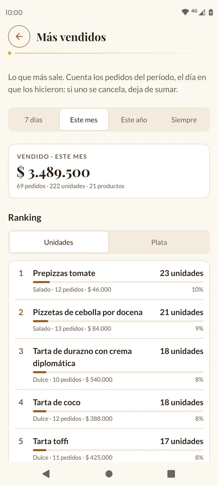
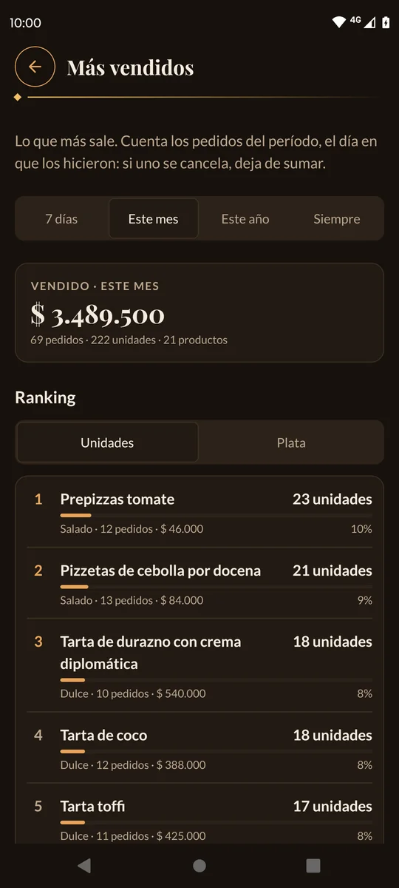

Arriba, el total vendido en el período, con cuántos pedidos, unidades y productos.

Abajo, el **Ranking**. Elegí cómo ordenarlo:

- **Unidades**: los que más cantidad vendiste.
- **Plata**: los que más plata te dejaron.

Cada fila muestra el producto, cuánto vendiste, el gusto, en cuántos pedidos estuvo y
qué porcentaje del total es. Se ven los 10 primeros; tocá **Ver los N productos**
para ver todos.

> 💡 Los productos se agrupan **por nombre**: si borrás el pan dulce y lo volvés a
> crear con el mismo nombre la temporada siguiente, sus ventas se suman.

---

## Gustos

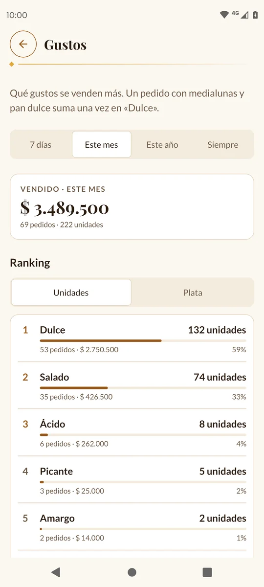
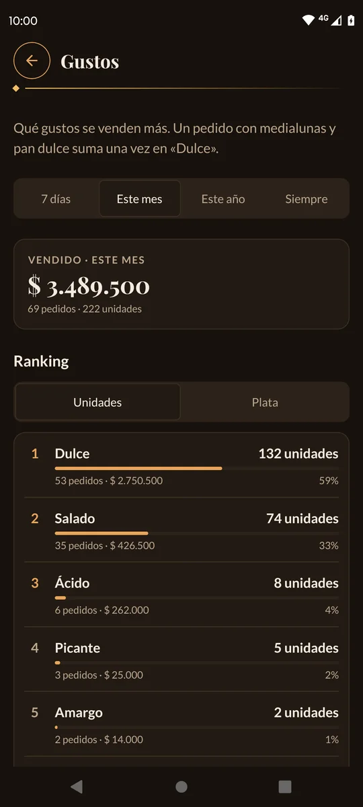

Lo mismo que **Más vendidos**, pero por gusto: Dulce, Salado, Picante… Abajo dice qué
gustos no tuvieron ventas en el período.

---

## Pedidos

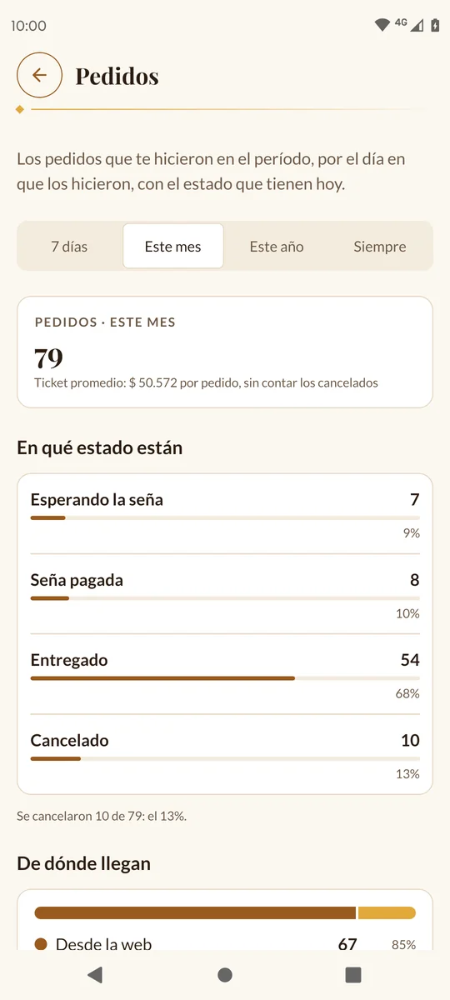
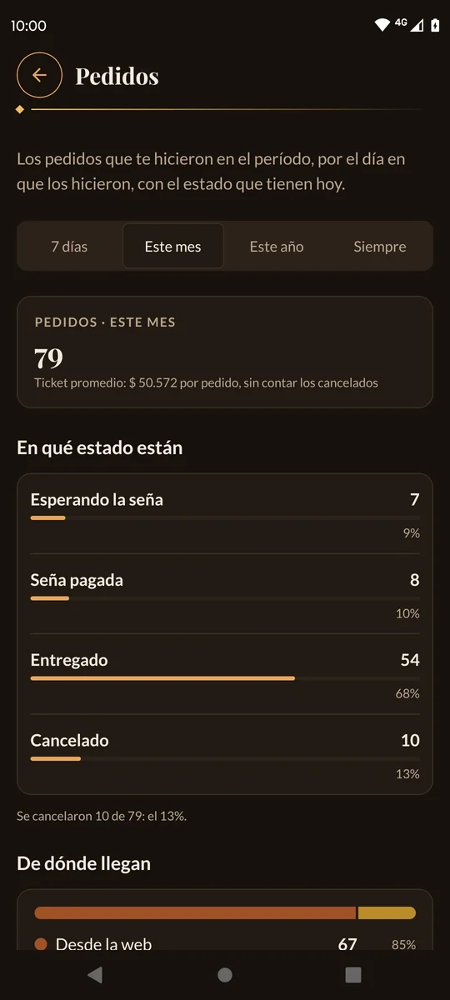

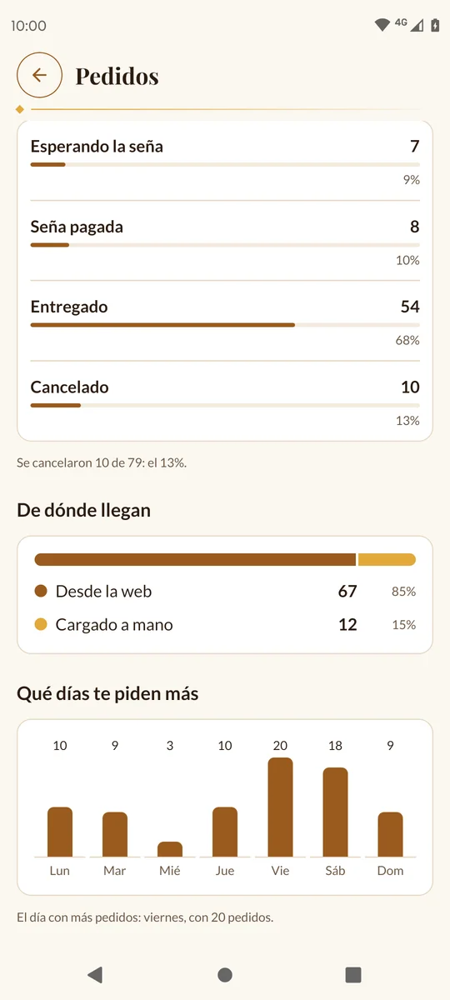
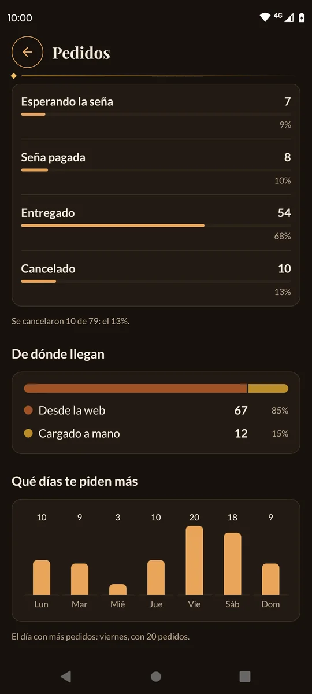

- **Cuántos pedidos** te hicieron en el período (contando los cancelados) y el
  **ticket promedio**: cuánto gasta en promedio cada pedido, sin contar los
  cancelados.
- **En qué estado están** hoy: Esperando la seña, Seña pagada, Entregado y Cancelado,
  con cuántos se cancelaron.
- **De dónde llegan**: **Desde la web** o **Cargado a mano**.
- **Qué días te piden más**: un gráfico de lunes a domingo, y abajo el día con más
  pedidos.

---

## Clientes

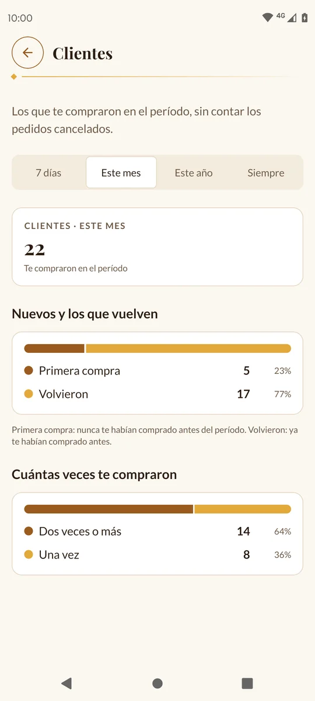
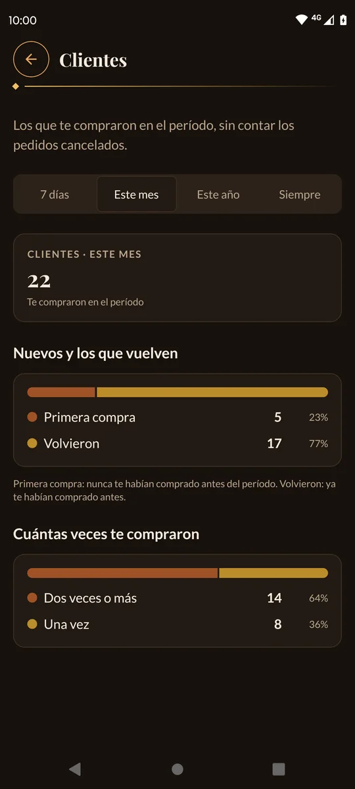

- **Cuántos clientes** distintos te compraron en el período.
- **Nuevos y los que vuelven**: **Primera compra** (nunca te habían comprado antes)
  contra **Volvieron** (ya te habían comprado antes del período). Con **Siempre**,
  todos son nuevos, porque no hay un «antes».
- **Cuántas veces te compraron**: **Dos veces o más** contra **Una vez**, dentro del
  período.

---

## Gasto en insumos

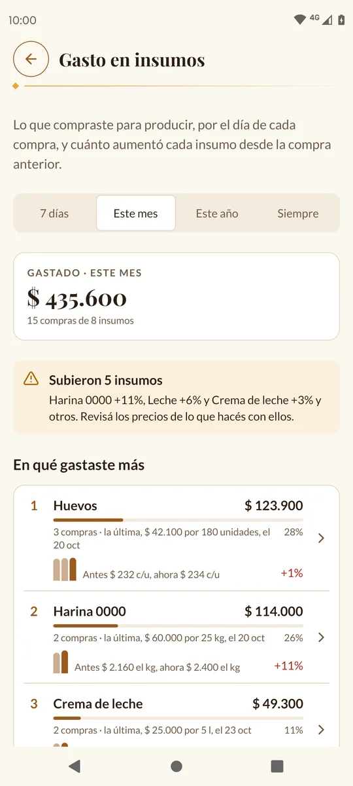
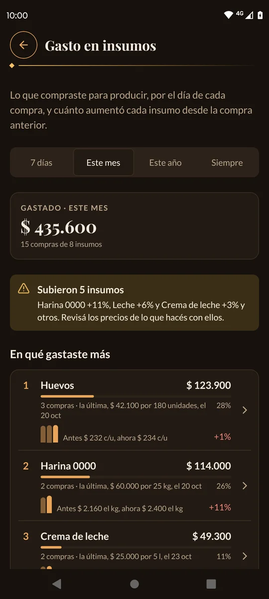

- **Gastado**: el total de las compras de insumos del período.
- **El aviso amarillo** («Subió 1 insumo», «Subieron 3 insumos»): qué insumos
  aumentaron en la última compra y cuánto. Te recuerda: «Revisá los precios de lo que
  hacés con ellos.»
- **En qué gastaste más**: cada insumo con lo que gastaste, cuántas compras hiciste y
  cómo cambió el precio desde la compra anterior: **en rojo** si subió («+11%»), **en
  verde** si bajó («−8%»).

Tocá un insumo para ver todo su historial de precios.

---

Siguiente: [9. Memoria →](09-memoria.md)
