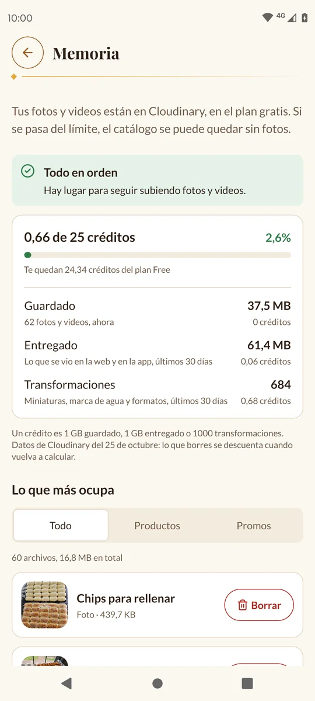
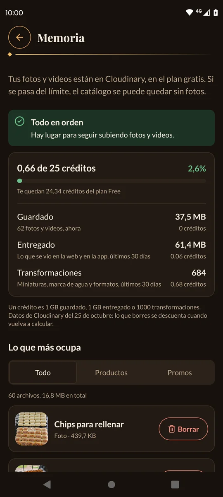
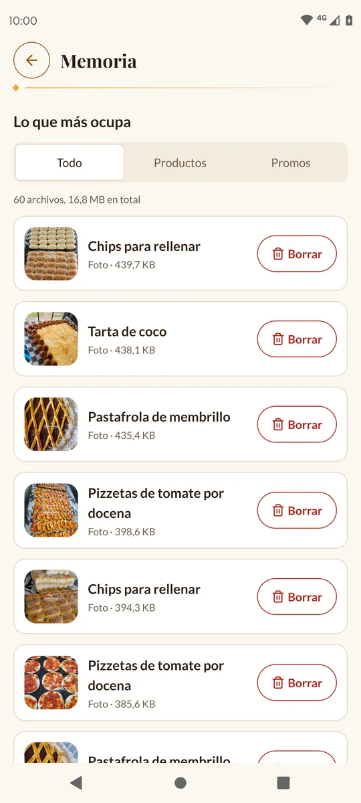
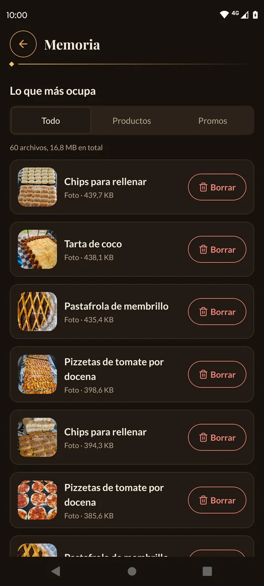
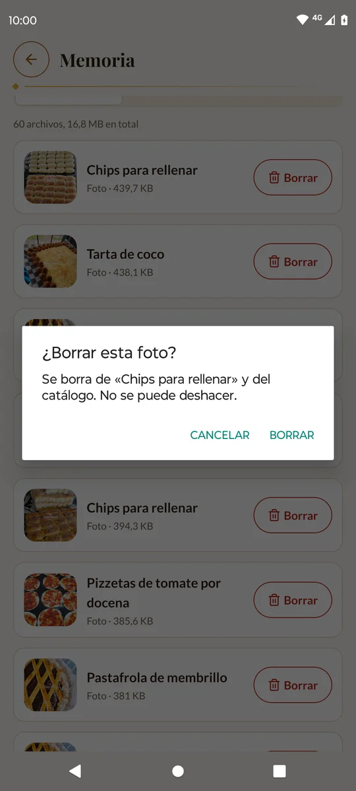
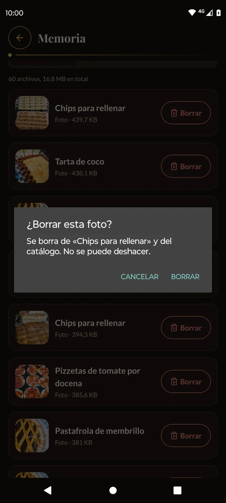

# 9. Memoria

Las fotos de tus productos y tus promos se guardan en **Cloudinary**, un servicio en
internet, con su **plan gratis**. Ese plan tiene un límite. En **Memoria** ves cuánto
usaste y podés borrar lo que más ocupa.

[← Volver al índice](README.md)

---

## Dónde está

Tocá la pestaña **Más** y después **Memoria**.

---

## Cómo leerla

Arriba hay un aviso según cuánto usaste:

| Aviso | Qué quiere decir |
| --- | --- |
| 🟢 «Todo en orden» | Usaste menos del 75%. Hay lugar para seguir subiendo fotos y videos. |
| 🟡 «Se está llenando» | Usaste más del 75%. Conviene borrar fotos y promos que ya no uses. |
| 🔴 «Casi sin lugar» | Usaste más del 90%. Si llega al 100%, el catálogo se puede quedar sin fotos. |
| 🔴 «Te pasaste del plan» | Cloudinary te va a mandar avisos por email y, si sigue así, deshabilita la cuenta: no se pueden subir fotos y el catálogo se queda sin ellas. |

Debajo, cuántos **créditos** usaste de los 25 del plan, con una barra.

Los créditos se gastan en tres cosas:

- **Guardado**: lo que ocupan tus fotos y videos ahora.
- **Entregado**: cada vez que alguien ve una foto en la web o en la app (últimos 30
  días).
- **Transformaciones**: las versiones que Cloudinary arma solo, como las miniaturas y
  la marca de agua (últimos 30 días).

> 💡 Los números no bajan al instante: Cloudinary los recalcula cada tanto. Lo que
> borres se descuenta cuando vuelva a calcular. «Entregado» y «Transformaciones»
> bajan solos con los días.

---

## Lo que más ocupa

Más abajo está la lista **Lo que más ocupa**: tus archivos, del más pesado al más
liviano. Arriba podés elegir **Todo**, **Productos** o **Promos**.

Cada fila dice de qué es (el producto o la promo), qué es («Portada», «Foto»,
«Promo · video») y cuánto pesa. Si el producto está pausado, también lo dice.

### Borrar desde acá

1. Tocá **Borrar** en la fila.
2. La app te dice qué se borra. Por ejemplo, para una foto: «Se borra de «Chipá
   picante» y del catálogo.». Si es la portada, avisa que la siguiente pasa a serlo.
3. Tocá **Borrar** para confirmar, o **Cancelar**.

> ⚠️ Borrar **no se puede deshacer**.
> - Si es una **foto de un producto**, se saca solo esa foto: el producto queda.
> - Si es una **promo**, se borra la promo entera.

> 💡 Lo primero que conviene borrar: las fotos de productos pausados que no vas a
> volver a vender y las promos viejas.

---

Siguiente: [10. Preferencias →](10-preferencias.md)
