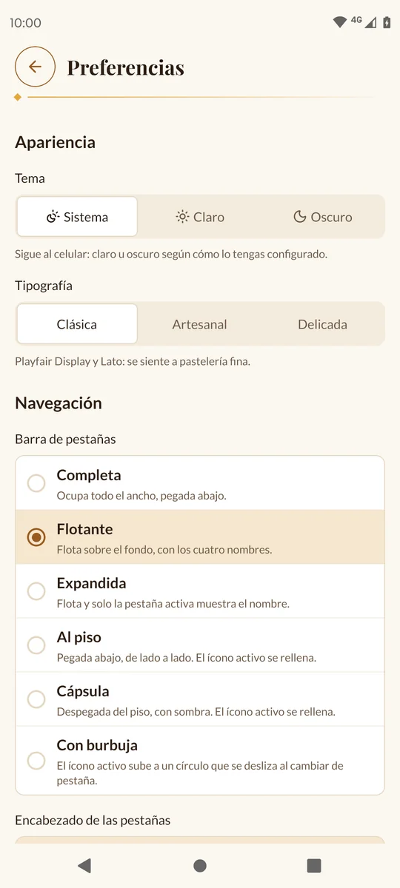
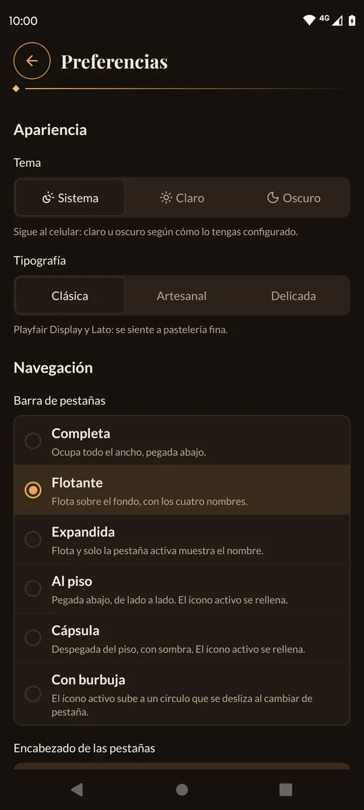
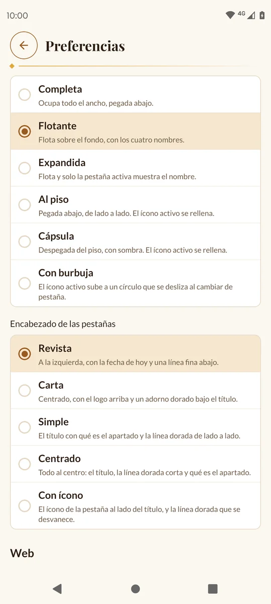
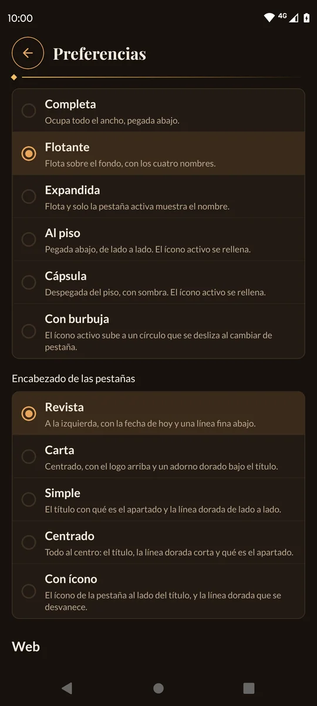
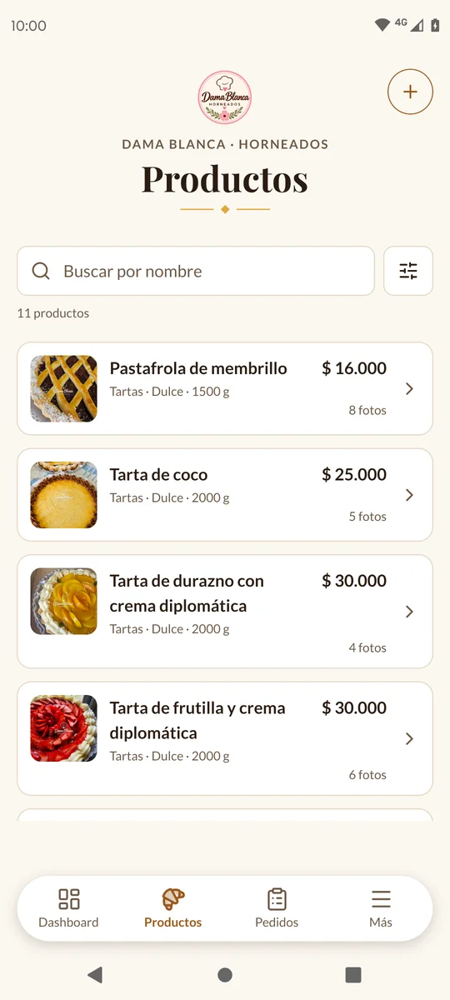
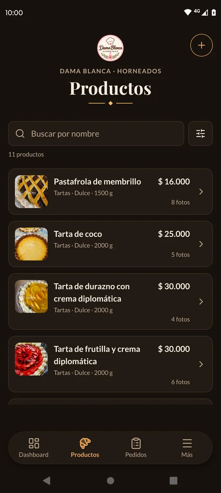
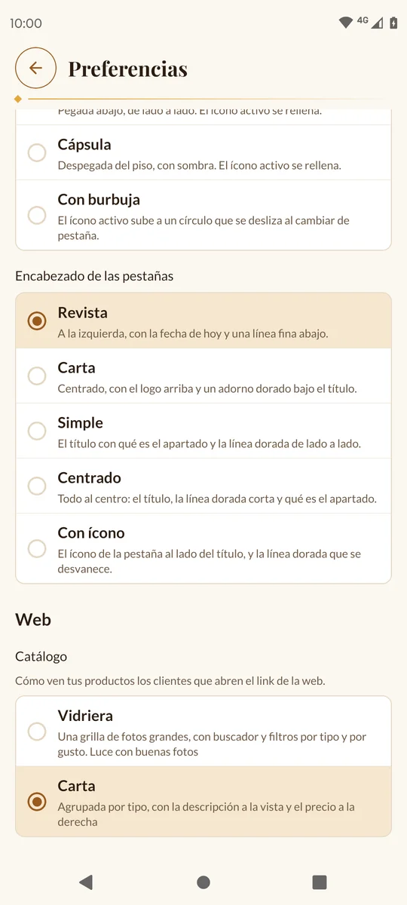
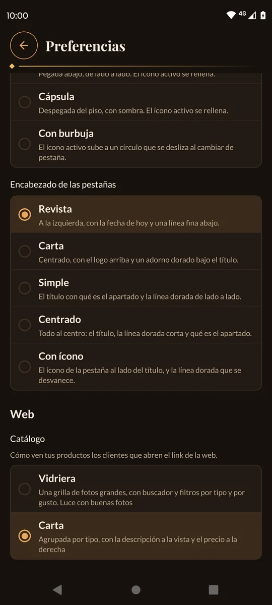

# 10. Preferencias

En **Preferencias** elegís cómo se ve la app en tu celular y cómo ven tu catálogo tus
clientes en la web. Todo se guarda solo, al tocar: no hay botón de guardar.

[← Volver al índice](README.md)

---

## Dónde está

Tocá la pestaña **Más** y después **Preferencias**. La pantalla tiene tres partes:
**Apariencia**, **Navegación** y **Web**.

---

## Apariencia

### Tema

| Opción | Qué hace |
| --- | --- |
| **Sistema** | Sigue al celular: claro u oscuro según cómo lo tengas configurado. (Es la que viene.) |
| **Claro** | Siempre claro, aunque el celular esté en modo oscuro. |
| **Oscuro** | Siempre oscuro: más cómodo de noche y en la cocina con poca luz. |

Todas las capturas de este manual están en los dos temas: a la izquierda el
**Claro** y a la derecha el **Oscuro**. Así ves cómo queda cada pantalla antes de
elegir.

### Tipografía

El estilo de letra de toda la app:

| Opción | Cómo se ve |
| --- | --- |
| **Clásica** | Playfair Display y Lato: se siente a pastelería fina. (Es la que viene.) |
| **Artesanal** | Fraunces y Nunito: casera y cálida. |
| **Delicada** | Cormorant Garamond e Inter: elegante y sutil. |

---

## Navegación

### Barra de pestañas

Cómo se ve la barra de abajo:

| Opción | Cómo es |
| --- | --- |
| **Completa** | Ocupa todo el ancho, pegada abajo. (Es la que viene.) |
| **Flotante** | Flota sobre el fondo, con los cuatro nombres. |
| **Expandida** | Flota y solo la pestaña activa muestra el nombre. |
| **Al piso** | Pegada abajo, de lado a lado. El ícono activo se rellena. |
| **Cápsula** | Despegada del piso, con sombra. El ícono activo se rellena. |
| **Con burbuja** | El ícono activo sube a un círculo que se desliza al cambiar de pestaña. |

### Encabezado de las pestañas

Cómo se ve el título arriba de cada pestaña:

| Opción | Cómo es |
| --- | --- |
| **Revista** | A la izquierda, con la fecha de hoy y una línea fina abajo. (Es la que viene.) |
| **Carta** | Centrado, con el logo arriba y un adorno dorado bajo el título. |
| **Simple** | El título con qué es el apartado y la línea dorada de lado a lado. |
| **Centrado** | Todo al centro: el título, la línea dorada corta y qué es el apartado. |
| **Con ícono** | El ícono de la pestaña al lado del título, y la línea dorada que se desvanece. |

Por ejemplo, así se ve **Productos** con la barra **Cápsula** y el encabezado
**Carta**:

---

## Web

En **Catálogo** elegís cómo ven tus productos los clientes que abren el link de la
web:

| Opción | Cómo es |
| --- | --- |
| **Carta** | Agrupada por tipo (Pizzas, Tartas…), con la descripción a la vista y el precio a la derecha. Los productos sin tipo van al final, en **Otros**. (Es la que viene.) |
| **Vidriera** | Una grilla de fotos grandes, con buscador y filtros por tipo y por gusto. Luce con buenas fotos. |

En [La web de tus clientes](11-la-web.md) hay capturas de las dos.

> 💡 El catálogo se guarda **en internet**: lo cambiás una vez y lo ven todos tus
> clientes. Si no hay conexión, la app dice «No se guardó el cambio.» y vuelve a la
> opción anterior.

---

## Qué se guarda dónde

- **Tema, tipografía, barra y encabezado** se guardan **en tu celular**. No cambian
  la web, y si instalás la app en otro celular, empiezan como vienen de fábrica.
- **El catálogo** se guarda **en internet** y cambia lo que ven tus clientes.

Tus clientes siempre ven la web con la letra **Clásica**, y en claro u oscuro según
cómo tengan configurado su celular.

---

Siguiente: [11. La web de tus clientes →](11-la-web.md)
