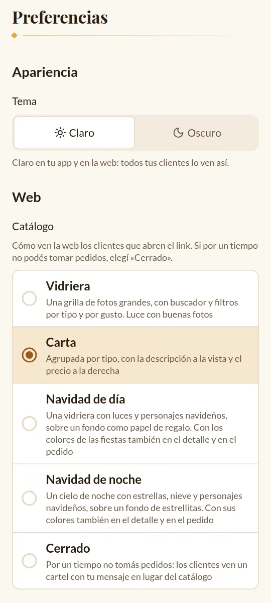
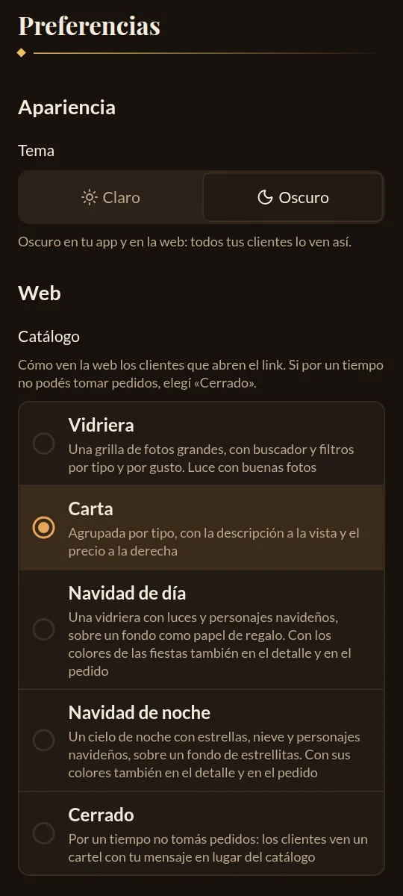

# 10. Preferencias

En **Preferencias** elegís cómo se ve la app en tu celular y cómo ven tu catálogo tus
clientes en la web. Todo se guarda solo, al tocar: no hay botón de guardar.

[← Volver al índice](README.md)

---

## Dónde está

Tocá la pestaña **Más** y después **Preferencias**. La pantalla tiene dos partes:
**Apariencia** y **Web**.

---

## Apariencia

### Tema

| Opción | Qué hace |
| --- | --- |
| **Claro** | Fondo claro, letras oscuras. |
| **Oscuro** | Fondo oscuro, letras claras: más cómodo de noche y en la cocina con poca luz. |

**El tema que elegís es el que ven todos tus clientes en la web.** No importa cómo
tenga configurado su celular o su compu cada cliente: si elegís **Claro**, todos ven
la web clara; si elegís **Oscuro**, todos la ven oscura. Por eso, debajo de las
opciones, la app te lo recuerda: «Claro en tu app y en la web: todos tus clientes lo
ven así.»

El cambio se ve en el momento en tu celular, y tus clientes lo ven la próxima vez que
abren o actualizan la web. Si no hay conexión, la app dice «No se pudo cambiar el
tema de la web» y vuelve al tema de antes.

Todas las capturas de este manual están en los dos temas: a la izquierda el
**Claro** y a la derecha el **Oscuro**. Así ves cómo queda cada pantalla antes de
elegir.

> 💡 El estilo de letra, la barra de pestañas de abajo y el título de cada pestaña
> ya no se eligen acá: la app quedó con los que ya tenías.

---

## Web

En **Catálogo** elegís cómo ven la web los clientes que abren el link (la lista está
en la captura de arriba):

| Opción | Cómo es |
| --- | --- |
| **Vidriera** | Una grilla de fotos grandes, con buscador y filtros por tipo y por gusto. Luce con buenas fotos. |
| **Carta** | Agrupada por tipo (Pizzas, Tartas…), con la descripción a la vista y el precio a la derecha. Los productos sin tipo van al final, en **Otros**. (Es la que viene.) |
| **Navidad de día** | Para diciembre: una vidriera con luces y personajes navideños, sobre un fondo como papel de regalo. Clara, con verde, rojo y dorado. |
| **Navidad de noche** | Para diciembre: un cielo de noche con estrellas, nieve y personajes navideños, sobre un fondo de estrellitas. |
| **Cerrado** | Por un tiempo no tomás pedidos: los clientes ven un cartel con tu mensaje en lugar del catálogo. |

En [La web de tus clientes](11-la-web.md) hay capturas de la Carta, la Vidriera y el
cartel de cerrado.

> 💡 El catálogo se guarda **en internet**: lo cambiás una vez y lo ven todos tus
> clientes. Si no hay conexión, la app dice «No se guardó el cambio.» y vuelve a la
> opción anterior.

### Los catálogos de Navidad

Para las fiestas tenés dos estilos especiales. Los productos, los precios, los
filtros y el pedido son los mismos de siempre: cambia cómo se ve. Tienen dibujos
navideños, nieve que cae detrás de los productos y adornos que se mueven (la
guirnalda, las esferas, los personajes en la nieve). El carrito de arriba se
convierte en un regalo y la barra de abajo dice «Tu pedido de fiestas».

No pintan solo el catálogo: **el detalle de cada producto y el pedido también salen
con los colores y los dibujos de las fiestas**. Al confirmar, el cliente lee
«¡Felices fiestas!» y, al final, «¡Que pases unas muy felices fiestas!».

**Navidad de día**: clara, con verde, rojo y dorado, y el saludo «¡Feliz Navidad!».

**Navidad de noche**: un cielo oscuro con estrellas y la guirnalda, el saludo
«¡Felices fiestas!» y los personajes (el reno, Papá Noel, el muñeco de nieve) sobre
una loma nevada.

Los dos se ven en claro o en oscuro según el [tema](#tema) que elegiste.

> 💡 Cuando terminen las fiestas, acordate de volver a **Carta** o **Vidriera**.

### Cerrar la web por un tiempo

Si te vas de vacaciones, te enfermaste o por lo que sea no podés tomar pedidos por
unos días, cerrá la web en lugar de pausar todos los productos:

1. En **Catálogo**, tocá **Cerrado**.
2. La app pregunta «Cerrar la web»: «Los clientes van a ver el cartel de cerrado en
   lugar del catálogo y no van a poder hacer pedidos hasta que elijas cómo se ve el
   catálogo. Tus productos no se tocan.» Tocá **Cerrar la web**.
3. Debajo de las opciones aparece **Qué les decís a tus clientes**. Escribí el
   mensaje del cartel (hasta 280 letras), por ejemplo «Me fui de vacaciones, vuelvo
   el lunes 10. ¡Gracias por esperarme!», y tocá **Guardar el mensaje**. Cuando
   dice «Listo: los clientes ya ven el mensaje nuevo.», ya está.

Debajo, en **Así lo ven tus clientes**, ves el cartel tal cual con lo que estás
escribiendo. Si dejás el mensaje vacío, el cartel dice que cerraste por un motivo de
fuerza mayor y que muy pronto volvés a hornear.

Mientras está cerrada:

- **Cualquier link** de tu web muestra el cartel: el catálogo, un producto que
  compartiste, el pedido. El cartel tiene el botón **Escribinos por WhatsApp**, por
  si un cliente te quiere consultar.
- Nadie puede hacer un pedido por la web. Vos sí podés cargar un
  [Pedido manual](04-pedido-manual.md).
- En el **Inicio** aparece el aviso «Tu web está cerrada», para que no te olvides.

Para **abrirla**, elegí un estilo en **Catálogo** (**Carta**, **Vidriera** o uno de
Navidad): la web vuelve en el momento, con ese estilo. Tus productos, precios y fotos
quedan como estaban. El mensaje queda guardado para la próxima vez que cierres.

---

## Qué se guarda dónde

- **El tema** (Claro u Oscuro) se ve en tu celular y además se guarda **en
  internet**: es el que ven todos tus clientes en la web.
- **El catálogo** (Vidriera, Carta, Navidad de día, Navidad de noche o Cerrado) y el
  mensaje del cartel se guardan **en internet** y cambian lo que ven tus clientes.
- **La letra, la barra de pestañas y el título de las pestañas** quedan como estaban
  en tu celular. No cambian la web.

Tus clientes siempre ven la web con la letra **Clásica** (salvo en Navidad de noche,
que trae su propia letra, más redondeada).

---

Siguiente: [11. La web de tus clientes →](11-la-web.md)
