# 11. La web de tus clientes

Este capítulo muestra lo que ven y hacen tus clientes cuando abren el link de tu web.
No tenés que hacer nada acá, pero te sirve para saber qué les aparece y para
explicarles si preguntan.

La web no pide usuario ni contraseña: cualquiera con el link la ve. Casi todos la van
a abrir **desde el celular**, porque el link les llega por WhatsApp; en la
computadora también se ve bien, más ancha.

[← Volver al índice](README.md)

---

## El catálogo

Lo primero que aparece es tu catálogo, con el estilo que elegiste en
[Preferencias](10-preferencias.md#web).

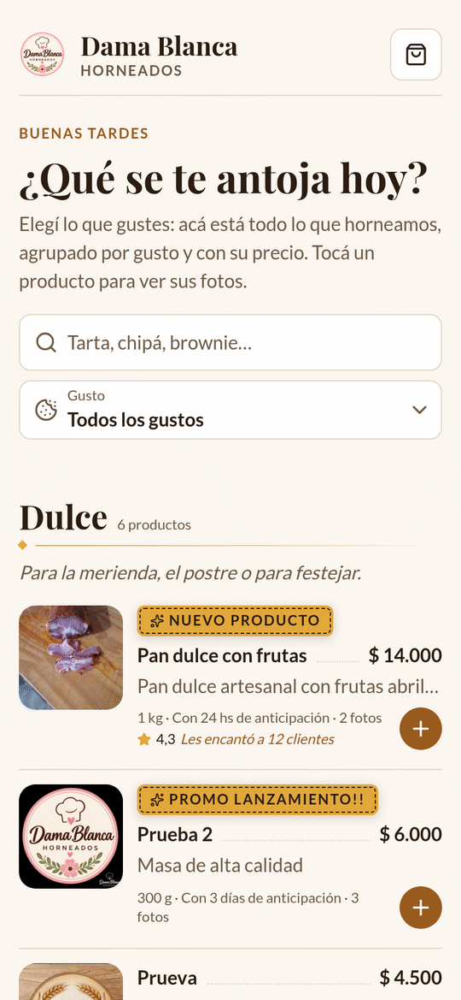
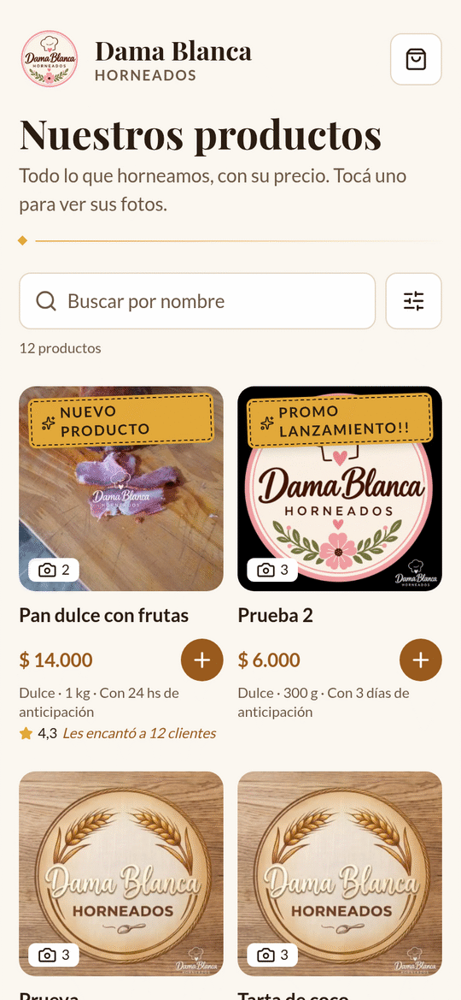

**Carta** (izquierda) arranca con un saludo según la hora («Buen día», «Buenas
tardes», «Buenas noches») y la pregunta «¿Qué se te antoja hoy?». Los productos
están agrupados por gusto, cada uno con su foto, el nombre, el precio, la descripción
en un renglón y los datos: peso, anticipación y cuántas fotos tiene.

**Vidriera** (derecha) muestra los productos en una grilla de fotos grandes, sin la
descripción.

En los dos estilos:

- La **etiqueta** que cargaste (por ejemplo «Nuevo producto») aparece como una
  estampilla dorada.
- Si el producto tiene votos, abajo aparece el puntaje, por ejemplo «★ 4,3 Les encantó
  a 12 clientes».
- Los productos **pausados no aparecen**.

### Buscar y filtrar por gusto

El cliente puede buscar por nombre y elegir un gusto. Solo aparecen los gustos que
tienen productos activos, con cuántos hay de cada uno.

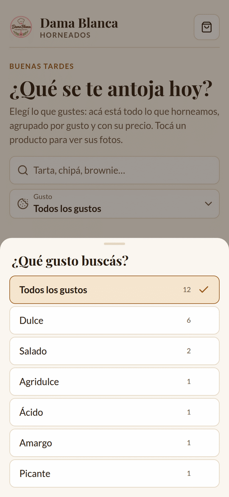

### Elegir productos

Cada producto tiene un **+** dorado. Al tocarlo se agrega al pedido y se convierte en
«− 1 +» para cambiar la cantidad. Abajo aparece una barra con **Tu pedido**, cuántos
productos lleva, el total y el botón **Ver pedido**.

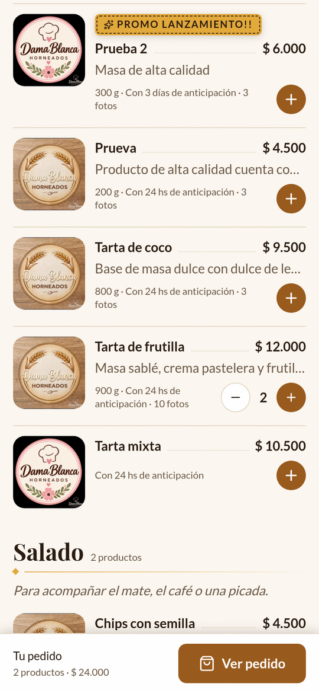

---

## El detalle de un producto

Al tocar la foto o el nombre se abre el producto: las fotos grandes (con las
miniaturas abajo para elegir), el gusto, el nombre, el puntaje, el precio, el peso, la
anticipación, la descripción completa, los ingredientes y el botón **Agregar al
pedido**.

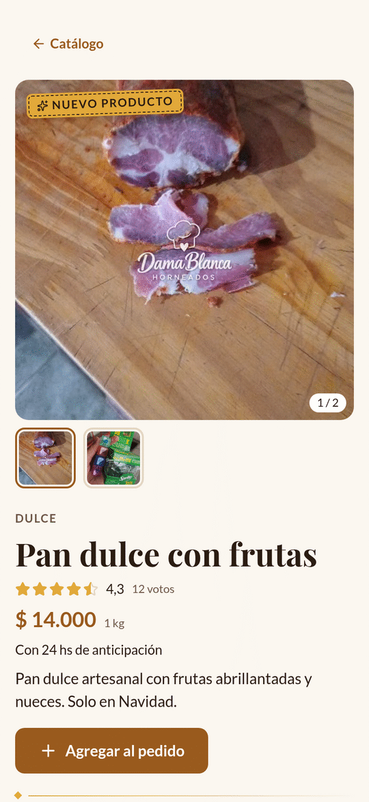

Cada producto tiene su propio link: lo podés copiar de la barra del navegador y
mandarlo por WhatsApp.

Si alguien abre el link de un producto pausado o borrado, la web dice «Este producto
no está disponible» y ofrece **Ver el catálogo**.

### Las recomendaciones

Abajo del producto, tus clientes pueden dejarte **de 1 a 5 estrellas** y, si quieren,
un comentario y su nombre. No necesitan cuenta. Si no se les ocurre qué escribir,
**Autorrecomendar** les propone frases.

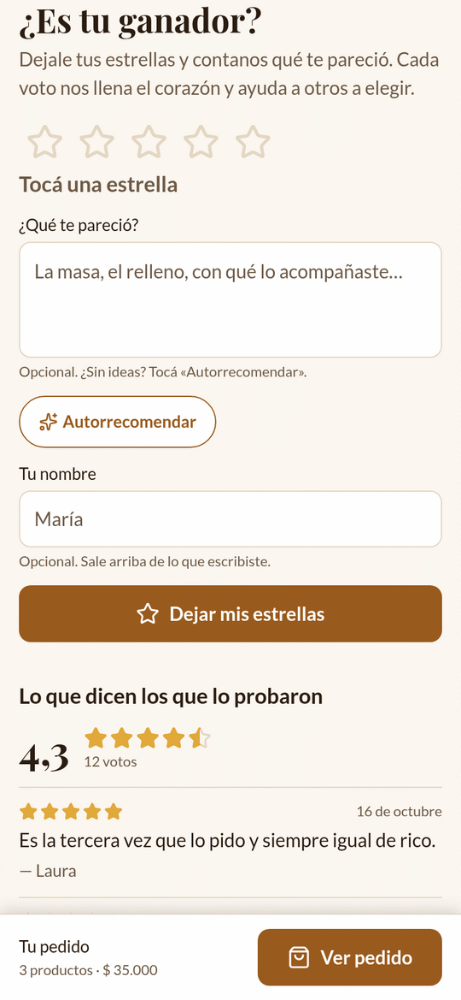
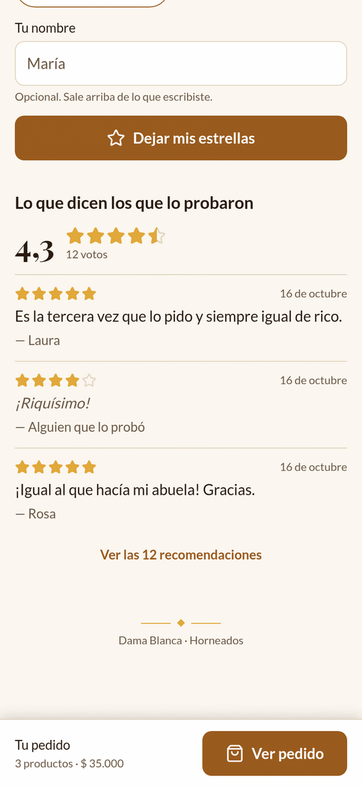

Debajo se ve el promedio y las últimas opiniones. El puntaje también aparece en el
catálogo.

> 💡 Las opiniones no se pueden borrar desde la app.

---

## Hacer el pedido

Al tocar **Ver pedido** se abre **Tu pedido**, en tres pasos:

1. **Lo que elegiste**: cada producto con su precio, la anticipación y la cantidad
   (se puede cambiar o quitar). **Agregar más productos** vuelve al catálogo.
2. **Resumen**: el total, la **seña para confirmar (50%)**, el resto que se paga en
   la entrega y cuándo va a estar listo.
3. **Tus datos**: nombre, teléfono y una nota opcional. El botón **Confirmar pedido**
   lo manda.

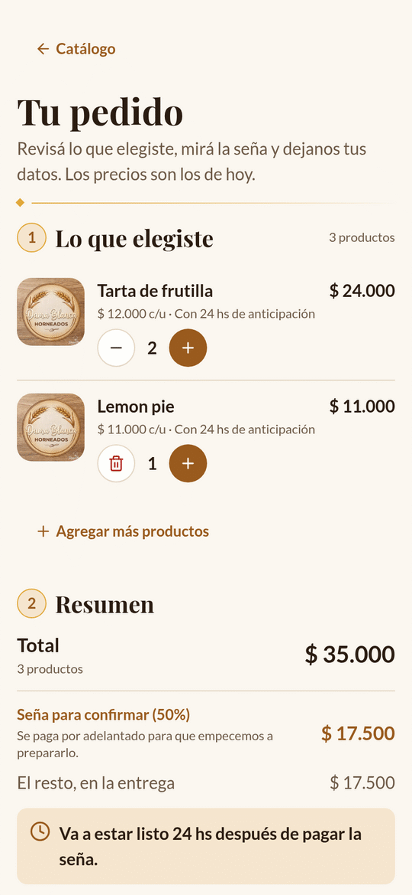
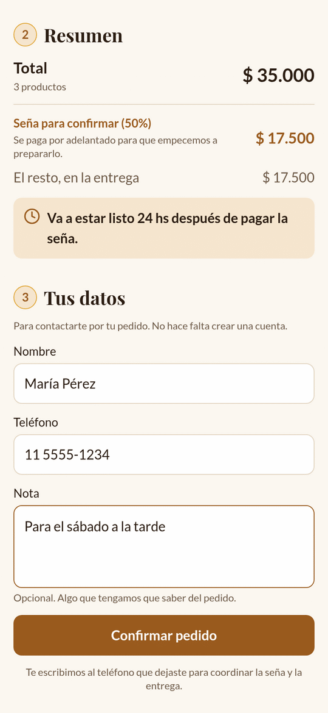

Cómo se calcula:

- **La seña** es la mitad del total, redondeada para arriba.
- **Cuándo está listo**: lo marca el producto con más anticipación. Si pide algo de
  24 horas y algo de 48, dice «Va a estar listo 48 hs después de pagar la seña.».

Los precios siempre son los de hoy: si cambiás un precio, el cliente ve el nuevo. Si
pausás un producto que alguien tenía elegido, la web se lo saca y le avisa: «Un
producto ya no está disponible: lo sacamos de tu pedido.»

En cuanto el cliente confirma, el pedido te aparece en la pestaña **Pedidos** como
«Esperando la seña» (tirá la lista para abajo para verlo).

---

## Pagar la seña

Después de confirmar, el cliente ve «¡Recibimos tu pedido!», el resumen y el bloque
**Pagá la seña**:

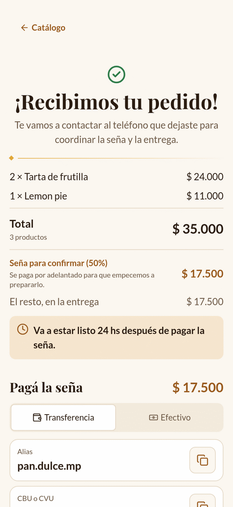

**Pagá la seña** tiene dos opciones:

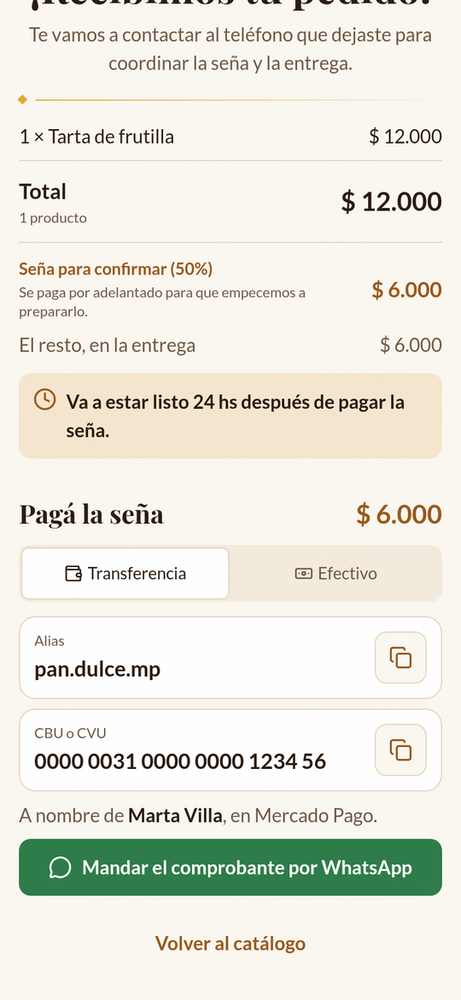
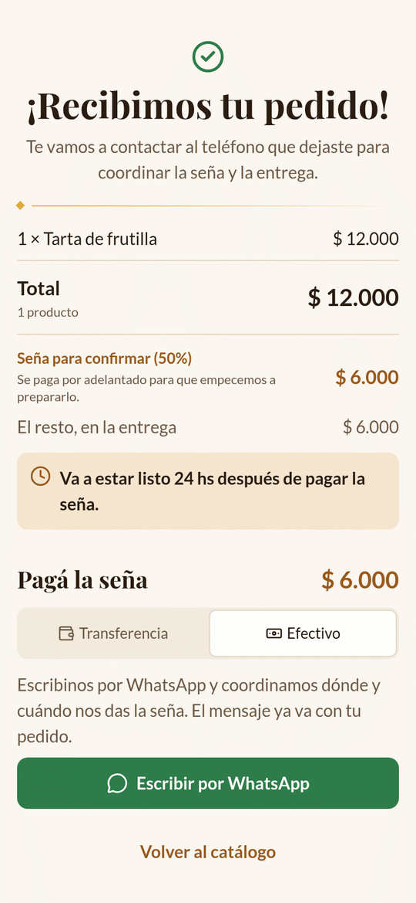

- **Transferencia**: tu alias y tu CBU (con botones para copiarlos), a nombre de quién
  y en qué banco o billetera, y el botón **Mandar el comprobante por WhatsApp**.
- **Efectivo**: el botón **Escribir por WhatsApp** para coordinar dónde y cuándo te da
  la seña.

Los dos botones abren WhatsApp con un mensaje para vos ya escrito, por ejemplo:

> ¡Hola! Acabo de hacer un pedido en la web:
> • 2 × Tarta de frutilla
> • 1 × Lemon pie
> Total: $ 35.000. Te mando el comprobante de la transferencia de la seña ($ 17.500).

El cliente tiene que adjuntar el comprobante él mismo en WhatsApp.

Si no cargaste tus datos en la [Billetera](05-billetera.md), la web solo ofrece
escribirte por WhatsApp para coordinar cómo pagar.

> 💡 Si el cliente se va a la app del banco y después vuelve a la web, sigue viendo
> cómo pagar: la web lo recuerda en ese celular.

---

## En la computadora

En una pantalla ancha se ve lo mismo, con más espacio: la carta ocupa el centro, la
vidriera muestra más fotos por fila y el pedido pone los pasos uno al lado del otro.

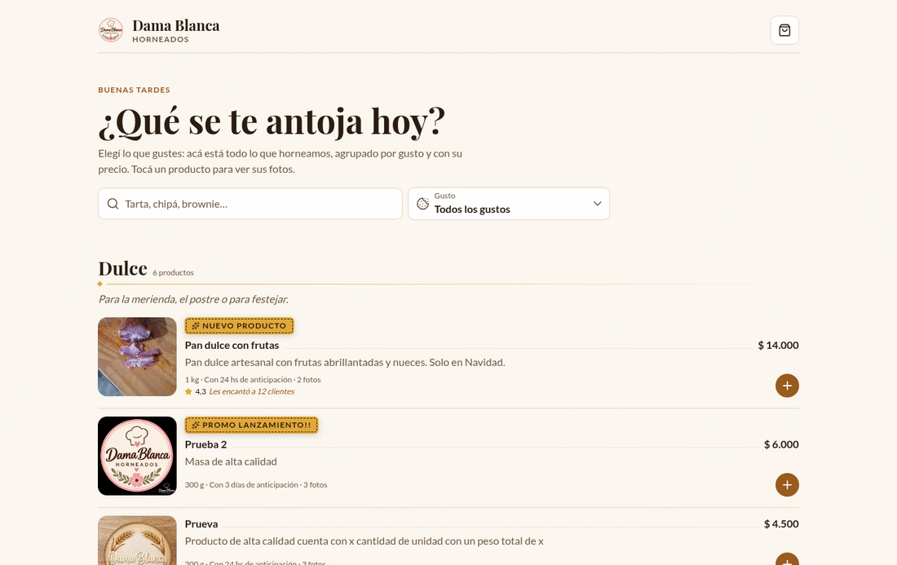

---

Siguiente: [12. Problemas y preguntas frecuentes →](12-preguntas-frecuentes.md)
