# 11. La web de tus clientes

Este capítulo muestra lo que ven y hacen tus clientes cuando abren el link de tu web.
No tenés que hacer nada acá, pero te sirve para saber qué les aparece y para
explicarles si preguntan.

La web no pide usuario ni contraseña: cualquiera con el link la ve. Casi todos la van
a abrir **desde el celular**, porque el link les llega por WhatsApp; en la
computadora también se ve bien, más ancha.

La web se ve en **claro o en oscuro según el tema que elegiste vos** en
[Preferencias](10-preferencias.md#tema), no según cómo tenga configurado su celular
cada cliente: todos la ven igual.

[← Volver al índice](README.md)

---

## El catálogo

Lo primero que aparece es tu catálogo, con el estilo que elegiste en
[Preferencias](10-preferencias.md#web). Los de todo el año son dos: **Carta** (la que
viene) y **Vidriera**. Para diciembre están **Navidad de día** y **Navidad de noche**
([En Navidad](#en-navidad)). Si cerraste la web por un tiempo, en su lugar aparece un
cartel ([Cuando cerraste la web](#cuando-cerraste-la-web)).

### Carta

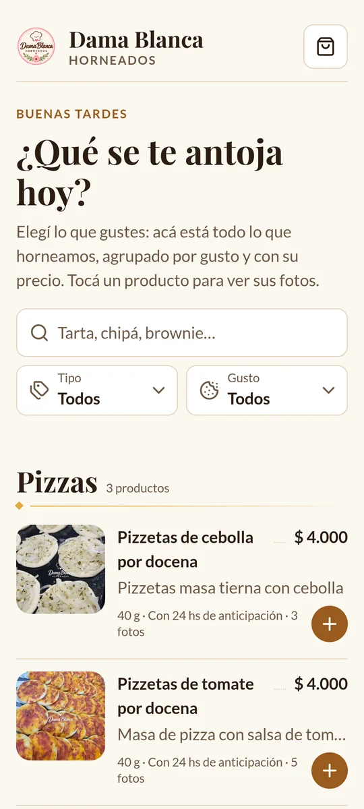
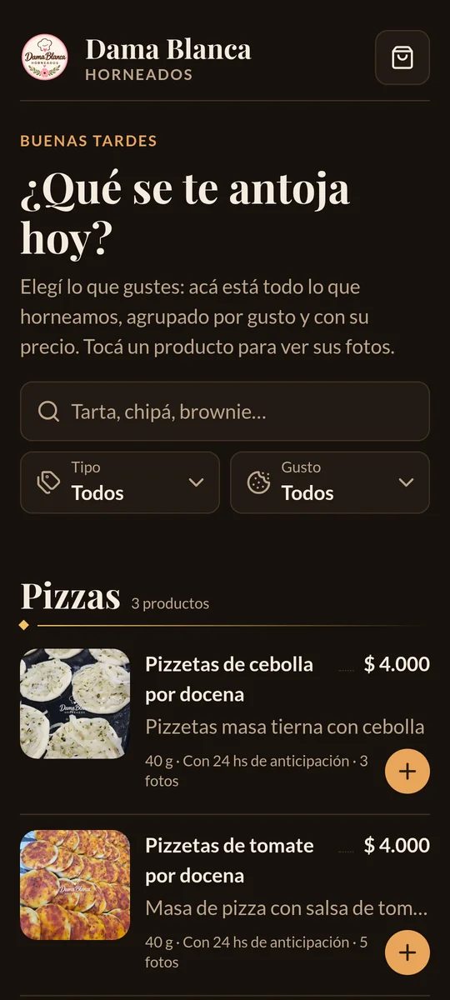

Arranca con un saludo según la hora («Buen día», «Buenas tardes», «Buenas noches»)
y la pregunta «¿Qué se te antoja hoy?». Arriba a la derecha está el botón del pedido
(una bolsa), con cuántos productos lleva el cliente.

Los productos están **agrupados por tipo** ([Los tipos](02-productos.md#los-tipos)),
cada grupo con su título y cuántos productos tiene. Los que no tienen tipo van al
final, en **Otros**. Cada producto muestra su foto, el nombre, el precio, la
descripción en un renglón y los datos: peso, anticipación y cuántas fotos tiene.

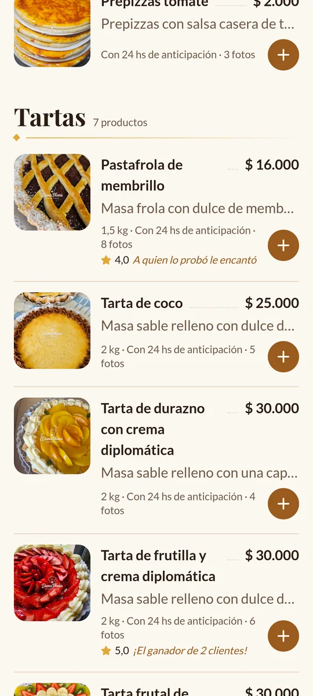
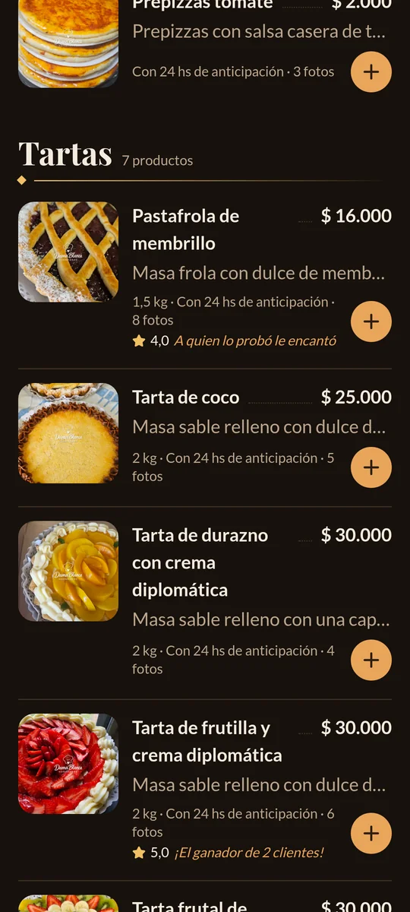

### Vidriera

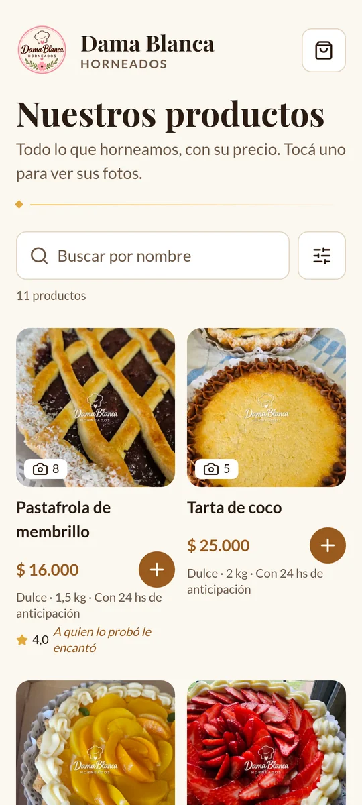
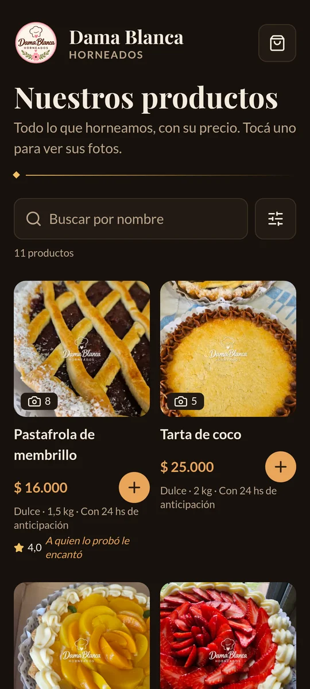

Muestra los productos en una grilla de fotos grandes (2 por fila en el celular, más en
una pantalla ancha), con el nombre, el precio y los datos, sin la descripción.

### En Navidad

Si elegiste **Navidad de día** o **Navidad de noche**, la web sale con los colores y
los dibujos de las fiestas: el catálogo, el detalle de cada producto y el pedido. Los
productos van en una grilla de tarjetas, con el buscador y los filtros de siempre, y
la nieve cae por detrás. En [Preferencias](10-preferencias.md#los-catálogos-de-navidad)
están las capturas de los dos.

### En todos los estilos

- La **etiqueta** que cargaste (por ejemplo «El más elegido») aparece como una
  estampilla dorada.
- Si el producto tiene votos, abajo aparece el puntaje con una frase, por ejemplo
  «★ 5,0 ¡El ganador de 2 clientes!» o «★ 4,0 A quien lo probó le encantó».
- Los productos **pausados no aparecen**.

### Buscar y filtrar

El cliente puede buscar por nombre y filtrar por **tipo** y por **gusto**. Solo
aparecen los tipos y los gustos que tienen productos, con cuántos hay de cada uno.

Cada opción cuenta **con el otro filtro puesto**: si el cliente eligió el tipo
«Tartas», cada gusto dice cuántas tartas tiene, y los gustos sin ninguna tarta no
aparecen. Así nunca elige algo que lo deja con la lista vacía.

- En la **Carta** (y en los de Navidad), debajo del buscador están los dos campos, **Tipo** y **Gusto**:
  cada uno abre una hoja para elegir.
- En la **Vidriera**, el botón cuadrado al lado del buscador abre la hoja
  **Filtros**, con el tipo y el gusto juntos.

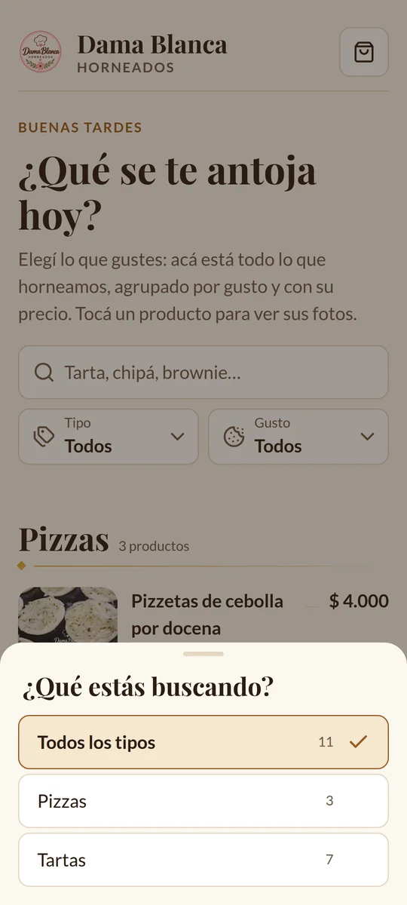
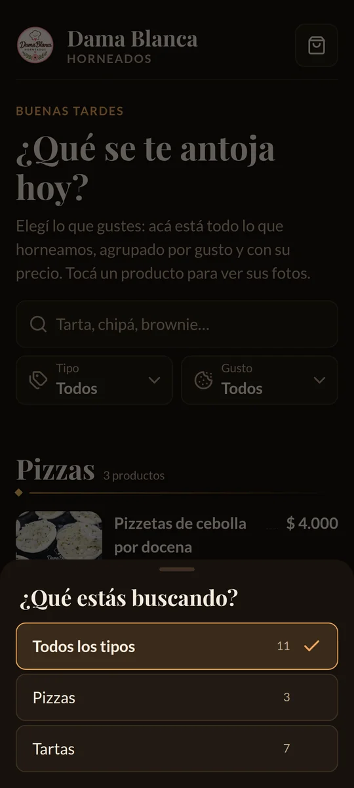

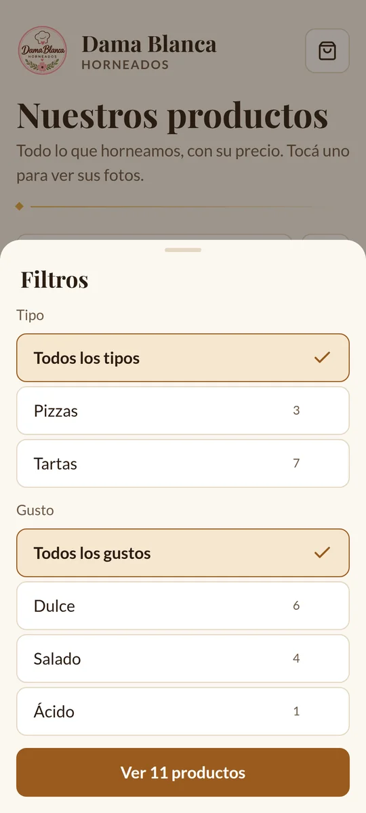
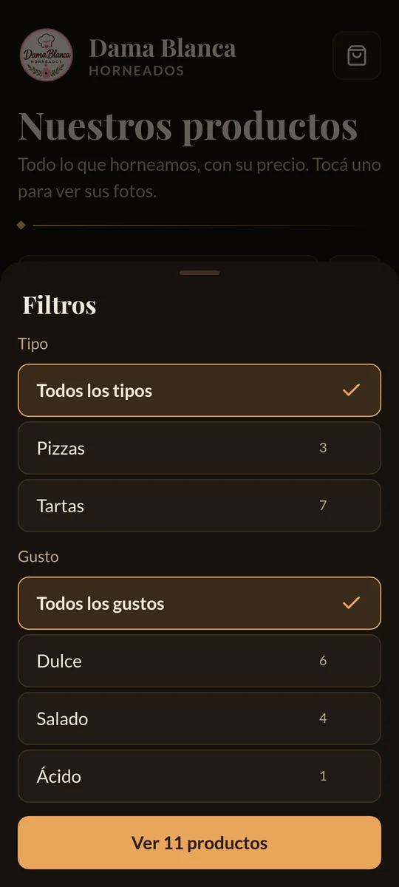

### Elegir productos

Cada producto tiene un **+** dorado. Al tocarlo se agrega al pedido y se convierte en
«− 1 +» para cambiar la cantidad. Abajo aparece una barra con «Tu pedido», cuántos
productos lleva, el total y el botón **Ver pedido**. Mientras la web recalcula el
total después de un cambio, en lugar del monto dice «· calculando…».

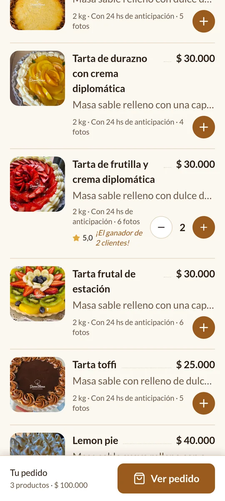
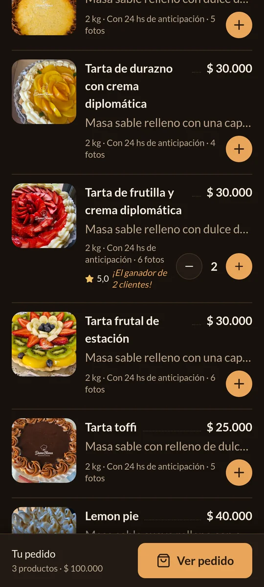

---

## El detalle de un producto

Al tocar la foto o el nombre se abre el producto. Todo va **uno debajo del otro**,
también en la computadora:

1. Las fotos grandes, con las miniaturas abajo para elegir. Si el producto tiene
   etiqueta, va sobre la foto.
2. Los datos: el gusto, el nombre, el puntaje, el precio con el peso, la
   anticipación («Con 24 hs de anticipación») y la descripción completa.
3. El botón **Agregar al pedido** (después de tocarlo, pasa a «− 1 +»).
4. Los ingredientes.
5. Las recomendaciones de otros clientes.

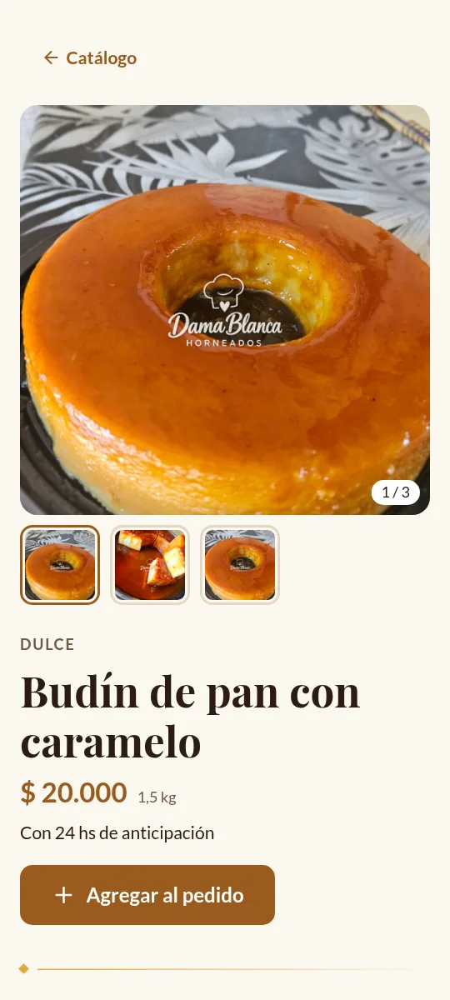
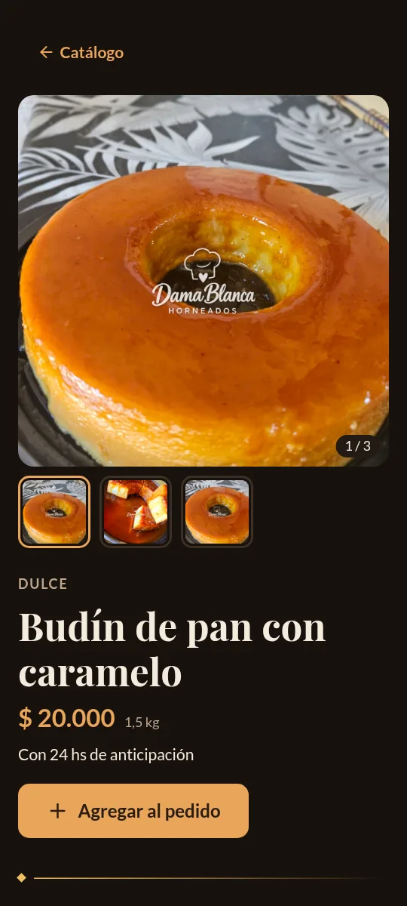

Cada producto tiene su propio link: es el que se manda cuando lo compartís desde la
app con **Compartir por WhatsApp** ([Productos](02-productos.md#compartir-un-producto-por-whatsapp)).

Si alguien abre el link de un producto pausado o borrado, la web dice «Este producto
no está disponible» y ofrece **Ver el catálogo**.

### Las recomendaciones

Abajo del producto, tus clientes pueden dejarte **de 1 a 5 estrellas** y, si quieren,
un comentario y su nombre. No necesitan cuenta. Si no se les ocurre qué escribir,
**Autorrecomendar** les propone cinco frases (y **Otras ideas** trae otras): al tocar
una, se escribe sola en «¿Qué te pareció?».

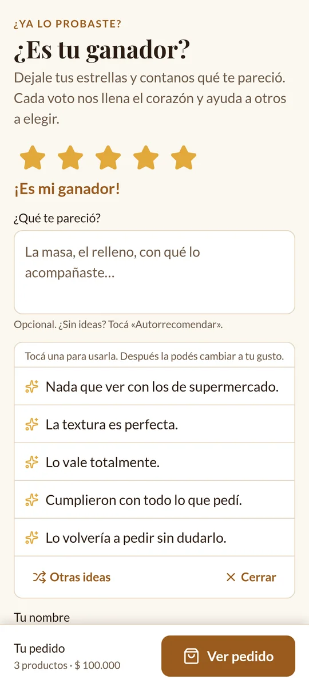
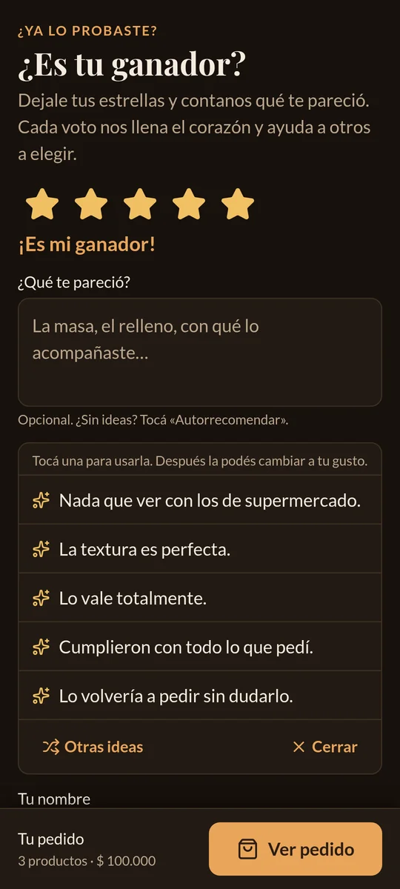

Debajo se ve **Lo que dicen los que lo probaron**: el promedio, cuántos votos tiene y
las últimas opiniones, con el nombre de quien la dejó. El puntaje también aparece en
el catálogo.

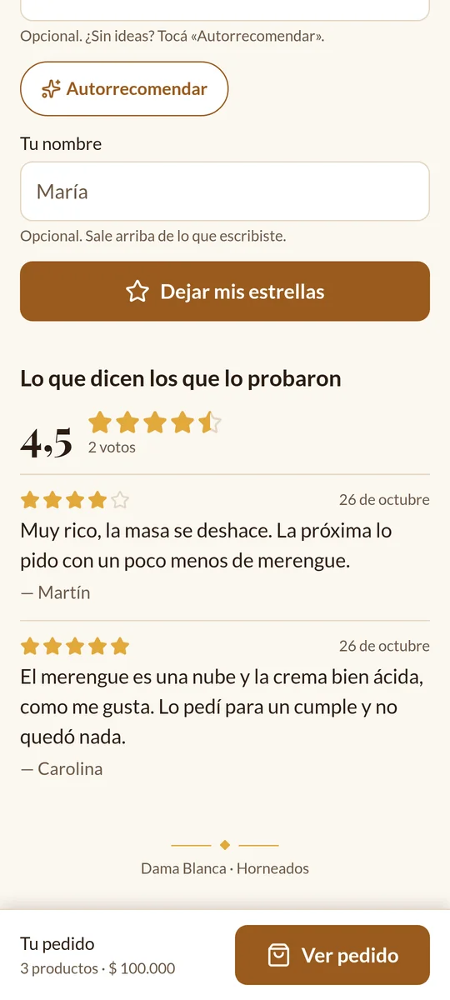
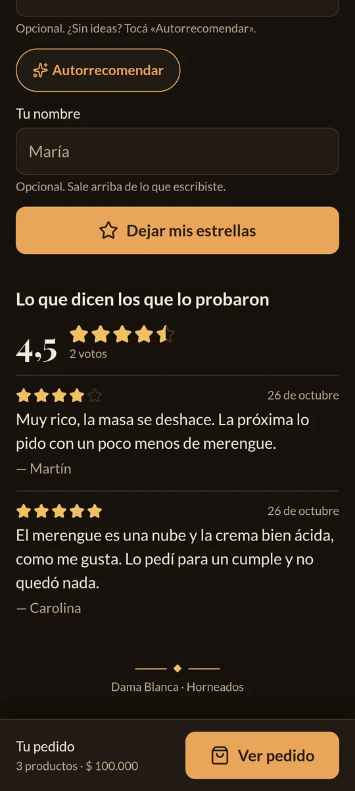

> 💡 Las opiniones no se pueden borrar desde la app.

---

## Hacer el pedido

Al tocar **Ver pedido** se abre «Tu pedido», en tres pasos, uno debajo del otro:

1. **Lo que elegiste**: cada producto con su subtotal, el precio de cada uno, la
   anticipación y la cantidad (se puede cambiar o quitar). **Agregar más productos**
   vuelve al catálogo.
2. **Resumen**: el total, la «Seña para confirmar (50%)» y «El resto, en la
   entrega».
3. **Tus datos**: nombre, teléfono, una nota opcional, **para qué día** lo quiere y
   **cómo lo recibe**. El botón **Confirmar pedido** lo manda.

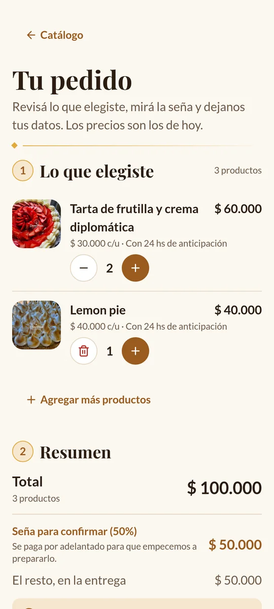
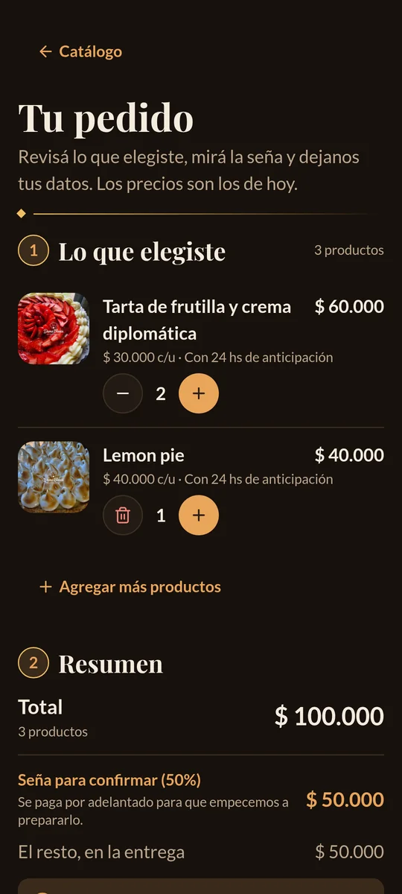

**La seña** es la mitad del total, redondeada para arriba.

Los precios siempre son los de hoy: si cambiás un precio, el cliente ve el nuevo. Si
pausás un producto que alguien tenía elegido, la web se lo saca y le avisa: «Un
producto ya no está disponible: lo sacamos de tu pedido.»

### ¿Para qué día?

**El pedido es para un día que elige el cliente.** En **Tus datos**, debajo de la
nota, aparece «¿Para qué día?» con un calendario del mes. Cada día que se puede
elegir tiene un color:

| Color | Qué dice | Qué quiere decir |
| --- | --- | --- |
| Verde | «Libre» | Hay lugar: se puede elegir. |
| Amarillo | «Casi» | Se puede elegir, pero ese día ya se está llenando. |
| Rojo | «Llena» | No se puede elegir. |

- **Nunca se puede elegir hoy.** El primer día depende de la **anticipación** de los
  productos: manda el que más demora. Si lleva algo de 24 horas, puede elegir desde
  mañana; si lleva algo de 48, desde pasado mañana. Si el cliente suma un producto
  que demora más, el calendario se corre solo.
- Un día sale **«Llena»** cuando llegaste a los productos que hacés por día o cuando
  vos lo marcaste como lleno ([La agenda](03-pedidos.md#la-agenda-tus-pedidos-por-día)).
  Si el cliente lo toca, la web le dice «Esta fecha ya está llena»: «Lo sentimos, ya
  no tenemos lugar para ese día. Te invitamos a elegir otro. ¡Gracias!», y le ofrece
  con un toque **El día antes** y **El día después** que estén libres.
- Los días se abren hasta fin de mes. Por eso, en el último mes que se puede elegir,
  debajo del calendario dice, por ejemplo: «Por ahora podés elegir hasta el lunes 30
  de noviembre. Los días de diciembre se abren más adelante.» Cuando falta una semana
  para fin de mes, ya se puede elegir también el mes siguiente.

El día elegido aparece arriba de **Confirmar pedido**, por ejemplo «Para el jueves 26
de noviembre», para que el cliente lo vea antes de tocar. Si no eligió ningún día,
la web le pide «Elegí para qué día lo querés».

> 💡 La web ya no dice «Va a estar listo 48 hs después…»: ahora el cliente elige el
> día y vos lo ves en el pedido y en la agenda del **Inicio**.

### ¿Cómo lo recibís?

Al final de **Tus datos**, el cliente elige **Lo paso a retirar** (la que viene
marcada) o **Con envío**. Si elige **Con envío**, abajo dice «La dirección la
coordinamos por WhatsApp.»: la web no pide la dirección ni cobra el envío. En la
computadora, esta opción va al lado de **Confirmar pedido**.

Lo que eligió te aparece en el pedido, en la pestaña **Pedidos** ([Pedidos](03-pedidos.md)).

Debajo de **Confirmar pedido** dice «Después de confirmar te mostramos cómo pagar la
seña.». En cuanto el cliente confirma, el pedido te aparece en la pestaña **Pedidos**
como «Esperando la seña» (tirá la lista para abajo para verlo).

---

## Pagar la seña

Después de confirmar, el cliente ve «¡Recibimos tu pedido!» y «Para confirmarlo,
pagá la seña acá abajo: con la seña empezamos a prepararlo.». Abajo está lo que
pidió, el total, la seña, el día («Para el jueves 26 de noviembre.») y cómo lo
recibe: «Lo pasás a retirar» con «Te avisamos por WhatsApp cuando esté listo.», o
«Te lo llevamos» con «La dirección la coordinamos por WhatsApp.».

Al final va el bloque **Pagá la seña**, con el monto al lado del título y dos
opciones:

- **Transferencia**: tu alias y tu CBU, cada uno con un botón para copiarlo (al
  tocarlo dice «Copiado»), «A nombre de … en …» con tu nombre y tu banco o billetera,
  y el botón verde **Mandar comprobante**.
- **Efectivo**: «Escribinos por WhatsApp y coordinamos dónde y cuándo nos das la
  seña. El mensaje ya va con tu pedido.» y el botón verde **Escribir por WhatsApp**.

Los dos botones abren WhatsApp con un mensaje para vos ya escrito, por ejemplo:

> ¡Hola! Acabo de hacer un pedido en la web:
> • 2 × Tarta de frutilla
> • 1 × Lemon pie
> Total: $ 35.000. Te mando el comprobante de la transferencia de la seña ($ 17.500).

El cliente tiene que adjuntar el comprobante él mismo en WhatsApp.

Si no cargaste tus datos en la [Billetera](05-billetera.md), la web solo ofrece
**Escribir por WhatsApp** para coordinar cómo pagar.

> 💡 Si el cliente se va a la app del banco y después vuelve a la web, sigue viendo
> cómo pagar: la web lo recuerda en ese celular.

---

## Cuando cerraste la web

Si elegiste **Cerrado** en [Preferencias](10-preferencias.md#cerrar-la-web-por-un-tiempo),
cualquier link de tu web (el catálogo, un producto, el pedido) muestra un cartel en
lugar del catálogo: el frente del local con un cartelito de «Cerrado» que se mece,
«Cerramos por unos días» y tu mensaje.

Abajo está el botón **Escribinos por WhatsApp**, que abre tu chat con el comienzo ya
escrito: «¡Hola! Vi en la web que por ahora están cerrados. Te quería consultar:». El
cliente termina la pregunta y la manda.

Mientras está cerrada, nadie puede hacer un pedido por la web. Cuando la abrís, el
cliente ve el catálogo de nuevo al recargar la página.

> ⚠️ Si el servidor de la app no responde (por ejemplo, porque está caído), la web
> también muestra el cartel, con el mensaje de «motivo de fuerza mayor». Así el
> cliente no se queda mirando una página que no anda. Si un cliente te dice que la
> web está cerrada y vos no la cerraste, mirá
> [Problemas y preguntas frecuentes](12-preguntas-frecuentes.md#un-cliente-dice-que-la-web-está-cerrada-y-no-la-cerré).

---

## Actualizar la web

Los clientes también pueden **tirar para abajo** para actualizar, como en la app: con
la página arriba de todo, deslizan el dedo hacia abajo, aparece «Tirá para
actualizar» y, cuando dice «Soltá para actualizar», sueltan. Sirve, por ejemplo,
para ver un producto que acabás de cargar.

---

## El link en WhatsApp

Cuando mandás el link de tu web por WhatsApp, debajo del mensaje aparece una vista
previa con **el logo de Dama Blanca**, el título «Dama Blanca · Horneados» y «El
catálogo de Dama Blanca: mirá todo lo que horneamos, con sus precios, y hacé tu
pedido online.» Es la misma para todos los links: el del catálogo y el de un
producto.

> 💡 WhatsApp guarda la vista previa la primera vez que alguien manda un link. Un
> link que ya se había mandado antes puede seguir apareciendo sin el logo.

---

## En la computadora

En una pantalla ancha se ve lo mismo, con más espacio: la carta ocupa el centro y la
vidriera muestra más fotos por fila. El detalle de un producto y el pedido siguen
siendo una sola columna, uno debajo del otro, como en el celular.

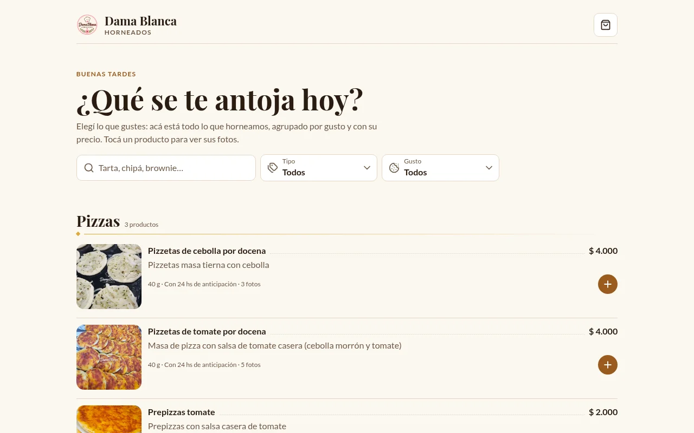

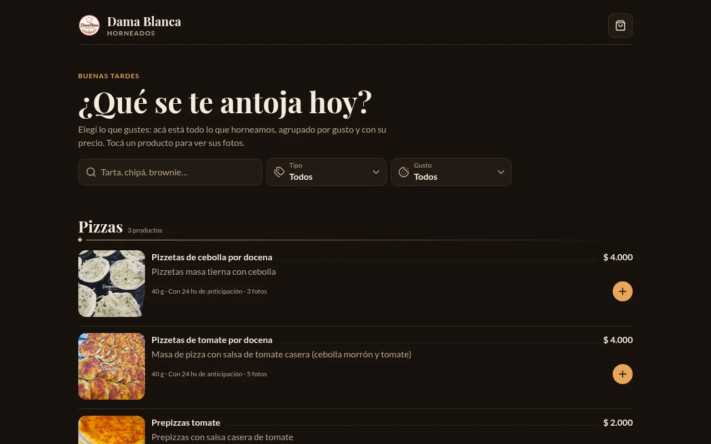

---

Siguiente: [12. Problemas y preguntas frecuentes →](12-preguntas-frecuentes.md)
